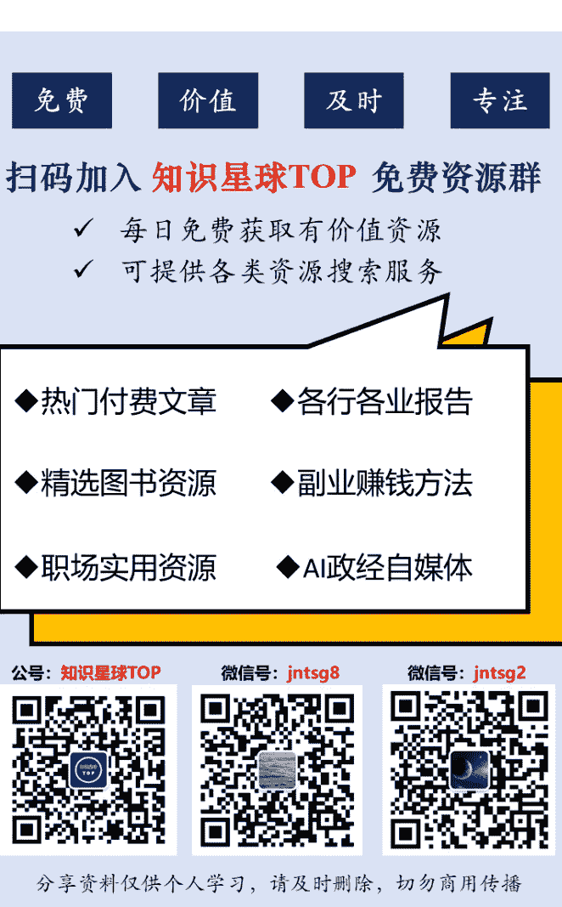

# 鉴茶财富进：195，普通人和老板，尽快 Ai+ 起来（上）

这节课是给普通人和公司中高管，老板们的建议，尽快 Ai+。

现在是什么情况，三大运营商接入了 DeepSeek，很多地方政府的数据平台，也开始提供公共算力，本地企业和个人无卡顿使用 AI 工具，这个浪会非常微妙。

如果你是乙方，要尽快给甲方提供 Ai+ 的解决方案，哪怕他暂时不需要，你也要先为主，ppt 写好，提升方案写好，先去汇报再再说，先入为主也为主。

我们先讲公司层面的，具体的解决方案是：

1. 把过去它交给你那些string、诉求、标准、数据等，喂 AI 看一遍。
2. 得出结论甲方在哪些领域和方面，对你有高频要求和较高的标准的；对已有订单和业务进行梳理，进一步优化，扩充提升空间；对客户过去想做过是没有经费的，属于辅助内容的订单要求等，提供新的解决方案。
3. 最关键的一条，提出可以对客户本身的数据、信息等进行 AI 分析和结构倒推【客户的客户】需要什么？他们的需求模型是怎样的。帮助你的甲方，完成更精准的图像处理、成本设计、发展策略建议。

加微信int52，免费进资料分享

甚至，你建个模型，告诉他这样说可以提高良率的/增加卖货的/降低成本的，你已经过了，在它那跑一下。

4. 如此，你就已经深入成为甲方的某业务流程重要节点和不可替代组成部分。你会比他还记得，你将不仅是卖货给他，还可以帮他培训自己员工，整理历史文件，进行数据清洗，协助调研市场，得出结论报告，等等。你帮客户解决它自己的问题，客户的问题，它头疼的问题。

5. 一步步下去，你将成为客户的 AI 升级供应商，在这个领域抢占先机。

6. 形成为标准产品，别给别人做推广。

一个好朋友，以前是给医院软件的，大王去年说他一定要加 AI。医院的问题在于，沉浸的病历太多，上亿份，有些甚至是手工的，根本没有激活，无法充分的。每次患者去看病，医生的时间很短，充分了解前面的情况，再给你开始打字之类，很容易出错。

有了 AI 病历，你往那边一坐，输入名字，AI 自动查询你的过往体检及数据情况，给出辅助建议，医生简单改即可。你回去后，AI 电话提醒你什么时候吃药，什么时候回复，甚至你的生命大模型，大概知道你什么时候还会会出现什么问题。

同时，现在看病上叫你抽血验，就那些细菌病毒指标，AI 一看，再合你既往病历，大脑里搜索下类比疗，立刻就知道该给你开什么药怎么吃。有些实习生，根据诊疗方案就下单了，也是老司机了。小医生的主要问题是经验少，没见过难症，AI 全懂。

这个公司很快拿出了方案，在一些地方的医院，已经中标了。你说实话不知道给甲方搞点梗，先把他的历史数据拿来做个清洗整理，是项目，谁家还有一堆存档呢？尤其是政府，什么发改、招商等部门，数据一大堆，都是 Excel 做的，要的时候，经常急死，出来的东西又没头没尾没结论，都不是方案。

加微信jntg2，免费进资料分享群
