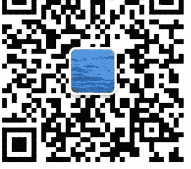
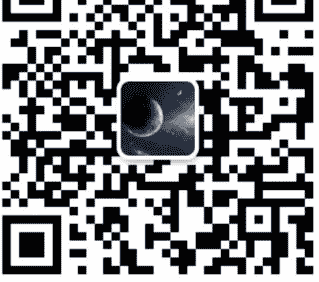

# 《九型人格】-后浪读书会预

AI出来以后，对我们最大的冲击是什么？
那些面对“事”的难度，将指指数级的下降；那些面对“人”的难度，将指数级的增加。

科技越发达，人的事情越多。

中国几乎所有的事，都是人的事。这个时代，你和人打交道，处理与人有关的问题是游刃有余，你将具备差异化的竞争优势。

而我们一些人的问题在于，既不够了解自己，也不够了解别人，最后干脆放弃。

- 越来越多的人在讲，他/她是社恐
- 恐惧来自于未知

你搞不定自己也搞不定别人，归根结底，还是因为对不同人的特征，行为、情况、模型不够了解和掌握。

大王看了很多心理学方面的书，《九型人格》，通俗易懂，又带操作指南，所以成为很多高校、企业乃至中的识人之术

- 知人者昌，自知者明

把人搞定了，基本上绝大多数事就搞定了，敬请期待。

日期：250203

# 大S，刚毅易折

刚刚说了要讲《九型人格》，大S就离开了，走好。性格决定命运。

大S是什么性格？
8号人格“挑战者”（The Challenger）

- 8号
- 8号人格自信、果断、倔强，追求权力和控制。他们渴望保护自己和他人，常常通过力量和决断来获得尊重。

比如，无论是转型演员、主持人、闪婚汪小菲、闪钻汪俊晔，都是拍马就过，雷厉风行。而且在家里，她扮演大家大角角色，主动承担责任。至于直率敢言就不必提了，大王第一次看她的节目被震到了，公众场合还能说话得这么直白甚至？

还有什么特点呢？

- 一是对抗性很强，看她早年面对媒体争议或网络攻击时，都是不解释，硬硬反击，吵架比沟通多。
- 二是会过度控制和霸道，难以接受他人的意见，她永远是对的。
- 三是倔强，认准了，八匹马也拉不回来，爱你是真的爱，牺牲身材生汪小菲两个孩子，还两次流产。
- 四是直接，如果感到不满，她不会给你面子，也缺乏共情能力，不会站在你的角度想问题。

周涵民说，有次惹了大S生气，别人礼拜冷落他。总是在担心被控制、伤害。她们需要关心，又时刻怕你有别的企图。

单从感情和吵架来说，汪小菲根本不是大S手，汪小菲紧咬牙来解释，大S打完脸看你表演。

8号性格强，又靠强，男人还好，一个女人，既要强希望别人围着自己转，太刚易折。

根本原因在哪里？加群微信cp6398号性格的童年，一般充满了斗争，强者受尊崇，弱者被人欺负，他们是愤怒的小公牛。

大S很小照顾家里妈妈和S，代替了父亲的角色，某种意义上，她是在向外界获得肯定和认可，弥补童年的缺失。

这方面说，大S也是个可怜的姑娘，不容易，走好。
和8号人格相处，就不能太越界，要对方留空间，平时多以肯定鼓励为主。心理学分类众多，观点各异，以上仅一家之言。

人生就是这样，好好取眼前吧。幸福的人，用童年治愈一生，不幸的人，一生治愈童年。

给孩子一个美好完整的童年，才是所有父母最应该做的。

日期：250203

# 扫码加入 知识星球TOP 免费资源群

- 每日免费获取有价值资源
- 可提供各类资源搜索服务

| 热门付费文章 | 各行行业报告 |
| :--- | :--- |
| 精选图书资源 | 副业挣钱方法 |
| 职场实用资源 | AI政经自媒体 |

公众号: 知识星球TOP 微信号: jnttsg8 微信号: jnttsg2

分享资料仅供内部交流，请勿转发或商用
