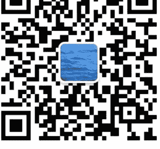
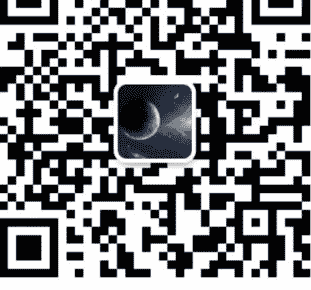

# 鉴茶财富经：人生第一个财神

南院大王：

人生第一个财神在中国文化中，老板叫做“官人”，官，就是官府，领导，倚仗，官是护财的。

老婆叫做“妻财”，妻和财是一体性的，都是你热爱和追求才能获得东西。

所有的第一次，也是最重要一次重组是什么？结婚。

你娶，或者谁嫁给你，人家肯定已经经过了深思熟虑和各种权衡，是现在最理解你，最知道你优势和不足的人。

而你要赚钱，无非是扬长避短，把自己的能力和优势去变现。与你在外头各种寻找，各种磨砺找机会，不如花个时间，静下心来，心态非常平和的爱人谈谈：

“当年我最吸引你的地方是什么？”
“你因为我哪点突出的优势才决定的？”
这些长处现在还在吗？
“你建议我如何做？”

你的爱人，不是你人生路上的伴侣，更是你的同事，合伙人，兄弟，朋友，投资人，从 A 轮就开始就满在你身上。

你人生第一个财神，就是你老婆。

- 财神在你身边。

遗憾的是，我们很多人，忙于柴米油盐，忙于日常琐事，早就不知道该如何放下情绪去沟通，规划，欣赏，早已忘了自己当年闪闪发光的样子。

- 做成了人生最靠钱的一笔事业。

巴菲早就说了，成功，不就是不断重复成功的那个模式吗？家和万事兴。

财神在你家，先把爱人爱好。内部的财，要靠相信自己，外部的财，是婚姻、职业、行业、人群。初逢迎财神之际，我们帮各位接了迎财神法会，为广大星友们进行了祈福，与财神近水楼台。

疼老老婆就会发财，疼别人就会发财。

财，爱出者爱返，福往者福来。求名求利莫人求，求须己惜农惜工尤惜物当惜时！

日期：250202

## 免费 价值 及时 专注
## 扫码加入 知识星球TOP 免费资源群

- 每日免费获取有价值资源
- 可提供各类资源搜索服务

| 热门付费文章 | 各行行业报告 |
| :--- | :--- |
| 精选图书资源 | 副业赚钱方法 |
| 职场实用资源 | AI政经自媒体 |

公众号：知识星球TOP 微信信号：jntsg8 微信信号：jntsg2

分享资料仅供内部交流，请勿转发，切勿商用传播
