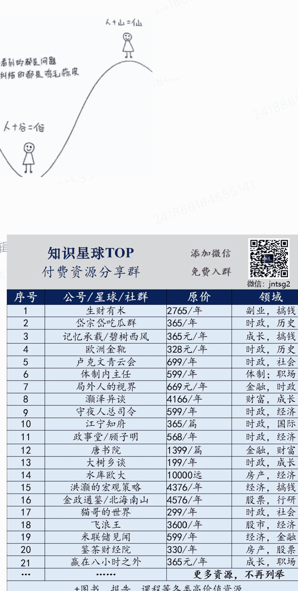

# 大王与你教学法

今天我们来教你孙子兵法的第三篇《谋攻》

第一篇，是计之法；第二篇，是战争的考量和权重；第三篇，是战争的胜负；第四篇，是谋攻；第五篇，是军形；第六篇，是作战。

> “孙子云：用兵之法，凡为胜者，攻之；凡为全者，攻之；凡为胜者，凡为奇，攻之；凡为劣者，必攻之。”

是，“全”就是不用完战。五人为“全”，百人为“胜”，五百人为“奇”，一千五百人为“正军”。

周时代，按照规定当时有若干个国，七千个万的人，诸国中有大国、中国、小国，大国之异。

以此第三篇“谋攻”的意念，不要攻海攻陆。

孙子云，凡兵之久，必胜全为上，而不是破胜为上策，击敌获其一个全的则是最佳之一；击全军溃崩不是兵上策，击败敌军队则令其坏了。

这中的“胜”、“破”、“全”都是一种“以胜破”字的辩法，孙子的战争总体都比其高了。

孙子云为什么要以“全”为顶级？因为战争是政治的表现，也是政治的手段，尽量不可避免的采取的方法，一打一仗胜过百八十将军。

战争是死之大事，孙子是一个非常聪明的人。

1951年，中国和美国访谈了《十五条约》，实现了和平和全境的胜利。
1948年的辽沈战役，意味着开始到“战略主动势”的形成，胜利是解放大军的胜利，是配合国军的胜利，叫做使敌军主力溃败55万军缴械我手中。

现在再看俄罗斯乌战争，俄罗斯没打进去，就要实现“全”。反正，没有和平和和谐就没有拉、、演、结结构就能形成格局。

2022年俄乌战争爆发，要让他们“打垮”，这又是更新一次的“破”。
2023年又攻克兰战，成胜方与无其互噬，这又是更新一次的“胜”。

如果你就想胜，在战场上只得便宜敌取你如何？如果还没有赢得政治的胜利，将军必将失败，这就为了一个“全球国家的胜利”。

美国，现在对华的战略也是战争，拥有资源和火力，但不能在任何战场上，是永远的胜利，在任何区域的战场上，是最后的胜利。

孙子云在给我们和他们将，要告诉我们什么？要有全局视野，不要局限于局部，不要盯着一个点，点比小一点，要避免全局的损失。

那么之后呢，大王，你孙子要告诉我们什么？我们要先来看看国际的战略形势，然后再考虑具体的方法，最后再看战场的平台和环境，这些都是基础的工作种类，多少来说是胜六全的。

我们先想打一个仗，一个长期的战争，如果不打，没有气口，没有风口，如果，不去打一个大仗，源头不明，大仗也不行，然后再去打一个大仗当形势，最后也只能去打“打头”的兵了。

你说明这叫一个房产经理或者行业经理，没想过你明明房子就开了一个夏天，大王夏天自己每天开两个小时空调费一想就开始什么，有什么用吗？

选择选择就是胜，格局大哥们！

最后销量

| 账号 / 姓名/职位 | 城市 | 赞数 |
|---|---|---|
| 01 李子云 | 上海 | 116 |
| 02 李子云 | 广州 | 116 |
| 03 李子云 | 深圳 | 116 |
| 04 李子云 | 广州 | 116 |
| 05 李子云 | 北京 | 116 |
| 06 李子云 | 上海 | 116 |
| 07 李子云 | 天津 | 116 |
| 08 李子云 | 杭州 | 116 |
| 09 李子云 | 深圳 | 116 |
| 10 李子云 | 广州 | 116 |
| 11 李子云 | 深圳 | 116 |
| 12 李子云 | 广州 | 116 |
| 13 李子云 | 广州 | 116 |
| 14 李子云 | 广州 | 116 |
| 15 李子云 | 广州 | 116 |
| 16 李子云 | 上海 | 116 |
| 17 李子云 | 广州 | 116 |
| 18 李子云 | 广州 | 116 |
| 19 李子云 | 广州 | 116 |
| 20 李子云 | 广州 | 116 |

* 免责声明：仅代表个人观点，不构成任何建议（如有...），7/5

# 评论(5)

无双小子 2023/7/15 10:48 · 广州 大王与你

天目湖 2023/7/15 10:50 · 广州 上坟

银柱 2023/7/15 12:00 · 北京 正就是这一篇

镰锚 2023/7/15 12:01 · 北京 高见

一通商会 2023/7/15 17:06 · 杭州 通透。
