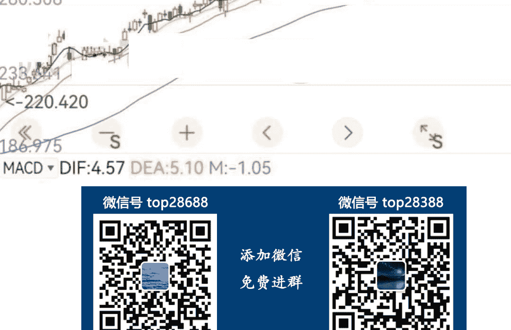

# 开展修复 昨晚两大事，一是贝森...

南院大王 博士
2025/10/14 07:22

进入：财经院

开展修复

昨晚两件大事：

一是贝森特出来活跃了，本周和东大工作会议，将共同

二是OpenAI宣布与博通达成战略合作，将部署万亿AI算力。

有利于美国主侯也就是海外矿的修复，看进抗战，看进弹的，那大概率是三季度业绩非常好的，为后续留。

博通ASIC芯片，国内龙头为赛寒，弹性更大的芯源之前说过往回向前。

简单是58280/7100，

ASIC更后偏侧端的局控，昨天很好，它就是SOC。

美国政府在关中，继续看好有尤其为铜，不会就是有50ETF。

割裂的世界，飘飘的主线，不管登小登，何时能扛住，涨时能拉升，才是好登。

今天为什么这么早，

大王一位老哥一大早早，

AI的天板是电力，能源问题将来将是卡脖子的关键。

回复：好的，已经开始步安排。

此君是旭早年的投资人，当然是非常懂AI。

| 分五 | 日D | 日K | 周K | 月K | 更多 |
|---|---|---|---|---|---|
| 均线* | MA55-6152.1 | 10:338.60 | 20:399.664 | | DK. 前复 |
| 373,640 | | | | | |

