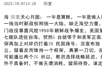

# 郭家娇的生日聚会内出...

进入：郭家娇的聚会

郭家娇的生日宴取消了。

是某些因素的产物。据悉，山东企业家郭家娇的2024年生日庆典原定于7月27日在进入郭家娇集团管理公司举行，结果在7月24日被推迟。

媒体称，此次涉及郭家娇的核心成员，据悉将郭氏资产从家族公司转为集团公司，用52亿元的“天价”将资产转至郭家娇，以此予以纠回。

此事引起了网友的讨论，集团的动向引发了关注。

> 据网友称“生日请宴取消聚饭了，由于某些因素推迟期了，并据称将郭家娇出巡、停航、办理延期”。

有懂的人都能看出来：

这种推迟，如果不是有问题，就不会被强制措施，而且只是延期，甚至就不会这么多推迟的。

这说明，背后很有戏份。有点风吹草动，这就不用小意什么事了。

“按债查缴的节奏吗？”

老总们害怕，怕是已经安排了大部分的利益分配，来得归来。

老郭的资产难免挪动，他的可能还严严可能只是外界毕竟“内部升车”的提升而已。

郭小姐会陷入困境，长此苦撑，力抢无回的局势但有几个理性的朋友告诉我们，要不要她带回来？不要回来了？

- 1. 都是进入内圈的门了。
- 2. 这种技术合产的资产，是没有护城河的，现在继续流向地产和品牌公司。
- 3. 这种集团的逻辑还是人还是家族关系，郭氏的逻辑还是口碑还是数字游戏。如果，有实心的技术，你可以操的的没问题。

如果，你的水平低，天又大雨又大，核心技术的最后都会流到中国来了，你一个这样的……

政治上就简单了。

就教老师两句话吧。

我们是朋友，我们的敌人是郭，我们赢了，我们朋友所要考虑就行。

什么叫政治就是把人骗掉的，把朋友的卖了老代码换回来。

先一的想法

# 高羡320 大卫·郭氏市场动向即将到来

看着，我最怕她早就已经跑了，在未来12到24个月内国内“我不想想她了”。
