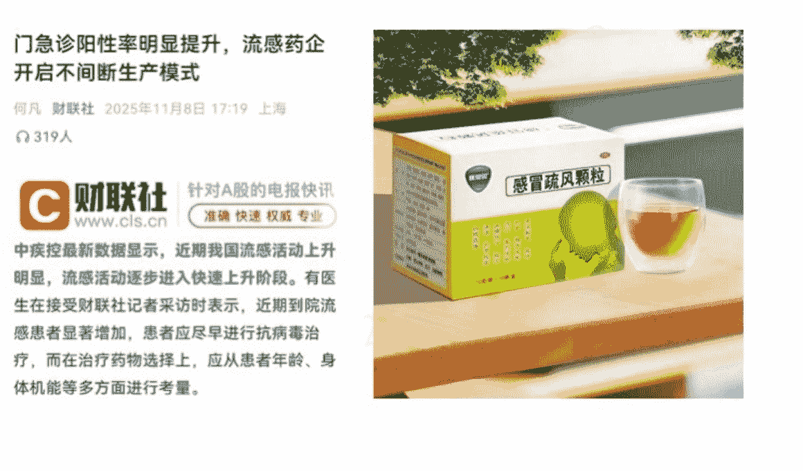

# 详情

南院大王 星华
2025/11/09 19:00

## 应对流感

这几天，流感已经成为呼吸道样本检测阳性率第一的病原体，鼻病毒和呼吸道合胞病毒都在上升趋势。

新闻一酵，有同学就想问流感概念，去炒一把题材。

市场很可能买涨，但我们并不建议，主线混沌期，不要跟着电风扇转了，不是你每分钱都要赚的。

生活中要讲有所为，股市中也要讲有所不为，亏是心境不清的结果。

而是现实中要注意，这时候的感冒和发热基本都是风寒，很多都是毒性超级减弱版本的“新冠”，主要体现是头疼、鼻塞、清涕、身上冷、发烧等。

可以去了解一个神药“感冒疏风颗粒”，老同学们都知道，它来自于张仲景的名方，麻黄桂枝汤。

一旦外旦外头吹了寒风，感觉不对劲，那就是“君疾在肠里”，黄金3小时内，抓紧时间干预一下，不要让病发出来。

如果同时还有腰酸背痛脖子僵的，加“葛根汤颗粒”。

注意不适合风热啊，风寒不出汗或少汗，舌苔白；风热是出汗喉痛，舌苔黄红，适合金花清解。

风寒冬多，风热春多夏。

为什么《黄帝内经》是治国之道呢？

## 它以人体为比喻，谈宏观调控

经济太热，就要清热解毒，降低杠杆；经济太冷，就要辛温解表，刺激机体。

评论(10)

黑润先生
2025/11/09 19:06
大王没有祛湿的良方

- 回复 黑润先生：+1，湿热严重
- 南院大王 回复 黑润先生：百病易去，一湿难除。大部分湿热湿湿还兼中焦不通，吃药下不去，最快的还是金刚功每天遍，以汗排湿，3月可解。
- 澎湃 回复 黑润先生：陕西这么干燥也湿热？广东的话去湿热喝五指桃汤，或者去买同仁堂的红豆薏米茯苓艾茶水泡水喝。
- 天心圆 回复 黑润先生：土能制水，祛湿的方法就是健脾，大太王汤的这个

# 详情

- 天心月圆回复 黑洞先生：土能制水，祛湿治本的方法就是健脾，像大王的，这个需要的时间会比较长。一是春夏多运动出汗，运动同时可以增长肌肉，也说是曲线健脾。二可以用山药粉、四神汤粉早餐吃，平时多吃山药、土豆这些埋在土里的根，简单的少添加的面食都是健脾的。三是时常保持心情愉快，做个乐观主义者，少想多劳动，以调肝和脾的关系。
- 天心月圆回复 黑洞先生：第四，忌吃东西，厚腻滋补的也要少吃，否则吃进去超出脾运的能力，脾运工者总忌。每顿吃饭七、八分，尽量不要暴饮暴食。
- 黑洞先生回复 南院大王：好的，我先去看看金刚功的视频。
- 黑洞先生回复 澎湃：九月到十月下下了50天雨，难息。
- 黑洞先生回复 天心月圆：好的，谢谢老师。
- 天心月圆回复 黑洞先生：长时间下雨可以多在室内点没有科技和狠活的纯正香，醒脾的。
- 天心月圆回复 黑洞先生：淘宝狮吼香堂的口碑好，今天正好开始做十一活动，满200减40，应该是近年来力度最大的一次了。

## 深度视野优质集群（链接优质社群，助你成功）

全部包含以下内容：限时年188/年 加微信cuk255

- ① 吃瓜群众含文档加时群聊对话（原价 365 元/年）
- ② 子明私享汇（含）内部文章
- ③ 政事室（顾子明）付费内容加送顾子明群
- ④ 米联锦顶【作者米横】（原价 599 元/年）
- ⑤ 欧洲金雀会员专属文章（原价 328 元/年）
- ⑥ 砖瓦斥内部文档（原价 400 元/年）
- ⑦ 卢文青读书会专属文章（原价 699 元/年）
- ⑧ 鉴茶财经知识星球（原价 3310 元/年）
- ⑨ 猫哥的视界知识星球文章（原价 299 元/年）
- ⑩ 十财经周【独家新闻】（原价 1498 元/年）
- ⑪ 杨世光在金钱塔（原价 2200 元/年）
- ⑫ 森淼财经知识星球（原价 1600 元/年）
- ⑬ 激源译译付费文章（持续更新）
- ⑭ 司马林解读未选全套音频和全套书籍隐藏删减（原价 2.3 万）
- ⑮ 虚三三部[民国梦、帝国争亡、不被理解的MAO](原价 599 元）
- ⑯ 卢克文知识星球文章（原价 268 元/年）
- ⑰ 额外再送：卢薛元新浪微博付费专栏、三丰老王、三花九涯文集

不定内容：......（更多资源不下去了......

- ① 守夜人司令知识星球、接魔王后、达叔浅论星球、成术财富圈、雪花桃花甲头等
- ② 创始绪、达叔浅论星球、成术财富圈、雪花桃花甲头等
- ③ A视野、大树乡谈、江宁序、泮咩说、上海家学等付费文集
- ④ 西风付费文章、老端、赢在八小时之外、局人的视界、升值、老A体制内等等其它一些大V付费文章（每月低于600元的付费文集）
