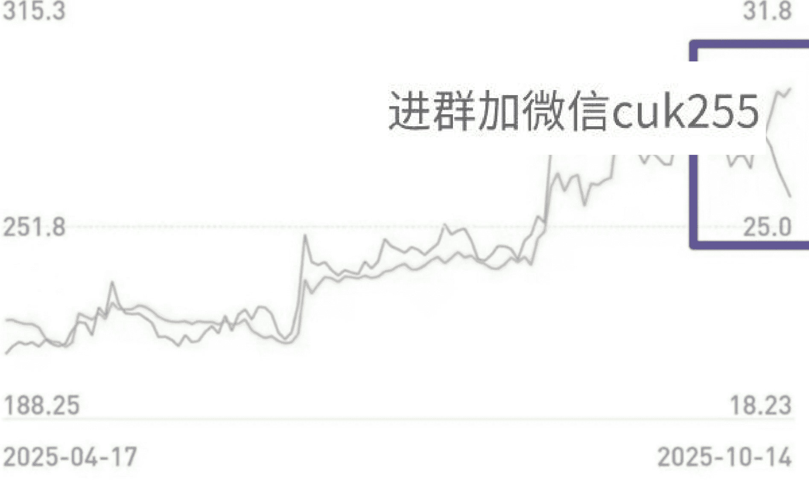
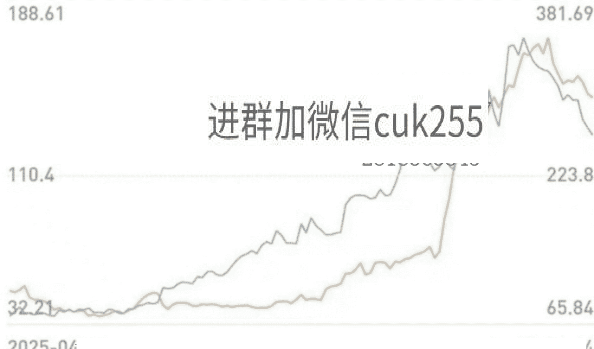

## 量价先

E = MC²。

E是股价, M是基本面, C是资金。

这轮核心科技的上涨, 很多都是由两融资金推过去的，现在明显看出, 两融的额度衰减后, 它们的股价也扛不住了。

那么，科技何时反转? 你看两融余额重新掉向上行。如图两个：

一个是胜宏, 行业统领企稳后, 两融再度杀入, 才是所有科技新一轮大涨的开始，否则都是假突破。

一个是东方财富, 这个有意思, 两融余额和股价竟然背离了。这就这两种可能：

一个是，机构把筹码卖给了散户；
二是，有大资金提前进去抄底在洗盘。

混沌期还是谨慎为上。目前地活跃资金，去了低位科技的比如电力，提前预防性的去抄创新药等，当然，你也可以选择不看它们，空出仓位等中枢和科技的共振。

## 东方财富 - 0%
300059
* 2013-09-16调入融资券标的

## 两融最新数据 10-14 已更新

| 融资净买入 | 环比增长 | 占成交额 | 行业排名 |
|---|---|---|---|
| 2.59亿 | 252.60% | 2.44% | 1/50 |

## 融资余额走势 查看主力资金
融资余额（亿） 收盘价 资金流向

## 胜宏科技 - 0%
300476
* 201 优质资源

## 两融最新数据 10-14 已更新

| 融资余额 | 融券余额 | |
|---|---|---|
| 融资净买入 | 环比增长 | 占成交额 | 行业排名 |
| -2.00亿 | 63.55% | -1.75% | 48/49 |

## 融资余额趋势 查看主力资金
- 融资余额（亿）
- 收盘价
- 资金流向

## 深度视野优质集团（链接优质社群，助你成功）

全部包含以下内容：限时年188/年 加微信cuk255

- ① 吃瓜群众时代圈加时群群对话（原价 365 元/年）
- ② 子明私享汇（含）内部文章
- ③ 政事室（顾子明）付费内容按需逐顺加群
- ④ 米联储闲闻【作者:米楷】（原价 599 元/年）
- ⑤ 欧洲金雀会员专属文章（原价 328 元/年）
- ⑥ 砖瓦仁内部圈（原价 400 元/年）
- ⑦ 陆亚文青读书会专属文章（原价 699 元/年）
- ⑧ 鉴茶财经知识星球（原价 3310 元/年）
- ⑨ 猫哥的视界知识星球文章（原价 299 元/年）
- ⑩ 财经周刊【独家新闻】（原价 1498 元/年）
- 十一 杨世光在金钱圈（原价 2200 元/年）
- ⑫ 森森财经知识星球（原价 1600 元/年）
- ⑬ 潇泽译译付费星球（持续更新）
- ⑭ 司马林解课全套音频和全书珍藏版无割（原价 2.3 万）
- ⑮ 虚构三部曲[民国梦、帝国争霸、不被理解的 MAO]（原价 599 元）
- ⑯ 克知识星球文章（原价 268 元/年）
- ⑰ 额外再送：卢锐元新浪付费专栏、三村丰老花、三花九洞文集

不定内容：……（更多资源写不下……

- ① 守夜人司令知识星球、接换魔笔记星球、成沃谈论星球、成沃财富圈、雪花桃花老头等
- ② 创始笔记、达叔谈论星球、成沃财富圈
- ③ A 视野、大树乡谈、江初将、泮咩说、上海海家等付费文集
- ④ 西凤付费文章、老端、赢在八小时之外、局外的视界、升值、老A 体制内等一些大 V 付文集（每月不超过 600 元的付费集）
