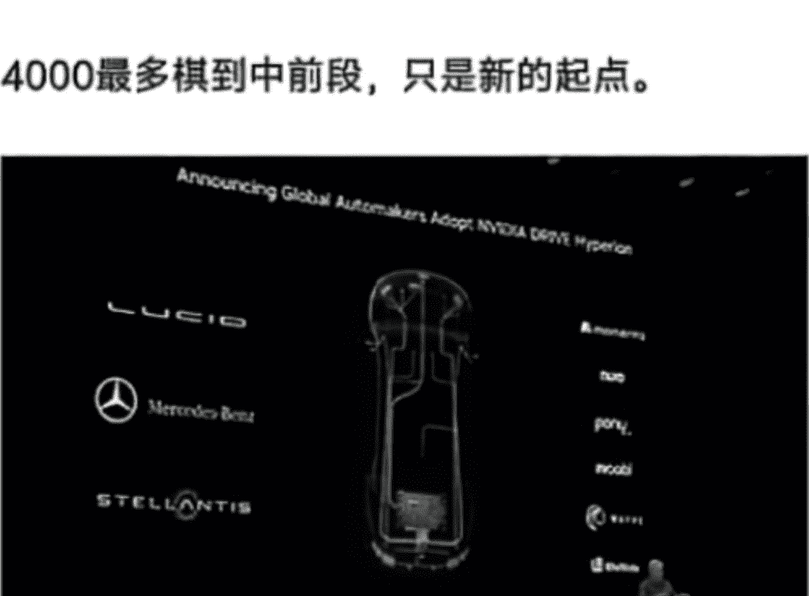
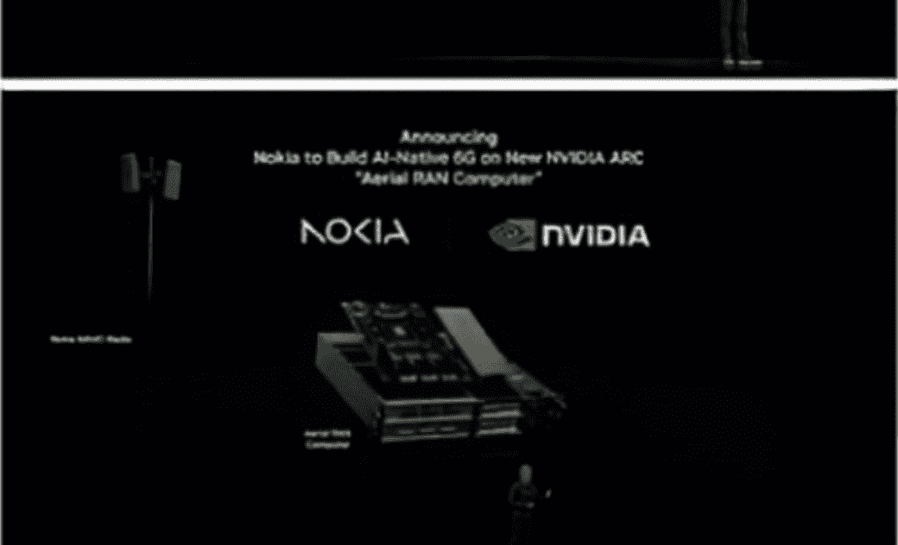

[content]
# 想象力

昨天GTC大会，黄仁勋勾勒了一个AI未来的宏伟蓝图：6G、量子计算、机器人、自动驾驶，和诺基亚等开展一系列合作赋能。

英伟达暴涨4.98%，突破200万，历史新高，市值到了4.87万亿美元，同时微软也突破4w亿。

之前我们就讲过，中国很多机构和客户的核心问题是缺乏想象力，既没有信念填天斗地的魄力，也缺乏用科技天换地的想象力。

看到宏伟蓝图，上来先视为左脚踩右脚的驴子。不是不是喜欢计算器吗，英伟达宣布在手未履行订单5000亿美元，超过了所有公告订单。

这还不算完，OpenAI还宣布，所有基础设施建设总规模略超30吉瓦，总投资额约1.4万亿美元，超过了中国去年企业利润的总和。

老董们是没戏的，因为老董当年创业，是穷的、逼的、活不下去的死马当活马医才的，发展基本都不高，不乏坑蒙撞，给自己求个富贵，历史有局限性。

而小仁们衣食无忧，就是执着热狂的兴趣和决心，活活着就是为了改变世界的。

要利好当然是主宰方，尤其是核心内核，未来3年的饭，人家已经给你玩完了，只会不断预期。

光镁PCB的那一条链和延伸，不用赞了了吧。

那么，如果极小概率，它们竟然都不涨了，反而是军工、题材、各种牛鬼神活跃起来呢？那就叫做“钝化”，说明大资金们憋着砸坏或者不可抗力，对未来严肃悲观了。

你那样还胆退考虑本年度止损了。

ps，不要被这拨小字吓住了，所有的战略都要包含“极微概率”的考量。憋着利好兑现，止盈走人的你们越多，战略要留视，战术上要重视，预留根弦要留着。即使发生，也只是影响波段，而不是不大的趋势。

外头有各种所谓的龙头战法，真正的龙头，都是这些改变世界的科技巨头，和极客与怪杰们。

高费，低好，K型画大家学多久了，没有垃圾回归，只有强者恒强。

总体，坐等今天的科技收获，以及再次突破 4000吧。4000最多美到中前段，只是新的起点。

虽然之前大王提过11月风险，如果现在用发展的眼光看，科技，尤其是光和PCB，是不是大概率还能接着接着舞？

2025/10/29 08:18 回复 南院大王 回复17217：到时再看，一轮狂加速后总要回归的，反噬概率更大。

2025/10/29 08:19 回复 骆晓小登，认知是基础。不怕吃苦的人们，可以先看《浪潮之巅》、再耐嚼下《人工智能时代》（上下），中国人吴军博士写的硅谷史和对未来的展望。怕吃苦的，直接听大王的做法就行了。

2025/10/29 08:25 回复 南院大王 回复骆晓鸣：《只有执狂才能生存》

2025/10/29 08:23 回复 GTC大会看的人心澎湃！再回头看大王讲的国内机构缺乏想象力，太对了。佩服大王精准的判断👍

2025/10/29 08:27 回复 家做ppt，咱们来现实

# 深度视野优质集群（链接优质社群，助你成功）

全部包含以下内容：限时年费188/年 加微信cuk255

- ① 吃瓜群众倍训练时群群对话（原价 365 元/年）
- ② 子明私享汇（含）内部文章
- ③ 政事室（顾子明）付费内容加送顾子明群聊
- ④ 米联储闪现【作者米横】（原价 599 元/年）
- ⑤ 欧洲金雀会员专属文章（原价 328 元/年）
- ⑥ 砖万瓦内部文档（原价 400 元/年）
- ⑦ 卢克文青读书会专属文章（原价 699 元/年）
- ⑧ 鉴茶财经知识星球（原价 3310 元/年）
- ⑨ 猫哥的视界知识星球文章（原价 299 元/年）
- 十 财经周刊【独家新闻】（原价 1498 元/年）
- 十一 杨世光在金钱塔（原价 2200 元/年）
- 十二 森淼财经知识星球（原价 1600 元/年）
- 十三 激泽异付费文章（持续更新）
- 十四 司马林解读毛选全套音频和全套书籍无割减（原价 2.3 万）
- 十五 虚虎三部曲[民国梦、帝国战争、不被理解的MAO]（原价 599 元）
- 十六 卢克文知识星球文章（原价 268 元/年）
- 十七 额外再送：卢锐元新浪付费专栏、三村丰老王、三花九洞文集

不定期内容：——（更多资源不下去了……）

- 守夜人司令知识星球、接换魔王知识星球、成术财富星球、雪花甲老头等
- 创始佳人、达叔浅深度论星球、成术财富圈
- 视野、大树乡谈、江后守、泮咩说、上海家学等付费文集
- 西凤付费文章、老端、高在八小时之外、局外的视界、升值、老
- 体制内等等一切大V付费文章（每月低于600 元的付费文章）

低成本连接全网V优质内容

深度视野文集

群微微信cuk255

深度视野（付费文集）

[/content]
