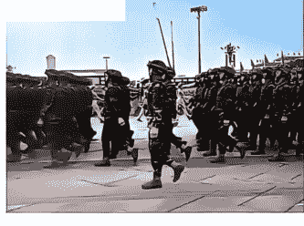

# 南好大主

看懂更硬核

昨天的大跌几乎必然的，进群微信cuk255

TMT的占比高达40%，必然蓝荡加剧。

上海门专门发过《贵享牛市的整个格局》。

科技现在聚齐了指数，一跌就会满地哀嚎。

跌了以后的格局呢？谈三点：

一是高位内部切换

二是高位内部头部，自己也是有低位的，会进行高低切

三是机器人创新没了吧

机器人就看特斯拉的，前几天还滞缓，今天就不适合你了，得等

机器人etf说长期还能看好，两个etf都不错

创新的药的几个依然好看

今天看看王建代表的国产芯片的修复

二是科技内部轮溜

昨天你发现什么，质地要好好的公司，跌的，跌的，看着补涨的后跟的杂毛，跌得多的。

比如，光模块就跌得少，交换机就跌得多的，因为门槛稳定和技术含量不一样。

海外力量头部，进群微信cuk255

中创就跌的少，中芯就跌得多的。

旭50倍pepe跌得少，天宇86倍多一跌一倍。

华为线里头部

华工就跌的少，光讯跌得多的。

华工40倍pe，光迅70倍，然不一一样。

# 深度视野大V文cuk255 有温度高质社群cuk255

以后面的科技，肯定要修复，但修复后你要知道，涵盖了。

要看核心的，要看头的，要看技术的，要看PE合理的，要看更卓越的。

科技的每一个细胞最多1-2个龙一，

当然不是说废的都是垃圾，而是那些绒毛，后掉的，涨的，涨的，晚的，硬关系关系的概念，还掉了。

尤其是那些小盘，微盘，市值太，行业没有统治力，或者技术不突出的，推狗墨股。

你有没发现，那些绒毛，往往往涨的时候慢，跌就少了。

如果你都不知道自己手里拿的品种，核心和龙头发，你就不适合合杂股，适合etf。

就像你在上班上，你不知道学习和班长是谁，岂不尴尬。

庸兵简政是为了更好进现在，现在的科技不狂嗨，科技还是主线，不用怀疑。

第三是绝对对低位的切除。

那些从杂毛中流出来的资金去哪了?

部分去了核心，部分去割席，部分会绝对对低位。

反内卷和大消费，之前蛮谈到过，可以前往，这里还是一样的，就看龙头发。

这里要加入一个你之前蛮谈过的sls，同时是上证50，180，沪上300，A500的组合，你也曾突破去年10月8日的高点呢，宁王都突破了。

当然对低位块块是不错的，可以摊低吸吸，进群微信cuk255最后依然谈谈一样。

# 深度视野大V集cuk255 有温度高质社群cuk255

拉银行坏事，券商才是进的，看到券筹板块舞动，会打野的同学机会就来了，盯好刚那三家。

大盘大幅低开甚至会给你来个冰点，然后慢慢拉起来，最好用券商拉。

今天比较戏散户的开局是，大幅破空高开，让狂天割肉的今天再追进去，周四四给你补口下口，让你自己再割肉。

然后你大牛市是散户亏钱的主要原因，人家周五再拉上去，盘赢完成。

ps，为了学习，今天9点大家好好复学习93。

总编辑：2025-09-03 08:54

- 卡芬：边着调饼跟大王学习 2025-09-03 08:18
- Jerry:给哈洛，太亮，离开，然后周四再开。这周四再参与本轮牛市，又了一个日。2025-09-03 08:19
- 心空九龙还是第二种 2025-09-03 08:22
- 金生：牛大王永远！追高低一直割肉的教训：就是要早信，买头，低吸又错，今早不开，高涨跟微调做2025-09-03 08:25
- 韭外剪金生：牛大王不是这样的，只是描述了这样一个版本，并不是发生。主要逻辑学好就能你赚了，如果你不知道明天会怎么样，那不是大王

# 深度视野V文看ck255 有温度高社群

- 无暇 回复 金源：确实，相同受，不好的决断2025-09-03 08:27
- The: 大王，金融除了那三个，银之杰看着三个都好，是否可以呢2025-09-03 08:27
- 南隆王 回复：市场那么，核心是掌握避险方法论，不用泥自己的，符合均衡即可2025-09-03 08:33
- The 回复 南隆王：谢谢大王2025-09-03 08:36
- 水：【DIK HUN】：询问大王，电源等暂时清理了，光蓝牙膜，现在正是王比较高，是不是吗？2025-09-03 08:33
- 花蕊【DIK HUN】：生意和电子是两妈妈2025-09-03 08:36
- 南隆王 回复【DIK HUN】：生意和电子是两妈妈2025-09-03 08:45
- 书自有：ls是个错，蛮力错2025-09-03 08:36 (注：此处内容重复)
- Carl: 还是不够，前几天找机器人，我看了总觉得好像高的，就没2025-09-03 08:38
- 花蕊【DIK HUN】 回复 Carl：我也是在第十低线，可能是过于刻的2025-09-03 08:42
- 无暇 回复 Carl：我也是，觉得高2025-09-03 08:46
- 抓汤连雏：听大王的，用最好的开头2025-09-03 08:47
- 乔远寻：三颗头2025-09-03 06:42

- Waowow: 大王 裴杨和灵酱，万之哥？因为甜许多次遇到心，但昨天都按v的迹象2025-09-03 07:15
- Waowow: 尤佳伟，伤心了# 深度野大V集cuk255 有温度高质社群cuk255

# 深度视野优质集（链接优质社群，助你成功）

全部包含以下内容：限时年费188/年 加微信cuk255

① 吃瓜群众粉丝圈加粉丝对话（原价 365 元/年）
② 子明私享汇（含）内部文章
③ 政事室（顾子明）付费内容加送子明群聊
④ 米联锦质【作者米褚】原价 599 元/年）
⑤ 欧洲金雀专属文章（原价 328 元/年）
⑥ 砖瓦仁内部圈（原价 400 元/年）
⑦ 卢克文青读书会专属文章（原价 699 元/年）
⑧ 鉴茶财经知识星球（原价 3310 元/年）
⑨ 猫哥的视界知识星球文章（原价 299 元/年）
十 财新周刊【独家新闻】原价 1498 元/年）
十一 杨世光在金钱煽（原价 2200 元/年）
⑫ 蒜森财经知识星球（原价 1600 元/年）
⑬ 潇游异译付费文章（持续更新）
十四 司马林解课选逸全套音频和全套书籍原无删减（原价 2.3 万）
十五 虚构三部曲[民国梦、帝国争霸、不被理解的 MAO](原价 599 元）
十六 卢克文知识星球文章（原价 268 元/年）
十七 额外再送：卢薛元新浪滚扑付费专栏、三村丰老王、三花九洞文集

不定内容：……（更多资源将下去了……

- 守夜人司令知识星球、接换魔王知识星球
- 创始人笔记、达叔谈论知识星球、养成财富、雪球花甲老头等
- A 视野、大树乡谈、江后语、泮咩说、上海海学等付费文集
- 西凤付费文章、老端、赢在小时之外、局外人的视界、升值、老A体制内等其它一些 V 付费文章（每月低于600 元付费文集）
