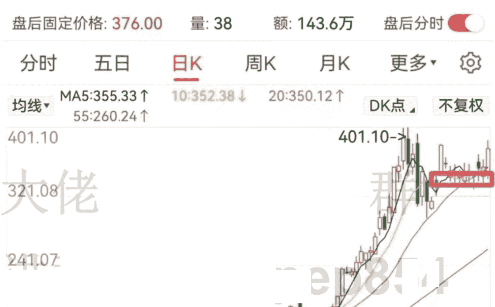

# 南京大王雷

进入：韭蛋财经院

双轮驱动越来越均衡，今天就拉起来，

因为今天方桌上写的是，弄不好越涨越便宜，

所以心里不能看空。进阶抖音cuk255

就像你时候发现自己折腾半天，还不一直拿着仓量。

现在的一轮是算力核心，一轮是中芯概念设备，再配合大头部指数维护。

强势的平台理论还非常重要，关键位置它会抓住。

比如20日线的支撑，

箱体整几天拉起来，又如今天涨的华工，上次还是如同的平台位置，

上个6%捡了便宜的兄弟们，如果谨慎达到了预期收益，可以止盈一部分。

此外还有什么方案呢？

如果它还有突破，且回调破5日平台或者缩小形态，那就有机会涨“伯利钢铁”到时候，会往300，如果不到100直接接下去了就稳了，不想想到130，那你回润也ok可以卖掉了。

晕量也一样了。进阶抖音cuk255

| 97.68 | 91.10 | 91.60 | 97.68 | 98.30 |
| :--- | :--- | :--- | :--- | :--- |
| 10.00 | 8.88 | 换手 | 10.27% | 总手 | 103.2 | 金额 | 982.2 | 跌幅 | -1.7% | 涨幅 | 5.30 |
| 更多 | | | | |

| 分时 | 日 | 周 | 月 | 年 | 更多 |
| :--- | :--- | :--- | :--- | :--- | :--- |
| 均线 | MA5:56.61 | 10:87.10 | 20:78.14 | DK | 不聚集 |

| 85.28 | 79.23 | 最高 | 86.91 | 最低 | 79.23 |
| :--- | :--- | :--- | :--- | :--- | :--- |
| 7.94 | 6.27 | 换手 | 12.13% | 总手 | 102.2 | 万 | 86.07 | 826.4 | 跌幅 | -8.6% | 涨幅 | 19.61 |
| 更多 | | | | | |

| 分时 | 日 | 周 | 月 | 年 | 更多 |
| :--- | :--- | :--- | :--- | :--- | :--- |
| 均线 | MA50:80.6 | 55:57.72 | 10:78.21 | 20:75.57 | DK | 不聚集 |

# 深度视野优质集群（链接优质社群，助你成功）

全部包含以下内容：限时年费188/年 加微信cuk255

- ① 吃瓜群众含帝圈文加时群对话（原价 365 元/年）
- ② 子明私享汇（内部）文章（原价 568 元/年）
- ③ 政事室（子明优）付费内容加送子明群聊
- ④ 米联储闲【作者:米横】（原价 599 元/年）
- ⑤ 欧洲金雀会员专属文章（原价 328 元/年）
- ⑥ 砖瓦仁内部画圈（原价 400 元/年）
- ⑦ 卢克文青学读书会专属文章（原价 699 元/年）
- ⑧ 鉴茶财经知识星球（原价 3310 元/年）
- ⑨ 猫哥的视界知识星球文章（原价 299 元/年）
- ⑩ 财经新周【独家新闻】（原价 1498 元/年）
- ⑪ 杨世光在金钱圈（原价 2200 元/年）
- ⑫ 森淼财经知识星球（原价 1600 元/年）
- ⑬ 激源异译付费文章（持续更新）

# 深度视野文集
进群微信cuk255
深度视野（付良文集）

- ⑭ 司马林解读未选全套音频和书书版无删减（原价 2.3 万）
- ⑮ 虚构三部曲民国梦、帝国争战、不被理解的DAO（原价 599 元/年）
- ⑖ 克文知识星球（原价 268 元/年）

- ⑰ 额外再送：薛锐元微信付费专辑 杭运老王、三花九涯文集
进群微信cuk255
不定期内容：（更多资源写不下去了）——

- ① 守夜人知识星球、进换魔王知识星球、生育知识星球、
- ② 创始笔记、达叔浅译论星球、成付财富圈、雪花甲老头等
③ A视野、大树乡谈、江宁后、泮咩说、上海海学等付费文集
④ 西风付费文章、老端、高在小时之外、局外人的视界、升值、老A体制内等其它一些大V付费文章（每月不超过600 元的付费文章）

# 限时年费188/年 低成本链接全网V优质内容
