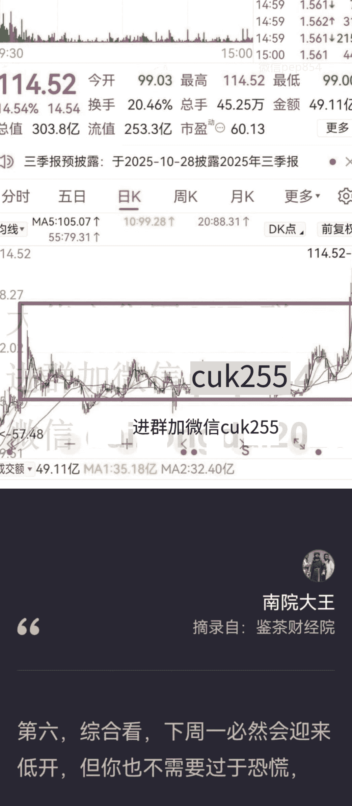

# 江浇火对视视今天的局势，就是...

南南大王 董莱财经
2023/10/15 10:28

进入：董莱财经

# 江浇火对对视

今天的局势，就是上所说的方案2，升高开，看看，进微加cuk255

下落后，杀总仓，生产再入场轻松一拉。

如果你今天上午，开盘没有割肉，在3850之前，低位减仓主力，再一，3%左右的创业板，部分仓位了男方或涨打铁，如此，就是非常合适的操盘手。

实际上你能做到其中一个，就跑赢90%的散户。因为你处于了恐慌的“情绪影响”，开始觉得难得错，实事就是。

光刻机和半导体设备风口中崛起，它依然是市场的主线。

之前谁拿了光刻机的那个错悔，真的是人都够了。

今天涨望，生产队并没有太多了，预期后在后村里继续发力。那时候市值会继续加强，还是观点，你科技在11月之前就不用纠结了。

中芯国际，582800，253.7，7862，nn从今天再没有涨证明你过otf?

当说龙丰是高手的那些，为什么？从241月，到25年9月中，一张涨幅怎么样？长达10个月的行情，你真的，它就是一个超级大的。

| 指标 | 数值 |
| :--- | :--- |
| 开盘 | 1.561 |
| 跌 | 1.424 |
| 高 | 1.562 |
| 低 | 0.92 |
| 涨幅 | 3.97% |
| 成交量 | 0.057亿 519.6万成交 7.862 |
| 历史类似 | 涨幅15.53，跌幅0.17% 影响0.24% |

> 第六，综合来看，下周一定会迎来低开，但你不需要过于恐慌。

国产逻辑没问题，海外业绩能迅速反衰。杀跳动面积跟跟路和考虑止盈，反倒是双方逐渐宽和和11月前后。

作者：南南大王 2023/10/11

# 异动详情 2023-10-13

- 14:55 中芯概念 涨 3.17%
- 中芯概念 45 / 0 / 21 涨 34.21亿
- 江丰电子 特华气体 沪产基金 14.44% 12.51% 10.83%

# 深度视野优质集团（链接优质社群，助你成功）

全部包含以下内容：限时年费188/年 加微信cuk255

- ① 吃瓜群众倍帝圈微信时费群对话（原价 365 元/年）
- ② 子明私享汇（内部）文章（原价 568 元/年）
- ③ 政事室（子明优）付费内享再送额外子明群
- ④ 米联储友英【作者米楼】（原价 599 元/年）
- ⑤ 欧洲黄金会员专属文章（原价 328 元/年）
- ⑥ 砖瓦斥内部文档（原价 400 元/年）
- ⑦ 卢克文青读书会专属文章（原价 699 元/年）
- ⑧ 鉴茶财经知识星球（原价 3310 元/年）
- ⑨ 猫哥的视界知识星球文章（原价 299 元/年）
- ⑩ 财财经周【独家新闻】（原价 1498 元/年）
- ⑪ 杨世光在金钱（原价 2200 元/年）
- ⑫ 森森财经知识星球（原价 1600 元/年）
- ⑬ 激译译读付费文章（持续更新）
- ⑭ 司马林解读末选全套音频和全套书籍版权无损（原价 2.3 万）
- ⑮ 虚虎三部曲【民国梦、帝国战争、不被理解的 MAO】（原价 599 元）
- ⑯ 克星球文章（原价 268 元/年）
- ⑰ 额外再送：卢祺元新浪微博付费专栏、三丰京东老、三花九树文集

内容：……（更多资源不写下去了）……

- ① 守夜人知识星球、接换魔王后星球、成就财富圈、雪花甲老头等上海家学等付费文集、生有术知识星球、
- ② 创始星球、达叔天译论星球、成就财富圈、雪花甲老头等
- ③ A 视野、大树乡谈、江宁后、泮祥说、上海家学等付费文集
- ④ 西风付费文章、老端、赢在八小时之外、局人的视界、升值、老A体制内等等其它一些大 V 付费文章（每月低于600 元的付费文章）

# 深度视野文集
进群微信cuk255

深度视野（付费文集）

限时年费188/年

# 低成本链接全网大V优质内容
