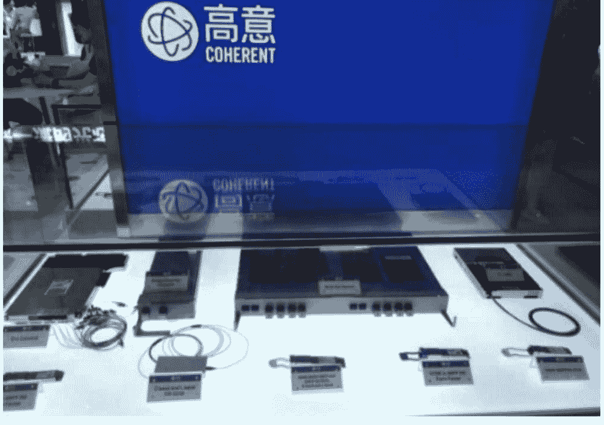

# 鉴茶财经院 251027: 今天这题很简单

今天这题很简单

就三个字，相信信光。

主力当然是易华和pcb，

有华工的同学这下舒口气了，

弹性大的光芯片早上早回复了叶枫同学，就看源杰和新士佳。

源杰很好，PE高了，

新士佳有望打破Lumentum垄断，

更早讲的东森微，有望打破日本光隔离器垄断。

科技出什么新题材，新的主线是什么，尚不能确定，目前只能说谷歌有迹象。

目前仍是6-8 月的涨法和打法来。

龙头和校花是能够突破新高的，其他的就要珍惜双N头的机会了。进群加微信cuk255

11月上旬，科技有望加速到一个新高峰，并且（此处原文此处似乎不完整）

# 珍惜。

炒了那么久光模块，大家快看光模块和交换机长啥样。

评论：

希望：今天收获不错，听大王的，一直到十一月上旬坚定持有校花

C++：校花包括主攻男方

阿伟 回复 C++：拿着中芯电，云飞的表示十月还亏4个点

Jerry：我的士佳一直卧倒缴

重庆胜利回复 Jerry：我没扛住，上周五跑了

国运盛：华工未来可期，执行力不够买迟了，天才进

尤优：想问大王剑桥是会新高还是双头概率大一些，早上看大王提到剑桥。

南院大王回复尤优：早上它和XYS的账你算算

胖瓜：相信大王进群加微信cuk255

玉泉：主力回补科技

Hygge：大王，感觉英维克其实没有什么技术含量，对维克后除了带后排，后续如何看？会有实质性业绩吗？

Jerry 回复 Hygge：肯定有啊

骆晓鸣：一定要相信光！静等胜宏三季报

事缓则圆：我是八月下旬加入知识星球的，从收益曲线图明显看到变化。相信光，相信大王，大王适配太庙

子日君子：机器人板块还有机会

红与蓝：回复子日君子：张凭主攻才会涨

吃相好看：谷歌链和达链重合的公司比较多，看上去没什么区别微信pep854

longge：大王，安倍龙这样的从高点至今每天换手率都10%左右，是一种什么样的节奏?

星星之火：上周四普跌再入的二线英维克，生益科技，华工，沪电，感觉表现都好，感谢大王，就是不知道本周还有没有加仓机会，鹏鼎长飞没敢入。

Jerry：鹏鼎已经送样，可以入

# 深度视野优质集圈（链接优质社群，助你成功）

全部包含以下内容：限时年费188/年 加微信cuk255

- ① 吃瓜群众倍帝文档加时群对话（原价 365 元/年）
- ② 子明私享汇（含）内部文章
- ③ 政事室（顾子明）付费内容加送顾子明群
- ④ 米联储寂美【作者米岩】（原价 599 元/年）
- ⑤ 欧洲金雀会员专属文章（原价 328 元/年）
- ⑥ 砖万瓦内部文档（原价 400 元/年）
- ⑦ 卢克文青读书会专属文章（原价 699 元/年）
- ⑧ 鉴茶财经知识星球（原价 3310 元/年）
- ⑨ 猫哥的视界知识星球文章（原价 299 元/年）
- 10 财新周【独家新闻】（原价 1498 元/年）
- 11 杨世光在金钱（原价 2200 元/年）
- 12 森淼财经知识星球（原价 1600 元/年）
- 13 激游译付费文章（持续更新）
- 14 司马懿解读机器学习全套音频和全套书籍收藏无割减（原价 2.3 万）
- 15 虚虎三部曲[民国梦、帝国战争、不被理解的MAO]（原价 599 元）
- 16 卢克文知识星球文章（原价 268 元/年）
- 17 额外再送：卢祺元新微博付费专栏、三村丰老王、三花九洞文集

不定内容：......（更多资源写下了......）

- ① 守夜人司令星球、接换魔王后星球、成反对财富圈、雪花桃花老头等
- ② 创始圣人、达叔浅论星球、成反对财富圈、雪花桃花老头等
- ③ A、大树乡谈、江初序、泮咩说、上海海家学等付费文集
- ④ 西凤付费文章、老端、赢在八小时之外、局人的视界、升值、老体制内等其它一些大V付费文集（每月不低于600元付费文集）
