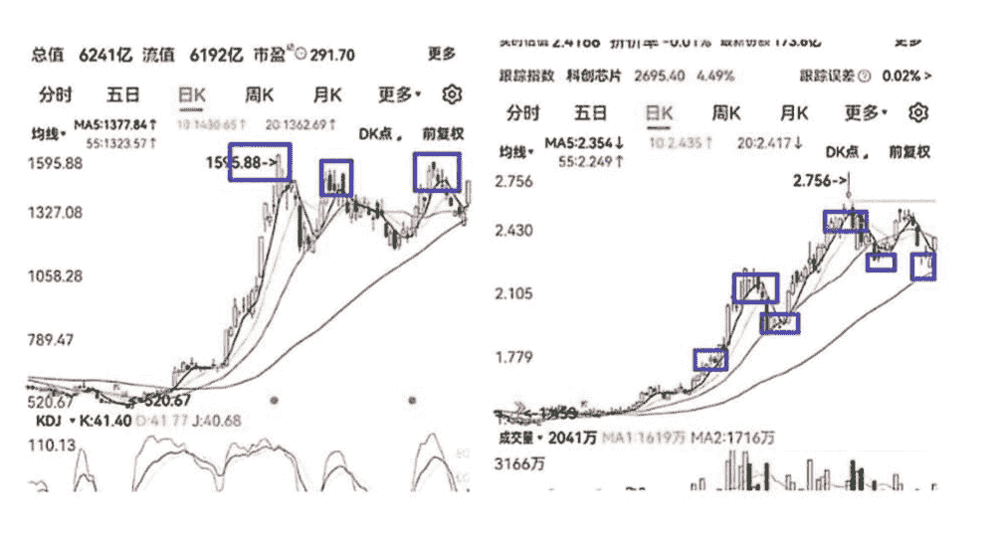

# 鉴茶财经院 251106: 两种不同的逻辑

芒果开盘跌破箱体，跌破了推阻，因为它就是图形。

在止损坚决走人的那刻，你可以为自己小点赞一下，杀伐决断，遵守纪律。

有人觉得亏了是咋，亏了正常，板块不配合，下次赚回来就不得了。

真操作流就是见风使舵，扭头杀进源术或者芯片ETF博弈赢了，不及再跑。

这就是，不以涨跌为耻，以心动为乱了阵脚为耻。

同样的还有赛马，

如果你按K线看，这个图韭眼睛没法看，这是一个三重顶，谁见了不说半导体要命，跑跑跑，

技术操作流，目前这个市场，是不会搞科技的，止盈走人或者等市场2.5万了。

但你从产业逻辑看，国产芯片渗透率才多少？早上我们又讲了强化。

在产业投资来看，它才叫做“跑出来了”。

各位搞投资的，当领袖的，当老板的，当老师的，

在日常中就知道“跑出来”有多难，

天时地利人和缺一不可的，

既然跑出来就把别人甩开了，那看它继续表现就行了。

技术流只会会在1600以上的放量大涨再回落后再新买入，问题是，真到时候，你又觉得高吗？

## 看图操作的和产业逻辑的，肯定是完全不用的逻辑和方式。

真是手想操作适合什么？ETF，ETF是一揽子集合，充分博弈，游资量化没法波动，你可以按照5日平台理论去把玩。

站住就一直拿，跌破了走，等站稳继续拿。

如图是588200的图形。

科技回来了吗？科技只回到最优的品种，严重缩圈。

这就是公募还没完全调仓，有很多今年已经不准备再来了。

而进入的一些都是准备锁仓的长线资金，它们只要最有辨识度的。

今天你拿的科技涨的不好，说明核心。

今天的情绪修复，重要原因是老外给了指引，老外讲光模块超预期，老外说国内AI芯片必须用国产芯片，老外讲北美缺电。进群加微信cuk255

然后他们又按照缺电的演绎搞了电解铝

没主的人还是太太多了。

## 评论：

文武：大王今天天量低走底盘拉升，这怎么理解

南院大王回复文武：这不就是早上说的分支

上善若回复文武：兄弟我也拿了，我觉得是洗筹加部分聪明引起抢跑

文武回复上善若：感觉明天还要有分支

上善若回复文武：看看洗完能不能再拉升

重庆污泥：芒果必须给自己点个赞，破了该就跑，亏了就再赚回来，从容不怕，谢谢大王英明指导。

吕俊辰：早上九点半卖了芒果，一半份额接入3%的马克顿，补了芒果的空错，过两天科技回调再入芒果哈哈

韩翔宇：不懂接谁，我就做到了把芒果推了。我也很棒！

无痕回复韩翔宇1：看完后完全明白，现在到底是可以了还是继续等，进群微信cuk255

火星情报局：老师您好，“公募还没有完全调仓，有很多今年已经准备再来了？”这句话意思是后面公募还会卖出，主筹还会跌吗？谢谢老师指导。

自己操作还是不好，前几天重新开始，就开始买在高位，看文章说要边边撤，5号6号差不撒撒。

深度视觉VIP 人工追踪50+V 付费进加微信cuk255 微信chp556调整看到19号英伟达业绩或许会 miss，然后等月底或者下月初初把寒纪、芯佳光子、协创数据、易天胜完美的砸在了昨天万幸留了阳光。

### 深度视野（优质U文集）

包含以下：
- 守夜人司令星球、接唤魔王知识星球、达沃滚论星球、成术财富圈、雪花花甲老头等
- A视野、大树乡谈、江初荷、泮咩说、上海海家学等付费文集
- 西风付费文章、老端、高在八小时之外、局外的视界、升值、老A体制内等其它大V付费文集（每月不低于600 元付费文集）

限时年费88/年 低成本链接全网优质资源
