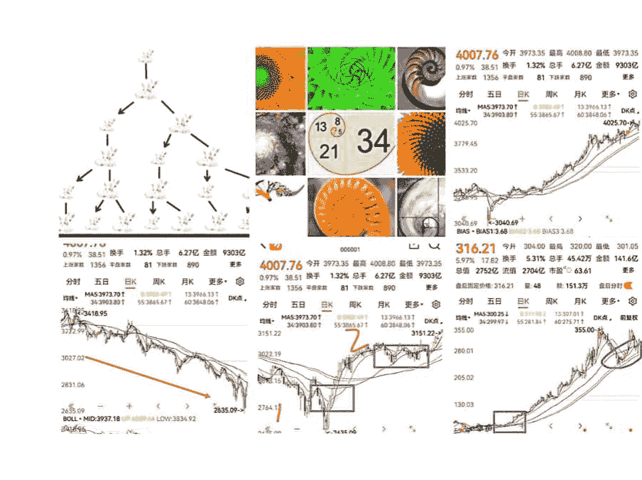

# 鉴茶财经 251107:中长短和超级均线的应用方法

这是当时一篇价值千百万的原创智慧，给大家的分享，国外的有些量化机构，就是把这个拿去操作市场的。

既又要，是人的本性，其实我们已经讲过了 5 日线上下穿，强势股的 20 日线反弹，55 日攻守线，60 日线走熊等，普通人用就够了。进群加微信cuk255。

5 日线用于核心龙头股和 ETF非常好用。

奈何有些人，既希望搞产业投资，又希望搞些操作，希望 1+2，又要第一种，也要第二种，尤其是喜欢那些不那么充分博弈的，不是龙头和后排的，补涨的，就当当年给老外的技术课程给大家讲。进群加微信cuk255。

之前讲过 154 超级均线的同学是知道的。

首先，大家明白波浪斐波契律，这是人们观察自然得出的规律，规律的高维世界密码。比如，树木在第一年长一根条，第二年新枝条休息，旧的又长一条，第三年，新旧一起萌发。这就是 (1,1,2,3)。

道生一，一生二，二生三，三生万物。这个数列，是后面的一个数字，是前两个数字之和。

第二，我们在股市中最短的周线是 5 日线，那么，5 的斐波那契数列就是：5, 8, 13, 21, 34, 55。

1. 看到这里，你是否明白了大王讲的，为什么强势股会在 20 日线出反弹？其实更精准的是 21 日线。
2. 在此之前，机构看牛熊的标准是 60 日线，其其实包括现在也是。大王在 2015 年之前后，给机构讲课和大力主导的是 55 日线，当然原理没有告诉他们，很多机构里糊涂就用了。
3. 那我们已经追溯 50+ 明白了：
- 5 日线，热门与否
- 20 日线，反弹与否
- 55 日线，攻守与否
- 60 日线，牛熊与否
4. 根据斐波那契，我们设置 6 个均线：(5, 8, 13) (34, 55, 60) 这组，叫做短期；55 这组，叫做做长期。均线设置会吧？

第三，设置完成后，你再看个股。

1. 长线组和短线组向上粘合时，发生了什么？是不是开始上涨？一旦长短均线组交织形成向上趋势，34 日线是否长期成为支撑？牛市时，大盘是不是可以击穿 20 日线，但在 34 日线却轻易不破，要么大阳，要么大阴，要么长下影线？没有人告诉过你 34 日线的秘密，这是生产队级别的。

# 现在的上证是不是这样？

你再拿几个大牛来说来看，比如特变、阳光矿？再如，超级大牛安费哲？

2. 当跌破长线组时，发生了什么？是不是步入下通道，熊市时，是不是被 34 日线牢牢压制，价格上沿顶着它？如图，是 2023 年的上证，又如，今年 34 月的英伟达。
3. 当短线摇抬头向上，突破 34 日线和长均线组几乎相交，是不是买 1 位置？当和 55, 60 相交，是不是买 2 位置？
4. 34 日线（绿线）是不是起到了风向风标的作用，先于上涨摇抬头向上，先于下跌摇头向下
5. 对于博弈没有充分的个股来说，是不是一旦击破了 34，就容易稳 55 日去，而强势股通常在 55 日线会反弹，这个区域是不是就成了博弈抄底区域？
6. 是不是强势优秀的票，越是线条清晰，长短线组距离分明？越是弱势的越乱无章？

是不是上升途中的票，你根本不需要任何操作，直到短线组下穿 34 日线？是不是下跌趋势中的票，也不需要任何买入和救它，尤其是 55 日线站不住下跌 60 的，直到短线再次上穿 34 日线扭转趋势？

用了这两组线，你发现是不是不是看的东西很少？有些人总是希望操作的非常精准，操作能赚中小钱，真让你赚大钱的是选股，选股比操作难 100 倍。

相信很多同学看了这两组均线，再对照下自己拿的大牛股，已经看出很多问题了，可以心里得出来。

涉及到学习内容，早点发，未完续，同学们自己研究，先有认识认识。

# 深度视野优质集团（链接优质社群，助你成功）

全部包含以下内容：限时年费188/年 加微信cuk255

- ① 吃群众倍时圈加时群群对话（原价365 元/年）
- ② 子明私享汇（含）内部文章
- ③ 政事室（顾子明）付费内容再送顾子明群
- ④ 米联储闲闲【作者米穗】（原价599 元/年）
- ⑤ 欧洲金雀会员专属文章（原价328 元/年）
- ⑥ 砖瓦仁内部文档（原价400 元/年）
- ⑦ 卢克文青读书会专属文章（原价699 元/年）
- ⑧ 鉴茶财经知识星球（原价3310 元/年）
- ⑨ 猫哥视界星球（原价299 元/年）
- ⑩ 财新周【独家】（原价148 元/年）
- ⑪ 杨世光在钱（原价2200 元/年）
- ⑫ 蒜淼知识星球（原价1600 元/年）
- ⑬ 激游异译付费文章（持续更新）
- ⑭ 司马林课全套音频和全套书籍珍藏无删减（原价2.3 万）
- ⑮ 虚构三部曲[民国梦、帝国战争、不被理解的 MAO]（原价599 元）
- ⑯ 卢克文知识星球（原价268 元/年）
- 额外再送：卢钛元新浪微博付费专栏、三村丰老王、三花九涯文集

不定内容：......（更多资源将写去了）......

- 守夜人知识星球、接换魔王知识星球、成达谈论星球、成术后财富、雪球花甲老头等
- 创始人笔记、达叔谈论星球、成术后财富
- A 视野、大树乡谈、江初将、咩咩说、上海海家等付费文集
- 西凤付费文章、老端、赢在八小时之外、局外的界、升值、老 A 体制内等一些 V 付费文章（每月不超过 600 元的付费文章）
