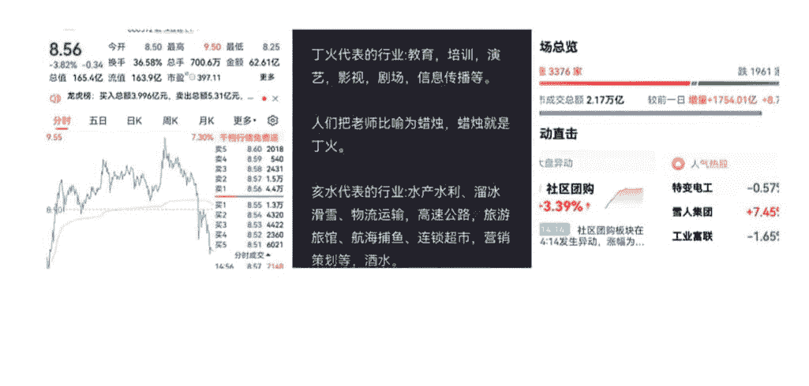

# 鉴茶财经 251110:根据量能看节奏

早上第一篇文章的一部分

市场有一量，基本上是抱团，科技，机构大票的天下，这时调整你是不怕的，市场一量，则是小票，题材，牛鬼蛇神的天下。

如果市场有量，而牛鬼蛇神在涨，还拉的很猛，那大概率是诱多。

量怎么看，每个软件都有大盘的总量，实时给你对比昨天放量还是缩量多少。

个股下面有后，叫做“量比”可以看。

就今天，市场上来是放量1000亿，周五自己2万亿了，那天总体不，题材票还在猛，非奸即盗。

现在日成交2.1万亿了，不建议再去搞妖了，你有那种体质的除外。

平潭今天就是典型案例。

拉起那三浪，浪浪在套人。

这种一头热冲进去。

# 周末易经解读了，套三年。

今天才是传统意义上丁亥月的第一个交易日，丁和亥真涨了啊。

# 如此精准？ 进群加微信cuk255

你们真能涨成月度难题吗

ps，“封建迷信，断不可信”，不擅长打野的不要搞，普通人还是参与主线和ETF最稳妥。

# 评论：进群加微信cuk255

水镜：今天妖清了，扶了科技。

无痕回复水镜：今天敢于扶科技洒的，都是大佬。

水镜回复无痕：有人说过，外面好玩的再玩再嗨，也要回家睡觉，双方都要一个面子。

深度视野VIP群人工追踪50+大V 付费进群微信cuk255 微信ch5556

上善若水：大王能盘中提醒就好好了，低点就把割了上午一直纳，能量放大，牛鬼蛇神还在乱舞。原来下午科技就回来了。

水镜回复上善若水：轮稳了，不到最后一分钟真不好说，只能凭个人经验和精力的。无所谓的心态。

上善若回复水镜：一点点仓位，无所谓的心态，想着下蹲再找机会抱抱，还是你牛”，低位抄底。

水镜回复上善若水：明天也是未知的，巴菲说过的，交易不需要多么聪明，关键在预期内敢不敢出手。

上善若回复水镜：对，纪律很重要，破了我就割，站稳再回来。

娇：大王好，今天的运夭跟这个图形差不多，明天要不要跑啊。

南院大王回复娇：10倍PE，47亿净利润，股息率4.5%，妖股们一条能跟它比?

JIU回复南院大王：啊哈哈。

娇回复南院大王：感谢大王，我就当存银行了。

英子：量比数值越高好吗?

王：我觉得合富平潭明天会涨：

知常：今天才是传统意义上丁亥月的第一个交易日，意味着涉及丁火的票还可以继续持有吗？

南院大王回复知常：都在涨相当继续。

赵子龙：鼎契数智吃了一碗大面。。

EasonJay：大王请教，根据三生万物系列，中宠从6月开始盘整，先后经过34日线和60日线压缩，最近两组线重合，并且34日线开始拐头，今天带量突破，是不是站稳五日平台就可以调整尝试试入？以上理解对不对，烦请大王解惑。

南院大王回复EasonJay：非常正确，激进派可以稳3天就小仓试错，但看两个东西，一个是食品饮料类消费是不是继续在涨，主线是不是真切过来了，二是龙头依旧是不是继续在打高度。

# 深度视野优质集群（链接优质群，助你成功）

全部包含以下内容：限时年费188/年 加微信cuk255

- ① 吃瓜群众倍时圈加时群群对话（原价 365 元/年）
- ② 子明私享汇（含）内部文章
- ③ 政事室（顾明）付费内容再送顾子明群群
- ④ 米联储闲【作者米穗】（原价 599 元/年）
- ⑤ 欧洲金雀会员专属文章（原价 328 元/年）
- ⑥ 砖瓦仁内部圈（原价 400 元/年）
- ⑦ 卢克文青读书会专属文章（原价 699 元/年）
- ⑧ 鉴茶财经知识星球（原价 3310 元/年）
- ⑨ 猫哥的视界知识星球文章（原价 299 元/年）
- 十 财新周【独家新闻】（原价 1498 元/年）
- 十一 杨世光在金钱爆（原价 2200 元/年）
- 十二 蒜森财经知识星球（原价 1600 元/年）
- 十三 潇游异译付费文章（持续更新）
- 十四 司马林解课全套音频和全套收藏版无割（原价 2.3 万）
- 十五 虚构三部曲[民国梦、帝国争合、不被理解的MAO]（原价 599 元）
- 十六 卢克文知识星球文章（原价 268 元/年）
- 十七 额外再送：卢薛元新浪微付费专栏、三村丰老王、三花九洞文集

不定内容：......（更多资源不下去了）......

- ① 守夜人司令星球、接换魔后星球、成达谈论星球、成术花财富、雪球花甲老头等
- ② 创创始笔记、达叔谈论星球、成术花财富、雪球等
- ③ A视野、大树乡谈、江初同学、咩咩说、上海海家等付费文集
- ④ 西凤付费文章、老端、赢在小时之时、局外人的视界、升值、老体制内等其它一些大V付费文章（每月不低于600 元付费文章）

# 限时年费188/年 底部链接链接全网V优质内容

# 深度视野文集进群微信cuk255

深度视野（付费文集）

