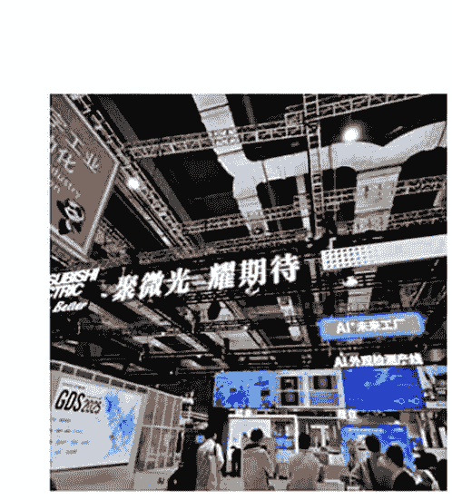

# 鉴茶财经 251111 这两天是重要窗口期

1. 昨天，总龙头英达强势反弹，退早新高的架势，元件更猛，做光芯片的 LITE（对标源杰/仕佳）大涨 8%，做模块的光模块的高谊大涨 7.9%，喷射不言而喻。

今天看大A，如果硬科技，尤其是就是 CPO/PCB 如果大力跟进，那就是预期的资金在进去，开始用仓位进行试探性抄底。

如果仍然滞脉甚至钝化，那就是科技还要调整。

激进的/稳健的/看出态势再做决定的，是不同的博弈选择。博弈只看前排校花，它们龙头溢价有借鉴效应，别人不行。

2. 2.5 万亿，就是牛市门槛，大家看看量即知，回暖该如何，遇冷还如何。

3. 有点让人尴尬的是，美股科技大涨，大A昨天刚加强了高低切，大批资金刚刚冲进了大消费...

那么，昨天大涨的低位区块，尤其是白酒饮料代表的消费，今天如果仍然能顶住，不是砸盘和大跌，甚至继续上涨，那就是真要上桌吃饭的架势。

消费总龙头和观察标：中免，酒鬼/舍得，带连锁二字的，国酒连锁。医美里面面看的：水羊。

对于大消费的观点，我们认为，这是能够持续一段时间的，顺顺顺畅畅的反弹，它不是反转，自然也不会一日游。相比，AI 营销，AI 广告，AI 教育等和新消费能看。进群加微信cuk255。

AI 线目前的机构龙头是 360，蓝牙比较活跃，是不是既旧又有，天意难测，不熟练的普通的不要看，仅供超级高手们自己品鉴。

AI 应用硬要找个 ETF 就软件龙头 ETF。要花钱先看电影 ETF，159855。

消费的总风向看谁呢？港股 PPMT。（不是买啊）

深度视野VIP群 人工追踪50+大V 付费加群微信cuk255 微信cuk255

4. 美股阿特斯大涨 13.8%，这代表老美电力的概念同样得到老美认可，这证明光伏+储能+电网的逻辑依然在走强。

昨天盘后，国内也发智能电网电网设备 ETF 你懂的。

在这个纠结的时期，不同的流派的投资者风格是不一样的。

- 操作流：注重双轮驱动，“科技+低位”，小登，中登，老登，都应该根据两边的态势，决定哪边侧重。目前看，中登电力设备要加强。中登有可能可能变成4季度最稳中有，贯穿到明年的重要支线。因为大盘走的纠结坎坷，上述任何一个驱动板块都不用追高，它一定会给你阴线低吸的机会。
- 产业流：不用关注短期的波动，我们的观点没有改变，这轮牛市的主线它就是科技。昨天我们了解的一个内幕级信息，某逆变器龙头（大家懂的）将获得 Coreweave 的储能订单，要在泰国扩大产能专供，CRWV 是英伟达养儿子，也就是说新能源也会加入 AI 阵营，这下更不能倒了。
- 新手菜：还是做好保险和面前的恒生科，它的本质是（中国核心资产 ETF），中俄互联在 60 天内已经拉起来几天，股市今天不会差。

## 两部门：到2035年将类比新能源的新型电力系统基本建成

国家发展改革、国家能源局发布关于进入消纳转型期的指导意见，其中，2030年，协同的多次清洁能源转型基本建成，支撑接纳电能力增强、灵活性提升、电源侧多元化调节、绿色储能，满足国家每年第20 亿瓦以上新能源消纳需求，助力能源实现两亿瓦以上目标。到2035年，将类比新能源的新型电力系统基本建成，新能源源调控体系一步步完成。

1514期

# 深度视野优质集团（进优质群，助你成255）

全部包含内含：限时优惠188/年 微信cuk255（原价365 元/年）

- 1. 瓜籽吕曾信专属时时文档加送时群群对话（原价 365 元/年）
- 2. 子明私享（会）内部专属（原价 568 元/年）
- 3. 学堂（镜子明）付费内购再送读时期朗锦
- 4. 米联联君【作者米米](原价 599 元/年）
- 5. 欧洲金会专属专（原价 328 元/年）
- 6. 镁广华内部专属（原价 400 元/年）
- 7. 老文君云非书专属专（原价 699 元/年）
- 8. 墨森财经知识星球（原价 3310 元/年）
- 9. 瑞萌的视界视星球（原价 299 元/年）
- 10. 瑞萌的视界视星球（原价 299 元/年）
- 11. 杨世在金钱（原价 2200 元/年）
- 12. 墨森财经知识星球（原价 1600 元/年）
- 13. 源湃异迁付费专属（特惊喜更新）
- 14. 可马联逸运全套豪和无无减（原价2.3 万）
- 15. 伍彦部民国、帝国诸号，不被处理的MAO）（原价 599 元）
- 16. 老克京视星球（原价 268 元/年）
- 17. 额外加赠：沛源六新源湖付费会员、村里老王、三井九文化艺术

深度视野
进群微cuk255

深度视野（付费会员）

不定期规定：更多资源不用下载了......
n守夜人令司令知识星球、接魄魔王知识星球、自财有有知识星球
创始人锐、达达天津论知识星球、致富财富雷、雪花老甲老乞等
杨野、大树杨、江护守、听咏涵、在八小时内、外局人的视界、升值、老
A体制内若干等它一些大V付费会员（每月不超过600 元的付费会员）
限时优惠188/年

低链建设全网V优质内容
深度视野VIP | 人员通道 50+A 付费会员微信cuk255 微信cuk255
