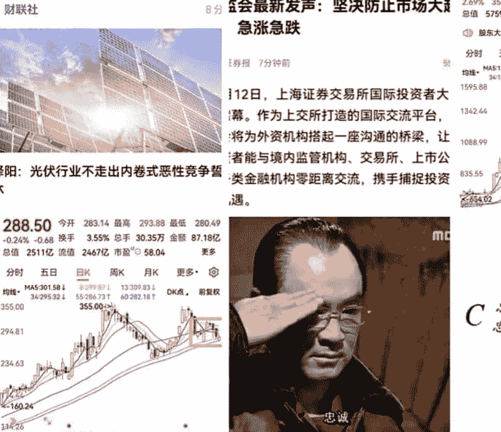
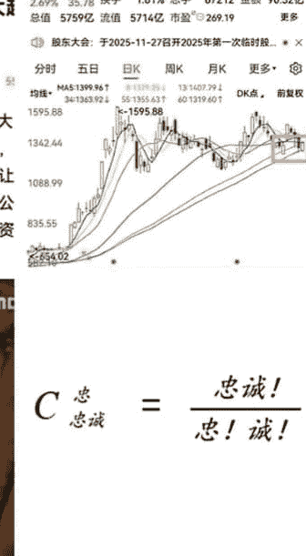

# 鉴茶财经 251112: 忠橙

昨晚英伟达一跃，AI 泡沫的呼声又强了起来。

美帝的 AI 真歇莱了，他们就是 1929-1933 的局，再次也是 2008，他们真敢玩这一出哈吗？

美帝的 AI 泡沫不准破，说的咱们的科技好像就好准破的，兄弟俩谁比准准？

既然大兄弟哥突破 60 日线了，你还有啥怕的，超级级线都学了吧，胜宏 60 日，寒宏 60 日，就问这个理论科学不，校花是不是比后排的强很多？它很想拉一个+5.20%给你。

我们的那些品种，逻辑都是没有问题的，有同学可能纳闷光伏，它们本来就是跌时再进的破旗翻走势，一大涨就跌几天。

今天猛杀，是昨天硅片降价，有资金认为为“反内卷”割菜了，搞笑笑，可是董事长亲笔写过文章的逻辑，PPI涨价就靠它们了。进群微信 cuk255

最惨的 24 年都不停，现在有去去年惨？科技之类一堆明年 20 倍 pe的就不提了，还是那个道理，在外野一圈唱完 KTV 后你回回家。微信pep854

早上为啥要说忠橙，因为很多人一开始都是忠橙的，最后的骨节上上不住了。头铁了半天到最后时刻不铁了。

后面，就看这几个在这个位置稳 5 日平台，然后等 19 日到来。

## 财财经

### 股市大发：暴跌后市场急需政策

急需政策

上海财经

17:32 上沪综指指数大跌，作为操作之后市场急需政策发力，以将外需修复转化为内需。信心与国内市场信心、市场、上市、美联储维持加利率，抚平预期

| 288.50 | 383.54 | 285.65 | 288.68 |
|---|---|---|---|---|
| -0.04% | -0.16% | 3.15% | 3.50% | 8162 | 8167 |

聚焦：光伏行业在内出现业绩显性增长

| 时间 | 开盘 | 最高 | 最低 | 收交 | 成交 |
|---|---|---|---|---|---|
| 09:30 | 288.51 | 289.01 | 287.91 | 288.50 | 390.2 |

C 感 = 感谢！恩感谢感谢! 感谢！

# 深度视野优质社群（链接优质社群，助你成功

全部包含以下内容： 限时年费188/年 加微信cuk255

- ① 吃瓜群众信贷文档实时跟进群粉丝对话（原价 365 元/年）
- ② 子明私享（内）内部内容（原价 568 元/年）
- ③ 直事堂（锦子明）付费内容跟两个粉丝进群群
- ④ 米联储解读【作者林】（原价 599 元/年）
- 澳洲会会员专属社群（原价 328 元/年）
- ⑥转股内部群（原价 400 元/年）
- ⑦ 克文灵音读书会专属社群（原价 699 元/年）
- ⑧ 萧泰财经领知识星球（原价 3310 元/年）
- ⑨ 萌的视角的知识星球（原价 299 元/年）
- ⑩ 新刚新闻【独家新闻】（原价 1498 元/年）
- ⑪ 杨世克在金钱中（原价 2200 元/年）
- ⑫ 森森梓财经知识星球（原价 1600 元/年）
- ⑬ 荔源译付费社群（持续更新）
- ⑭ 可马林软硬件精选全社群书籍锦藏无减割（原价 2.3 万）
- ⑮ 卢虐三说说民国故事、帝国兴衰、未被秒的老王（原价 599 元/年）
- ⑖ 克文灵灵星球（原价 268 元/年）

## 深度视野文集
群微信cuk255

深度视野（付费社群）

限时年费188/年

底部收益跌全大V优质内容

深度视野VIP 加入通道50人+ 付费加入微微信cuk255 微信cuk255
