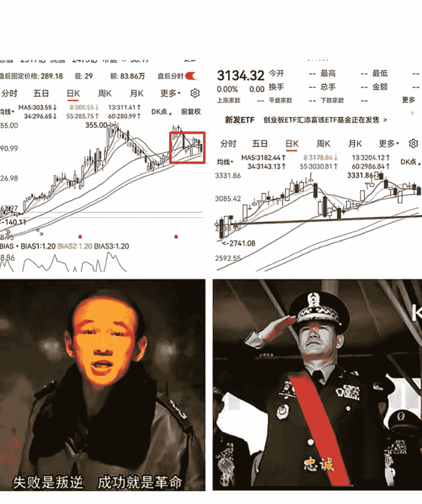

# 鉴茶财经院 251112：考验重要均线

想必这两天你已大概看清了大盘的逻辑，

缩量，涨小票妖股银行，

刚科技跌，双创跌。

部分资金会去试探消费低位，

放量，小票妖股银行跌，

指数涨，科技跌。

开盘半小时你就能看出大概，手机快操作的同学自学已看。

随注意中的突发利好/利空。

这些天大盘的主要任务，就是要修复公募 TMT 占比过高的问题，他们违反协议风格漂移，代价全体承担。

对于新手来说，保险+恒生科技的配置没有问题，你就看南下资金的动作就知道，每天疯狂买买，有点像 2021 年的银行。

喜欢均线组的同学也有明确的选择。

对于波段技术流同学来说，

没有小作文，

胜宏都是要去踩一下 60 日线，

再看中创，34、55、60 也准备相交，考验 34 可能不大，

再看创业板指数，昨天正好是 3143，是 34 日线，

长期均线组的 34、55、60，基本恰好是颈线位。

有人说，那我拿着科技，一直看着要走，

结果没涨，执行力不强，哎，咋办呢？

都这时候了，反而反复横跳头部吗，要继续铁，要么宁肯继续轻仓也要等主线，是否也是一种差的选择？

19 英伟达公布业绩，大概时候双创都要考验颈线位，你真要规避的，是那种趋势形成后的东西。

跌穿了就是 M 三重顶，

不跌穿就是王后功臣。进群加微信 cuk255

要跌穿支撑，要放拉升。

# 用小将当年的话，

# 失败了那就是叛国，成功了就是革命。

深度视野 VIP 群 人工追踪 50+V 付费群加微信cuk255 微信 chp5568

# 深度视野优质集团（链接优质社群，助你成功）

全部包含以下内容：限时年费 88/年 加微信cuk255

- 1 吃瓜群众倍时圈微信加时群对话（原价 365 元/年）
- 2 子明私享汇（内部）优质文章
- 3 政事室（顾子明）付费内容内再送子明群聊
- 4 米联锦兜【作者米楼】（原价 599 元/年）
- 5 欧洲金雀会员专属文章（原价 328 元/年）
- 6 砖瓦斥内部圈文（原价 400 元/年）
- 7 卢文青读书会专属文章（原价 699 元/年）
- 8 鉴茶财经知识星球（原价 3310 元/年）
- 9 猫哥的视界知识星球文章（原价 299 元/年）
- 10 财新周【独家新闻】（原价 1498 元/年）
- 11 杨世在金钱塔（原价 2200 元/年）
- 12 森森财经知识星球（原价 1600 元/年）
- 13 激源译异付费文章（持续更新）
- 14 司马林解读目选全套音频和全套书籍版权无损（原价 2.3 万）
- 15 虚虎三部曲[民国梦、帝国争霸、不被理解的 MAO]（原价 599 元）
- 16 虎克知识星球文章（原价 268 元/年）
- 17 额外再送：卢祺新微博获付费专栏、三丰老王、三花九树文集
定期内容：......（更多资源不下去了......

- ① 守夜人知识星球、接换魔王后星球、成术财富圈、雪球花甲头等
- ② 创始星球、达叔译论星球、成术财富圈
- ③ 视野、大树乡谈、江初荷、泮咩说、上海海学等付费文集
- ④ 西风付费文章、老端、赢在八小时之外、局人的视界、升值、老A等等其它一些大V付费文章（每月低于600 元付费文集）

# 深度视野文集
群微微信cuk255

深度视野（付费文集）

# 限时年费 88/年 低成本链接全网大优质内容

十五
