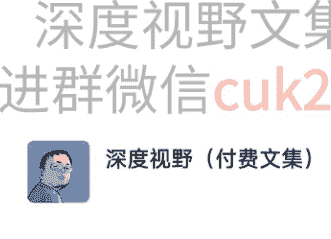

# 鉴茶财经 251113: 汤恩伯出手

如何，坚守到今天拂晓？

村里严令下，大盘冲击了 4025。

市场在两条线上开展反攻，

一条是储能，海博思创公告要找宁未来 3 年买 200GW 电芯，这也是学坏了，学 OpenAI 跟英伟达左脚踩右脚啊。

宁王作为我们看好的世界公司，再次验证了那句话，如果不知道买什么，就买 CATL。

宁王今天，正好是回踩 34 日线？

光储的逻辑就不赘述了，AI 强化了储能，弹性大的锂电材料专门给大家谈谈，尤其是永太代表的氟化工，德方、富临代表的铁锂等，走紧缺涨价格线。

磷酸铁锂可以低端的储，高端的车都用三元，n 侧面验证消费不行。这些材料涨到时候？产业实现是春节前，股市就看龙头和催化。进群加微信cuk255

最后必然涨到电芯，就那几家。

一条是科技，

昨天都快明牌了，今天一早再砸光模块 pcb，昨天扫底的资金卖出而已，继续考验你的忠诚用的。

尾盘了 AI 应用，我们看好的即蓝标和三六零，因为阿里出了 AI 助手手机，全面对抗 ChatGPT。

阿里如果继续开支，就会利好算力硬件，后面看哪个大厂跟后面的储能会不会接棒主线，两三天就能看出，大概将是我们拭目以待。

又要把 2021 年的重新做一遍。

# 阿里巴巴-W
09988 港股通

164.500 今开 153.900 最高 166.000 最低 153.300
4.91% 7.700 换手 0.52% 总量 9943万 金额 156.9亿
总值 3.14亿 市盈 19.77 净值 2.80 更多

相关港股（人民币计价）:150.500 4.88%

# “锡矿铁链”五大上市公司市收（亿元）及同比增长对比

| 上市 | 市收（亿元） | 同比增长 |
| :--- | :--- | :--- |
| 湖南能 | 46.3 | 46.3% |
| 龙瑞科技 | 58 | 2.9% |
| 德方矿业 | 60 | -7.6% |
| 万源能 | 73 | 51.2% |
| 安达科技 | 22.7 | 109.0% |

南院大王 251110:

有资金在不断搞化工，化工里没错最难的就是 PVDF。

同样受于价格上涨暖的还有谁呢？磷。当年磷锂，大家已经搞过天锋了，磷的云天化，9倍 pe，4.6%股息率。生产队和长期资金喜欢的类型。

- 同样还有铁锂材料。

德方纳米，宁王核心供应商，当年是大牛，后来一调整，

富临精工也能看，它还有华为的机器人概念。

这里的龙目前是湖南湘能，离已达68，它跌破5日平台后就得注意了。

# 深度视野优优质文集团，助你成功

全部包含以下内容：限时188/年 加微信cuk255

- 1. 吃瓜群众私享售书文章时群对话（原价365 元/年）
- 2. 子明私享（会）内部文章再读圈子明轩
- 3. 政策党会员专属文章（原价568 元/年）
- 4. 米联联财富集【作者米程】（原价599 元/年）
- 5. 欧洲全会员专属文章（原价328 元/年）
- 6. 元华内部购文（原价400 元/年）
- 7. 卢克文优专属文章（原价699 元/年）
- 8. 姜某财经星球（原价3310 元/年）
- 9. 猫猫的视界星球（原价299/年）
- 10. 大财新周刊【独家新闻（原价1498 元/年）
- 11. 杨世全金豪（原价2000 元/年）
- 12. 森霖梓财经星球（原价1600 元/年）
- 13. 湘源付费文集（持续更新）
- 14. 可马林畅解全章古书锦藏原版无删减（原价2.3 万）
- 15. 卢虔三卖书【民王朝、帝国后轮，不理解的MAO】（原价599 元/年）
- 16. 其他（原价268 元/年）

另外外：卢某微信源付费集，三末欢老号、三九树文集不定更新：

- 1. 守农人全识星球、拨捷牛王优识星球、生有财富知识星球
- 2. 创始锐、达达添演视星球、成财富帝国、雪花甲头签
- 3. A视野、大树横、江宁好、呼咏、悦上海学等付费文集
- 4. 亿体系内等其它一些大V付费文集（每月不低于600元的付费文集）

# 低成底全大V优质内容

深度视野VIP 人工诸路50+大 付费群加微信cuk255 chop9558 闲妹
