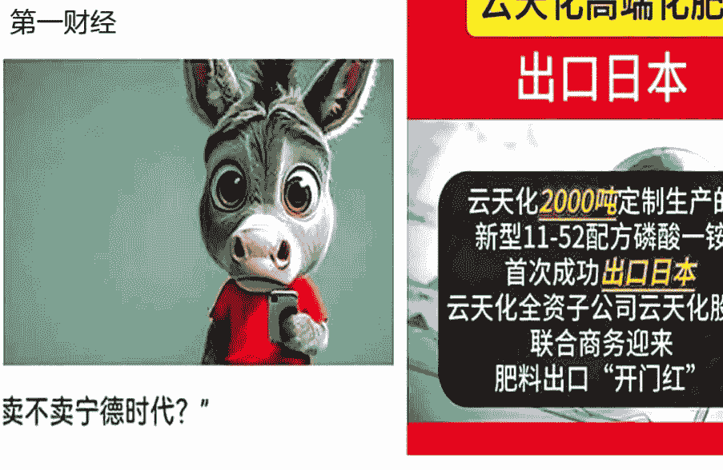

# 鉴茶财经 251117: 等待 19日

周末的整个消息面是偏利的，

美股不景气，AI 泡沫论盛行，一大堆减持，和本子这一出，影响本就首鼠两端的大资金。

于是是，很多人普遍看空。

这种环境利好什么？各种题材概念，海峡军工。

对日 battle，可能要比对美 battle 的时间要长。

还是来说几个产业：

- 锂电与材料：
宁王的黄世林减持 100 多亿，都认为此是达高套现，他 21 年起就不怎么管事了，干哈去去了，搞储能，亏了一堆，拿钱去继续干储蓄。
储蓄已经是一个新的风光储蓄周期，替代的是过去的新能源车。
我们认为，宁王之类的砸下来，会又是一个黄金坑的机会。
先观望两天，等它们企稳。
电池 ETF 很多，只要持仓没有亚的均可。可以关注的是 562880。

- 出来的资金可能去哪里：
弹性的，可能会之前讲的 pcs，你百度或者查一下就知道，上能、盛弘那几家。
求稳的，大概率是那三家光伏，其中以 TCL 带着头，毕竟二增长曲线是半导体。
图形上，光伏大的长期均线向上，趋势并没有破坏。
储能为什么是一个新周期，昨天隆基正式收购了苏州精控就是证明，其实早年我一直把精控卖给 CATL。

今天观察 pcs 和光伏，就能看出资金的态度。进群微信cuk255

这里依然能看有磷矿那两家，云天化、兴发集团。不光是它们的磷酸铁锂能做储能，日本的磷肥 90% 都是进口。至于国联水产，高手们自己看。

- 还有同学们关心的科技：
最大的问题是集中度过高，本轮最高是从 9 月 24 日的 41.32%，11 月 14 日大约在 26% 左右，起码也是风险释放进程过半了吧。
就看 11 月 19 号左右的“中考日”。真要是当强不强则为弱，跌破中期线组，操作流玩家你大了先走来年再战。

巴菲特等人都在大买入谷歌，既有卡又有应用，还有生态，它可能领涨新一轮硬科技。

## 之前谈过国内最像谷歌的，就是阿里

- 鉴于 4000 点上下反复拉锯，有仓位的可以继续空着观望，会玩同学可以去搞创业板 50 ETF、上证 50 之类，大幅低是机会，大跌 2-3% 在尾盘时都是机会，分批买入，拉高或者反弹一把卖出。这不让暴涨暴跌吗，套利的机会。虽然利较多，但不用过于悲观，被几百枚核弹头描着的本子而不是咱们，已经一米大八的小伙子，心里总要成熟起来。

既然涉及到日本的问题，用教员当年的理念解释，最妥当不过了。既不会亡国，也不会速胜。最终的胜利终将属于我们。不知道有什么好恐慌的，

## 难道现在比 1937 年还差?

第一财经

云天高端化肥出口日本
云天 2000 吨定制生产的新型 11-52 配方磷酸铵首次成功出口日本
云天全资子公司云天化股份联合商务迎来肥出口迎“开启门”

卖不要妥德吗？

## 深度视野优质集团（链接优质社群，助你成功）

全部包含以下内容：限时年费 188/年 加微cuk255

- 1 群众群包信实文文档时群群对话（原价 365 元/年）
- 2 子明私享（内部）（原价 568 元/年）
- 3 政策观（犀明）
- 4 美联债（作者甲）（原价 599 元/年）
- 5 欧洲会专属文章（原价 328 元/年）
- 6 转瓦内部圈（原价 400 元/年）
- 7 广文书专属文章（原价 699 元/年）
- 8 袁泰财经锐识星球（原价 3310 元/年）
- 9 福娜的锐识星球（原价 299 元/年）
- 10 新财周独家新闻（原价 1498 元/年）
- 11 杨生光在钱锋（原价 2200 元/年）
- 12 森森财经锐识星球（原价 1600 元/年）
- 13 涯源译文章
- 14 司马韩禁读全书籍珍藏版无删减（原价 2.3 万）
- 15 邵虚陈内部帝国与历史，未被理解的规律（MAO）
- 16 古克文锐识星球（原价 268 元/年）

深度视野文集 微信cuk255

* 外颖：苏凯新南德利付费、村西老王三、三九九系统不定期内容：更多资源没写下了……
• 守护人知识星球，挑选优质知识星球，财经财有知识星球
• 创始创锐、达达通读知识星球、成富财富圈、雪球财经甲老头等
• A视野、老大乡伶、汇京昕、听咖、成富老师、上海学士等、老A体系内等其他一些大V付费收费（每月不低于600 元的付费收费）限时年费188/年 低成本搭建大V优质内容

A体系内等其他一些大V付费收费（每月不低于600 元的付费收费）大V资源综合，全年年费 3000 元，现仅享 249 元，包含以下内容：

深度视野VIPVIP人进之路50+ 付费加微信cuk255 微信358
