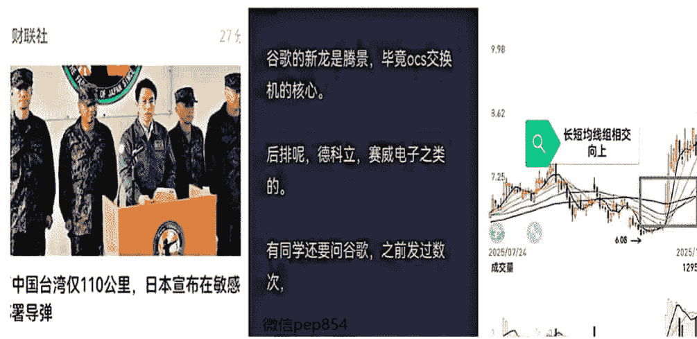

# 鉴茶财院 251124: 噢，两个方向

3820 附近拉起来，good。

早上的技术图形讲的非常详细，对号入座就行。

大 A 历来是结构性牛，一指的两个方向，科技的独苗谷歌链，科技的落地 AI 应用。11 月初反复提应用，压力是很大的，但真咨询了有关部门的朋友，并专门标的朋友问了下。

今天蓝标险 20cm，不愧是丁世小王子，机构买的 360 大家都知道，早上突击进去了谷歌受益的省集团。印象很深刻的是莹桃丸子等同学早早进行了“高切低，硬切软”，想必有段时间是难熬的。现在可是能松松气了。

谷歌的先遣图就不述了，OSC 的龙头当然是景象，四小龙补涨，中字很流畅，硬科技和英伟达交集的差点会受累，自己专属都很强。

复联跌才抱团瓦解，小作文是催化，瓦才是 AI 跌出性价比的开始。服务器有啥技术含量，这帮机构抱大妈也是醉了。软件龙头 ETF 的同学们真是太辛苦了，那叫一个愁，恒生科技也是。

## 全球 AI 叙事转向应用，恒生科技是应用。

真的是很服主力们，小本子在岛上部署个导弹，你怕怕，大盘都险些砸绿。

得，方向也得再加个军工了，手快的同学应该是新闻盘中上才对。进群加微信cuk255。

那个地方我们根本不用导弹，火箭炮都能打过去。

深度视野VIP 群 人工追踪 50+大 付费群加微信cuk255 微信vip5568

## 评论：进群加微信cuk255

iz: 妇联还重仓在里面，是不是要看情况割了？

南院大王回复 iz: 早说过它是大妈，等个反弹修复，今天确实小作文影响了。

水镜回复南院大王：还有事实性的利空，部分产业转移回老美了吧，最近鬼故事多了。

南院大王 回水镜：主要富士康的大本营在岛上，不能深想。

水镜：军工业绩又预期一波了。

南院大王回复 水镜：AI军工，新质生产力军工。

糖包回复 南院大王：请教大王 AI 军工是哪些？

水镜回复 南院大王：有可能拉一把 5 浪。

大元：请教大王，寒王，亮杰，中际还能继续扛着吗？

火星情报局回复大元：我也重仓这三个，又不会做 T。

南院大王 回复 大元：盘面看还比较强。

波波 大王，国庆之前我入了华工和鹏鼎，到今天分别亏 20% 和 30%，把今年的利润都亏完了，再亏又要亏本金了。这两货什么时候能止跌回升吗，我的利润还能回来吗？

斌回复波波：我也想知道。

南汐大王 回复波波：看图形就跌穿线组或者 20 日线走人，等两个线相交向上再对接回来，看产业就不要在短期内波动，既又要犹豫纠结了。受不了就趁反弹把仓位控制到自己能接受的位置。

水镜：应用今天有一致高潮了，要调一下了。

lwm：请教大王，亚仓，胜宏，阳光还能挺着吗？图形走坏了但是对这几支信心十足。

水镜回复 lwm：羁绊和执着是投资大忌，心不死道不生，哪怕巴菲都割过航空股。

lwm 回复水镜：受教了。

水镜回复 lwm：赚钱的股，一定不要亏着走，你真要和股票谈谈恋爱结婚？

lwm 回复水镜：不能和票子有感情，对这几支期望太高了，这跟抬头的有点狠，绝对绝杀，恐痛割。

水镜：妇联还重仓在里面，是不是要看情况割了？

南院大王回复 iz: 早说过它是大妈，等个反弹修复，今天确实小作文影响了。

水镜回复南院大王：还有事实性的利空，部分产业转移回老美了吧，最近鬼故事多了。

南院大王 回水镜：主要富士康的大本营在岛上，不能深想。

水镜：军工业绩又预期一波了。

南院大王回复 水镜：AI 军工，新质生产力军工。

糖包回复 南院大王：请教大王 AI 军工是哪些？

水镜回复 南院大王：有可能拉一把 5 浪。

大元：请教大王，寒王，亮杰，中际还能继续扛着吗？

火星情报局回复大元：我也重仓这三个，又不会做 T。

南院大王 回复 大元：盘面看还比较强。

波波 大王，国庆之前我入了华工和鹏鼎，到今天分别亏 20% 和 30%，把今年的利润都亏完了，再亏又要亏本金了。这两货什么时候能止跌回升吗，我的利润还能回来吗？

斌回复波波：我也想知道。

南汐大王 回复波波：看图形就跌穿线组或者 20 日线走人，等两个线相交向上再对接回来，看产业就不要在短期内波动，既又要犹豫纠结了。受不了就趁反弹把仓位控制到自己能接受的位置。

水镜：应用今天有一致高潮了，要调一下了。

lwm：请教大王，亚仓，胜宏，阳光还能挺着吗？图形走坏了但是对这几支信心十足。

水镜回复 lwm：羁绊和执着是投资大忌，心不死道不生，哪怕巴菲都割过航空股。

lwm 回复水镜：受教了。

水镜回复 lwm：赚钱的股，一定不要亏着走，你真要和股票谈谈恋爱结婚？

lwm 回复水镜：不能和票子有感情，对这几支期望太高了，这跟抬头的有点狠，绝对绝杀，恐痛割。

水镜：妇联还重仓在里面，是不是要看情况割了？

南院大王回复 iz: 早说过它是大妈，等个反弹修复，今天确实小作文影响了。

水镜回复南院大王：还有事实性的利空，部分产业转移回老美了吧，最近鬼故事多了。

南院大王 回水镜：主要富士康的大本营在岛上，不能深想。

水镜：军工业绩又预期一波了。

南院大王回复 水镜：AI 军工，新质生产力军工。

糖包回复 南院大王：请教大王 AI 军工是哪些？

水镜回复 南院大王：有可能拉一把 5 浪。

大元：请教大王，寒王，亮杰，中际还能继续扛着吗？

火星情报局回复大元：我也重仓这三个，又不会做 T。

南院大王 回复 大元：盘面看还比较强。

水镜：妇联还重仓在里面，是不是要看情况割了？

南院大王回复 iz: 早说过它是大妈，等个反弹修复，今天确实小作文影响了。

水镜回复南院大王：还有事实性的利空，部分产业转移回老美了吧，最近鬼故事多了。

南院大王 回水镜：主要富士康的大本营在岛上，不能深想。

水镜：军工业绩又预期一波了。

南院大王回复 水镜：AI 军工，新质生产力军工。

糖包回复 南院大王：请教大王 AI 军工是哪些？

水镜回复 南院大王：有可能拉一把 5 浪。

大元：请教大王，寒王，亮杰，中际还能继续扛着吗？

火星情报局回复大元：我也重仓这三个，又不会做 T。

南院大王 回复 大元：盘面看还比较强。

水镜：妇联还重仓在里面，是不是要看情况割了？

南院大王回复 iz: 早说过它是大妈，等个反弹修复，今天确实小作文影响了。

水镜回复南院大王：还有事实性的利空，部分产业转移回老美了吧，最近鬼故事多了。

南院大王 回水镜：主要富士康的大本营在岛上，不能深想。

水镜：军工业绩又预期一波了。

南院大王回复 水镜：AI 军工，新质生产力军工。

糖包回复 南院大王：请教大王 AI 军工是哪些？

水镜回复 南院大王：有可能拉一把 5 浪。

大元：请教大王，寒王，亮杰，中际还能继续扛着吗？

火星情报局回复大元：我也重仓这三个，又不会做 T。

南院大王 回复 大元：盘面看还比较强。

水镜：妇联还重仓在里面，是不是要看情况割了？

南院大王回复 iz: 早说过它是大妈，等个反弹修复，今天确实小作文影响了。

水镜回复南院大王：还有事实性的利空，部分产业转移回老美了吧，最近鬼故事多了。

南院大王 回水镜：主要富士康的大本营在岛上，不能深想。

水镜：军工业绩又预期一波了。

南院大王回复 水镜：AI 军工，新质生产力军工。

糖包回复 南院大王：请教大王 AI 军工是哪些？

水镜回复 南院大王：有可能拉一把 5 浪。

大元：请教大王，寒王，亮杰，中际还能继续扛着吗？

火星情报局回复大元：我也重仓这三个，又不会做 T。

南院大王 回复 大元：盘面看还比较强。

水镜：妇联还重仓在里面，是不是要看情况割了？

南院大王回复 iz: 早说过它是大妈，等个反弹修复，今天确实小作文影响了。

水镜回复南院大王：还有事实性的利空，部分产业转移回老美了吧，最近鬼故事多了。

南院大王 回水镜：主要富士康的大本营在岛上，不能深想。

水镜：军工业绩又预期一波了。

南院大王回复 水镜：AI 军工，新质生产力军工。

糖包回复 南院大王：请教大王 AI 军工是哪些？

水镜回复 南院大王：有可能拉一把 5 浪。

大元：请教大王，寒王，亮杰，中际还能继续扛着吗？

火星情报局回复大元：我也重仓这三个，又不会做 T。

南院大王 回复 大元：盘面看还比较强。

水镜：妇联还重仓在里面，是不是要看情况割了？

南院大王回复 iz: 早说过它是大妈，等个反弹修复，今天确实小作文影响了。

水镜回复南院大王：还有事实性的利空，部分产业转移回老美了吧，最近鬼故事多了。

南院大王 回水镜：主要富士康的大本营在岛上，不能深想。

水镜：军工业绩又预期一波了。

南院大王回复 水镜：AI 军工，新质生产力军工。

糖包回复 南院大王：请教大王 AI 军工是哪些？

水镜回复 南院大王：有可能拉一把 5 浪。

大元：请教大王，寒王，亮杰，中际还能继续扛着吗？

火星情报局回复大元：我也重仓这三个，又不会做 T。

南院大王 回复 大元：盘面看还比较强。
