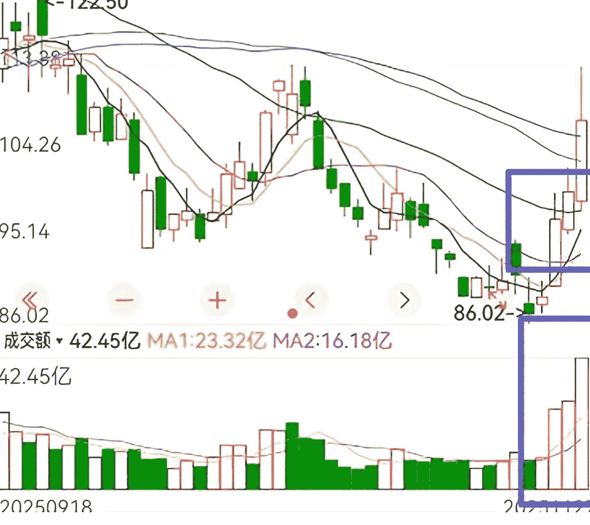

# 鉴茶财经 251127: 量价关系与几个案例

所有的价格，本质都是量能的最终反应，

是量能运动的结果。

所以，量在价先。

今天量能在 1.7 万亿，

所以这个角度说，量能已经接近见底。

后面的价格即使再波动，差不多了。

最后讲两个《三生万物》的案例：

11 月 25 日，5 日线上穿 8 日线，量能 25 亿，相比最近 8 亿 9 亿成交 2.5 倍以上，明显放量，

11 月 26 日，昨天，盘中恢复 34 日线，放量到 28 亿，今天大涨，主要也受到科技化，太辰光是康宁的供应，间接供货谷歌，另一个长飞光纤差不多，25 日，收复 34 日线，也有谷歌光纤概念。

讲这个并不是要大家去追高买，而是学会看点抄底结构的几个要点：

一是图形，走得出样子，

二是量能，不能太小，最好比低点盘整期高 2 倍以上，

三是要空间，最好调整出了部分上升空间。

四是要催化，有信息有政策，市场的注意力吸引了过来。

所以各位，当热点切换过来，前排龙头打开了高度，你不了手，可以看技术图形和量能，博一下预期。

或者提前看好有关图形和储备，一听到较大的消息或者政策，手快动起来。进群加微信同学们学会了吗？

可以再看什么呢，创新药。有些已经图形有点端倪，但量能太不够，看先走出来的。

评论：

水：大王，按照所学的。萝卜周二两倍量，然后逐渐缩量，均线也是有契合，图形上看是符合吗？

南院大王回复水：还没有收复 34，量能太不够，估计还得磨磨。

文武回复 南院大王：那个量能够够是不是以为参照物呢？是以前一天为参照物还是以前高放量的为参照

水回复南院大王：问问。这个量能够是以什么标准？比哪一天的交易量，还是那个压力位的交易量，我看它的成交量前面应该是基本一个月最大的

南院大王回复水：一天不够诚意，起码有两个三天，你看看它的红柱不够长

斌 回南院大王：大王那英皇是不是这样要等他回复 34 再下手

南院大王回复：它昨天收回复了，有点遗憾量不能太够，英皇的主要问题，而是太强了，基本没跌，时间空间太不够，这短时间如果再回踩且不破 20 周线的 65 更好。

胡福：创新药可以直接看港股创新药 ETF 吗

南院大王回复胡福：可以

莹桃小丸子：请问大王瑞芯微分析 5 日上穿和 13 日，今天站上 34 线，这两天能量红柱子也长。它符合抄底的条件了吗？

南院大王回复莹桃小丸子：优秀，有那么点意思了，激进的可以在一天冰点建观察仓，稳健的再磨一磨，等 55.60 贴近一点更好，然后你再看看近 AI 眼睛并没有什么会或者政策，盯着看它。

水镜：明天就看看机器人能不能表现一下，轮冒烟了。

王超回复水镜：老师，东伟达出了吗，我还留了一半幅

水回复王超：下午做了 T，有可能双顶，留了底仓。底仓在。

黄糖：大王,根据所学，长志博创今天验了压力位 117, 短线组都穿了长线组,后续是否可短期看 132 位置

| 指标项目 | 数值 |
| :--- | :--- |
| 开盘 | 107.50 |
| 收盘 | 99.00 |
| 最高 | 113.22 |
| 最低 | 98.00 |
| 涨跌 | 7.51% |
| 换手 | 20.57% |
| 总手 | 39.53万 |
| 金额 | 42.45亿 |
| 总值 | 244 |

| 状态 | 数值 |
| :--- | :--- |
| 涨幅 | 7.51 |
| 换手率 | 20.57% |
| 总手 | 39.53万 |
| 金额 | 42.45亿 |
| 总值 | 244 |

| 状态 | 数值 |
| :--- | :--- |
| 涨幅 | 7.51 |
| 换手率 | 20.57% |
| 总手 | 39.53万 |
| 金额 | 42.45亿 |
| 总值 | 244 |

# 深度视野（VIP）

# 深度视野（VIP）

# 深度视野（VIP）

# 深度视野（VIP）
