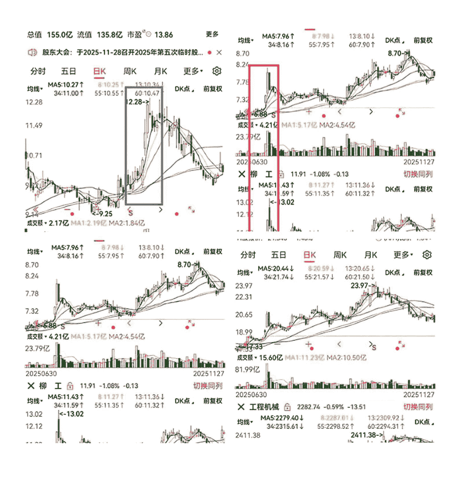

# 鉴茶财经 251128: 谈一谈股性

前两天讲俄乌停战，提到了工程机械，这是题材概念。

昨天在隔壁讲了《工程机械新周期》，我们用几个案例，来体验一下什么是股性。

1. 提起机械你首先会想起三一重工，中国卷王，业绩确实可以，但它的走势，和工程机械板块相比，明显弱。三一早就破 60 日线，板块强势横盘，如果你再切换到周线，更容易理解。

2. 我们再看徐工机械，走势还，但三个月内，从无 7%以上大涨。缺乏大涨历练，也不行。

3. 中联重科，有 8%以上大涨，然而，没有涨停，跳高开缺口只有一个。相比的柳工，有涨停，有两个跳高开缺口。

4. 恒立液压，在 11 月 21 日，大盘破 60 日线，跳低开的时候，它逆势反涨了 2.69%。关键时候护盘。

5. 工程机械属于周期行业，温吞慢涨，很少有一个礼拜飙升快 30 个点，哎，山推股份就能，搞出一波主升浪。进群加微信cuk255

看到这里你已经对波动性有了理解：

- 个股走势要强于板块走势
- 最近要有涨停经历
- 关键时候能够抗跌
- 跳高开且不补，越多的越好
- 最好玩过主升浪模型，一把爽爱起来。
- 波动幅度越小越好，别搞得人心受不了了。

ok，柳工的国际化 40%以上，尤其在一带一路发展不错，12 倍 pe；山推的 AI 智能化搞得不错，电动化领先，后机细分龙头，13 倍 pe；恒立抗跌且有主力护盘，行业龙头。

工程机械 etf=柳工+山推+恒立。

看起来，什么时候可能迎来较好的点？消化消化，最好是大盘回调一杀，12 月上旬再。微信cuk255

现在关注起来。

至于你来说大盘怎么走？

重要结论忘了吗？

有中签摩尔同学了吗？

# 大胆拿着它，砸了就跑一部分。

深度视野VIP 人工追踪50+大 付费加群微信cuk255 微信chp5568

# 深度视野优质圈（链接优质社群，助你成功）

全部包含以下内容：限时年费188/年 加微信cuk255

+ ① 吃瓜群众倍时圈加时群群对话（原价365 元/年）
② 子明私享汇（含）内部文章
③ 政事室（顾子明）付费内容加送顺子子明群
④ 米联储美圈【作者米穗】（原价599 元/年）
⑤ 欧洲金雀会员专属文章（原价328 元/年）
⑥ 砖瓦斥内部图文（原价400 元/年）
⑦ 卢克文青学读书会专属文章（原价699 元/年）
⑧ 鉴茶财经知识星球（原价3310 元/年）
⑨ 猫哥的视界知识星球文章（原价299 元/年）
⑩ 财新周【独家新闻】（原价1498 元/年）
⑪ 杨世在金钱圈（原价2200 元/年）
⑫ 森森财经知识星球（原价1600 元/年）
⑬ 激源异译付费文集（持续更新）
十四 司马林解读全套音频和全套书籍收藏版无删减（原价2.3万）
十五 虚彦三部曲[民国梦、帝国统治、不被理解的MAO]（原价599 元/年）
十六 卢克文星球文章（原价268 元/年）
十七 额外再送：卢户元新浪微付费专栏、米斯特井老王、三花杭州文集

不定期内容：（更多资源不写去了）......
① 守夜人司令知识星球、接换魔星球、成术星球
② 创始星球、达叔谈论星球、成就财富圈、雪花甲老头等
③ A视野、大树乡谈、江宁后、泮说、上海家学等付费文集
④ 西风付费文章、老端、赢在八小时之外、局人的视界、升值、老A体制内等等大V付费文集（每月低于600 元的付费文集）
