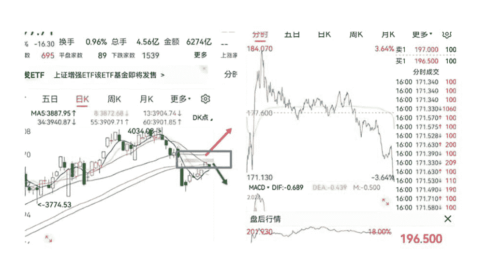

# 鉴茶财经 251202: 肃

一看平潭发展涨停，合富，海峡，人民同泰，得，妖股时间，今天没戏了。

不肯一步到位，就得磨一磨。

我们要看出谷歌链的韧性，以及端侧 AI 的继续保持。

ocs 四赛龙轮上涨，今天赛微 AI 值也快快120了，它本来是家里 PE 值最低的。

谷歌扩散的硬件，旭创，提到的之类不提了，端侧模块的带带宽和吞吐接很强，就说明端侧AI不会是一日游。

美股的 Credo(CRDO)，业绩爆表后盘大涨14%，同学们可以搜一下它主营业务的，中国主要供应商是谁，又和哪些上市公司是同行。

大盘今天很有意思，恰好收在13日线的位置，明天就会有两个方向，一个是补上缺口，去恢复3926，一个是是回调3816一线（位置可能没那么）形成一个 w，然后再拉上去，创造新高。

你觉得会继续 V 还是 W 呢？

拿稳主线，大盘就只是给你制造波动的

评论：
- 水镜：W 的概率大，机构已经用脚投票了，情绪投机明天也要寂寂的
- 南院大王回复水镜：情绪机6 号前要跑光
- 水镜回复南院大王：还好美的，从从容容
- 文武：回踩吧，都没啥量支撑大盘上攻，而且也要有主线了
- 可可：V 不回去去创新低整个瑟瑟发

王艺橙：wind 没有找到 A 有供应关系，主要是在台湾地区，Credo Technology (CRDO)是一家总部位于美国、研发与运营高度依赖中国供应链的半导体公司，其核心业务聚焦于人工智能与数据中心高速互连解决方案，主要产品包括电源电缆(AEC)、光 DSP芯片和SerDes Chiplet 及 IP 授权服务。公司为美国上市公司，但与中国在制造、人才与市场存在深度关联。与中国关联的核心维度：
- 制造与供应链：公司采用无晶圆厂（fabeless）模式，100%依赖台积电（TSMC）进行晶圆代工，封装测试由 Amkor/ASE 完成，其制造产能全部位于中国台湾地区。
- 人才布局：截至2025年5月3日，公司全球622名员工，337名工程师位于亚洲（主要为中国及周边地区），技术团队高度集中于中国。
- 市场收入：2025财年，香港地区贡献56%的营收（2.44亿美元），美国市场占15%，显示其客户结构高度依赖亚太超大规模云厂商。
- 知识产权：公司拥有48项中国专利，覆盖SerDes、网络电缆等关键技术，表明其在中国进行实质性研发与专利布局。

截至目前，根据Wind提供的参考资料，中国A股中无明确信息显示公司直接为Credo Technology提供供应链供应或建立正式Credo 的供应链主要依赖集成电路及 Amkor/ASE（封装测试），其客户集中于全球超大规模云厂商，目前公开资料未披露其与中国 A 股企业的直接采购或技术合作。

- 胡福：豆包是兆龙互联
- Piaoyi：Credo 专注于为人工智能、云计算、超大规模数据中心等领域的高速互连芯片、电缆及解决方案，是全球高速连接技术的重要供应商。那就是北方主域核心产品

-小米：这两天拿起源杰有点老火，一跌，感觉不知道什么时候是底
重庆污水泥回复：小米：随时可以给你露个大长腿
小回回复重庆污水泥：大长腿，这两天本来都有点尴尬

天谢了，头一回买这股，就被套起来了，这几天磨麻完，不过借你吉言，争取给我来个大长腿哈

- Allen: 兆龙互联?
- Allen: 博创瑞可达有竞争
- 无常：豆包的结果：Credo（股票代码 CRDO）是全球领先的高速连接解决方案供应商，主营业务为研发和销售光、电以太网应用的高速连接产品及技术，核心产品包括电源线缆（AEC）、DSP芯片、重定时器、SerDes 小芯片、端口速率覆盖100Gbps至1.6Tps，产品主要应用于 AI 数据中心、云计算、5G等领域，其中AEC市场份额接近73%，是其核心收入来源。

Credo的中国主要供应商集中在高速铜缆及连接器领域，具体包括：
- 兆龙互联（300913）：Credo的核心代工商，为其量产400G高速铜缆产品，800G高速铜缆组件，处于批量试样阶段，也是英伟达核心供应商。
- 瑞可达（68880）：与中际旭成立合资，未来有望进入AEC领域，同时是特斯拉核心供应商。
- 潮起科技（68008）：在 PCIe Retimer领域技术领先，是Credo在高速接口领域的同行。
- 博创科技（300548）：在800G DAC铜缆领域，通过英伟达认证，与Marvell合作，是Credo领先。
- 华华科技（68629）：在国产数据中心高速传输需求中，是Credo在高速连接领域的竞争。
- 沃尔核材（02130）：子公司在400G/800G高速铜缆领域，适配Credo在高速连接领域的竞争。

Amey：看来看，都看不上，我想买旭创，清仓出来
唯玉：大王好，有买中证小盘量化私募。请问是否要撤回，还是拿到中证春节节？想听大王对于中小盘股走势的分析。

- 南院大王：这个时间段，很多私募化要出手手里的东西。随着机构再次进场，题材逐步熄灭，小微盘即将消失，这几天的余晖了。
- 匿名用户：大王你好，我是公众号铁粉，最近面临职业选择的问题。我是一个普通毕业生，想问大王哪个方向更有前景？高真空，北方华创，盛这种，温度均匀很好，代表28nm以下的进制程。总体上，你还是要看公司的方向和老板的决心，如果决定了，资源就会倾斜，你就要抓紧提前，主动表达，积极表现，争取被定为典型。没怕，公司是做半导体刻蚀设备，现在的主营业务是。
