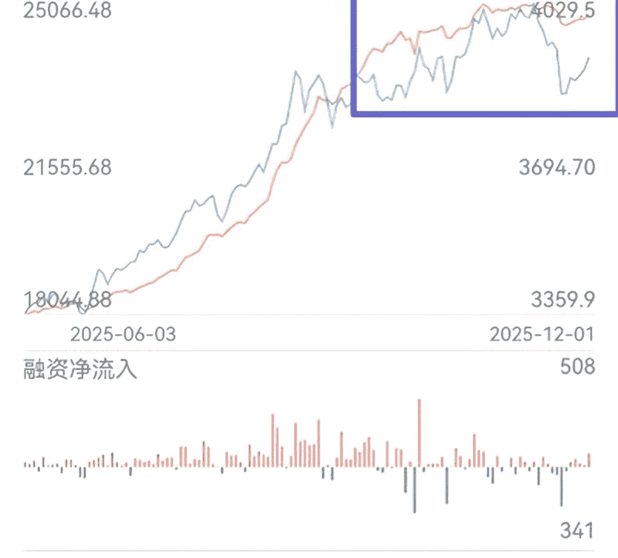

## 鉴茶财经 251203: 跷跷板模式

现在的市场是极端模式，也很简单，

你一早就能看出，

妖股涨，科技跌，大盘缩量，今天没戏。

妖股跌，科技涨，大盘放量，有点看头。

妖股的代表，

什么福建平潭、人民同泰、商业航天，

科技的代表，

端侧、谷歌、机器人、电新。

底部阶段=量能1.5万亿左右+妖股大面积跌停+美股大涨+可能的3830左右+村里出政策加护。

其实，再来一次2万以上的放量杀跌最好，一把出清，然而各方面不让，只能磨。

最近的市场，完全是靠两蹦的高涨值群靠着的，没有他们打不死卖，就 9-11 月轮机构大甩卖，双创早就跌破颈线，市场经历血雨，大盘回到 3600了。

仗义从散靠，负心多是机构人啊。

让机构们无比纠结的是，自己 9 月底 10 月初面积卖出科技，以以为又会跟以前一样，打个骨折起码三四成外拿回来，进群加微信cuk255

结果回来一看，旭创新，寒王没跌，王是横盘，再进场只能更高价价格买回来，有点“日了狗”感觉这话一个基金经理私下讲的。

## 融资融券走势

- 两融余额(亿) 上证指数 - 融净买入(亿)

深度视野VIP群 人工追踪50+大 付费群微信cuk255微信chp5568

## 深度视野优质圈（链接优质社群，助你成功）

全部包含以下内容：限时年费188/年 加微信cuk255

- ① 吃瓜群众包时圈文加时群对话（原价 365 元/年）
- ② 子明私享汇（含）内部文章（原价 568 元/年）
- ③ 政事室（顾子明）付费内享加送顺子明群辑
- ④ 米联储兜【作者米楼】（原价 599 元/年）
- ⑤ 欧洲金雀会员专属文章（原价 328 元/年）
- ⑥ 砖瓦斥内部图文（原价 400 元/年）
- ⑦ 卢克文青读书会专属文章（原价 699 元/年）
- ⑧ 鉴茶财经知识星球（原价 3310 元/年）
- ⑨ 猫哥的视界知识星球文章（原价 299 元/年）
- ⑩ 财经周刊【独家新闻】（原价 1498 元/年）
- ⑪ 杨世光在金钱（原价 2200 元/年）
- ⑫ 森森财经知识星球（原价 1600 元/年）
- ⑬ 激译异读付费文集（持续更新）

深度视野文集
进群微信cuk255

深度视野（付费文集）

- ⑭ 司马林解读谋选全套音频和全套书籍收藏版无删减（原价 2.3 万）
- ⑮ 虚彦三部曲[民国梦、帝国争亡、不被理解的MAO]（原价 599 元）
- ⑯ 卢克知识星球文章（原价 268 元/年）
- ⑯ 额外再送：卢薛元新浪微博付费文专栏、三村丰老王、三花九树文集

不定内容：——（更多资源不下去了……）

- ① 守夜人司令知识星球、接换魔王星球、达叔浅论星球、成就财富圈、雪雪花甲老头等
- ② 创始世纪笔记星球
- ③ A 视野、大树乡谈、江初宁、泮咩说、上海家学等付费文集
- ④ 西风付费文章、老端、高在八小时之外、局外的视界、升值、老体制内等其它一切大 V 付文集（每月低于 600 元的付费文集）

## 限时年费188/年 低成本链接全网V优质内容
