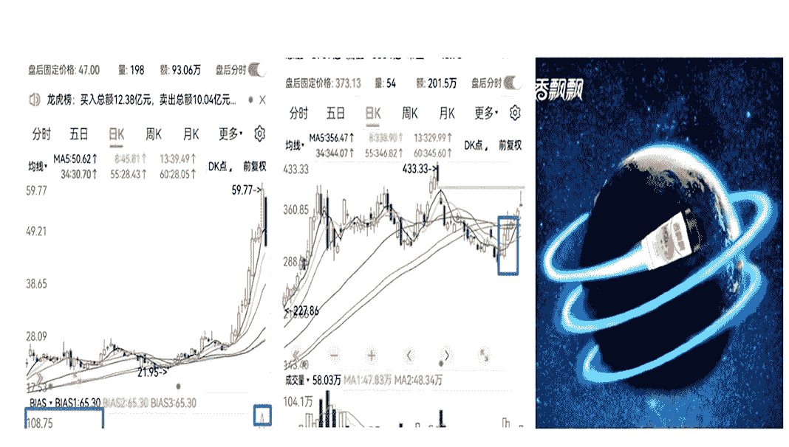

# 鉴茶财经 251204: 看两个技术案例和信息差

先说技术图形，

一个是赛微，OCS四小龙里 PE 最的，其他几个都涨过后，就剩它，我们也提前韭过 BIAS 过 100 止盈，2 日线冲到 110，昨天几乎跳停。

之前的腾景也是冲到 110 熄火。

下一步往哪里？

20 日线可能有个反弹，这行情不把握也罢，硬去也别上仓位。它可能给你搞个复杂顶，没格局的直接 A 杀了。

稳妥的看哪里？等它调到长短线组的相交。

这就是第二个案例，XYS，11 月 26 日，5 日线上穿 8 日线、13 日线，收复 34 日线，放量 220 亿，之前都只是 130 亿，甚至 80 亿，200 多亿。它是 8 月主升期的量，操作技术流当盘中就可以介入。

昨天为什么冲高回落？冲到了 392，上面是 394 的缺口，真冲了就得恢复 433 了，分明蓄势不够。

后面呢？后面它就看大盘波逐流了。量能够足够情绪又好趋势冲一下，不够就要盘调整补缺的力量。

恒立液压在 1126 这个技术图形和走势，博弈越充分的公司，越是行业前排和体量大的公司，越适用均线理论，你没法暗中操纵。

最后还是给会图的谈两个信息，

恒立液压也在切入机器人，特斯拉有合作意向，工程机械的周期我们也讲了。特斯拉即将新高，看大 A 的机器人今天表现，高手可以根据超级选线打野的。

另一个，联科科技的 800G 光模块通过谷歌验证，Q4 出货约 5 万只，1.6T 没有通过，目前仍只是旭创有望。

当然不需要追高，市场又无量。

有人说这几天总是冲高回落咋办？它冲高你扔一部分，它回落你接回来，看龙头，看大盘情绪，看 A50 指数就知道大概了。

如果盘中拉的是银行，科技不普涨，量能也不大，就前几个排努力，不就是主力团没有大大区小小组格局啥呢？进群微信ck255

当然国运投资流都是打主力决战的，根本不 care 路上这些变化，还是看的流派。

香馥飘奶茶，一年卖 50+ 卖 2 亿，可以绕地球转两圈绕地球自传，商业航天啊，量化直接无厘头它了。这就是现在商业航天的主力投资者。

深度视野VIP 群 人工追踪50+V 付费进群加微信cuk255 微信ch5568

# 深度视野优质集群（链接优质社群，助你成功）

全部包含以下内容：限时年费 188/年 加微信cuk255

- ① 吃瓜群众倍帝文档加时群群对话 (原价 365 元/年)
- ② 子明私享汇（含）内部文章
- ③ 政事室（顾子明）付费内容加送顾子明群
- ④ 米联储闲文【作者米横】(原价 599 元/年)
- ⑤ 欧洲金雀会员专属文章 (原价 328 元/年)
- ⑥ 砖瓦幻内部文档 (原价 400 元/年)
- ⑦ 卢克文青读书会专属文章 (原价 699 元/年)
- ⑧ 鉴茶财经知识星球 (原价 3310 元/年)
- ⑨ 猫哥的视界知识星球文章 (原价 299 元/年)
- 十 财经周刊【独家新闻](原价 1498 元/年)
- 十一 杨世在金钱塔 (原价 2200 元/年)
- 十二 森淼财经知识星球 (原价 1600 元/年)
- 十三 激泽异读付费星球（持续更新）
- 十四 司马林解读全套音频和全套书籍收藏版无割减 (原价 2.3 万)
- 十五 虚构三部曲[民国梦、帝国争霸、不被理解的 MAO] (原价 599 元)
- 十六 卢克知识星球文章 (原价 268 元/年)
- 十七 额外再送：卢薛元新浪韭付费专栏、三村丰老王、三花九树文集

不定期内容：（更多资源将下去了......

- ① 守夜司令知识星球、接换魔王知识星球、成达泛论星球、成术财富圈、雪球花甲头等
- ② A 视野、大树乡谈、江初序、泮咩说、上海海家学等付费文集
- ③ 西凤付费文章、老端、赢在八小时之外、局人的视界、升值、老A体制内等其它一些V付费文集（每月不超过600元的付费文集）

