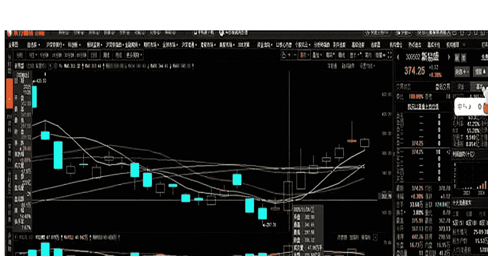

# 鉴茶财经院 251204:继续熬

1.55 万亿，

缩量也是没什么抛盘了，

科技的先头部队陆续进场，

女方的还是搞易中天和芯片，英伟达和谷歌链受益差差不多，

男方的继续搞芯片和先进进制，如同同学问到的微导纳米，京仪装备之类，龙头赛王最近都谈不上跌，

外头逛一圈没有发现，

主线就是主线。

很多时候你觉得家里的饭菜不刺激，可是最养人。

肚子全是在外头吃坏的，肥肉也是外头吃出来的。

深度视野VIP群 人工追踪50+V 付费群加微信cuk255 微信ch555

# 评论：进群微信

胖瓜：期待指一飞冲天

重庆污泥：没怎么涨，但也没怎么跌，挺好的，心态越来越稳了，静待主力拉升，吞吐。祝愿主力齐筹顺利，合作共赢

水镜：大王急个先锋拿下商业航就差不多了

上善若水：三个月的连涨带跑，终于体会到大哈滋味，大部分仓位调回ETF及凡朵花，接下来的，茶，看书，当一个体面的股东，感谢大王及群友的苦口婆心教导！有一帮一起做多中国的良师友，人生如此精彩！

文武：博创今天摸到13日线速度反弹到高高附近。好热人

Allen：不知天摩尔上市会怎样，寒王跌？

蕾提问：老师，你刚发的文说这个新易盛的走势，26号5日穿8日、13日、到34日，给我讲五下吗，我看到的一是5日和8日往走，真正上穿上是27日到28日这两个K线的中间，我就想是不是我判断准还有问题。麻烦讲一下。

南院大王：

当天盘中摸到34日线，鉴于当天放量，之前底部2倍左右，尾盘回落可以当成买1，天穹在那天也不那样。

深度视野VIP群 人工追踪50+大V 付费群加微信cuk255 微信ch5568

# 深度视野优质集群（链接优质社群，助你成功）

全部包含以下内容：限时年188/年 加微信cuk255

- ① 吃瓜群众倍时圈加微信时群对话（原价 365 元/年）
- ② 子明私享汇（含）内部文章
- ③ 政事室（顾子明）付费内容再送顾子明群聊
- ④ 米联储闲【作者米穗】（原价 599 元/年）
- ⑤ 欧洲金雀会员专属文章（原价 328 元/年）
- ⑥ 砖瓦仁内部图文（原价 400 元/年）
- ⑦ 卢克文青读书会专属文章（原价 699 元/年）
- ⑧ 鉴茶财经知识星球（原价 3310 元/年）
- ⑨ 猫哥的视界知识星球文章（原价 299 元/年）
- ⑩ 财经周刊【独家新闻】（原价 1498 元/年）
- ⑪ 扬世光在金钱圈（原价 2200 元/年）
- ⑫ 森淼财经知识星球（原价 1600 元/年）
- ⑬ 潇泽异译付费星球（持续更新）
- ⑭ 司马林解课全套音频和全套书籍藏版无删减（原价 2.3 万）
- ⑮ 虚构三部曲【民国梦、帝国亡、不被理解的 MAO】（原价 599 元）
- ⑱ 卢克知识星球文章（原价 268 元/年）
- ⑲ 额外再送：卢户源新浪薇付费专栏、三村丰老王、三花九树文集

不定内容：......（更多资源写不下下了）......

- ① 守夜人司令星球、接换魔王知识星球、星球财富知识星球、
- ② 创始人笔记、达叔谈论知识星球、成后财富、雪雪花老甲头等
- ③ A 视野、大树乡谈、江初序、咩咩说、上海海家学等付费文集
- ④ 西凤付费文章、老端、赢在八小时之外、局外人的视界、升值、老体系内等其它一些 V 付费文章（每月不超过 600 元的付费文章

限时年188/年

# 底层链链接全网 V 优质内容

深度视野文集

# 进群微信cuk255

深度视野（付费文集）

