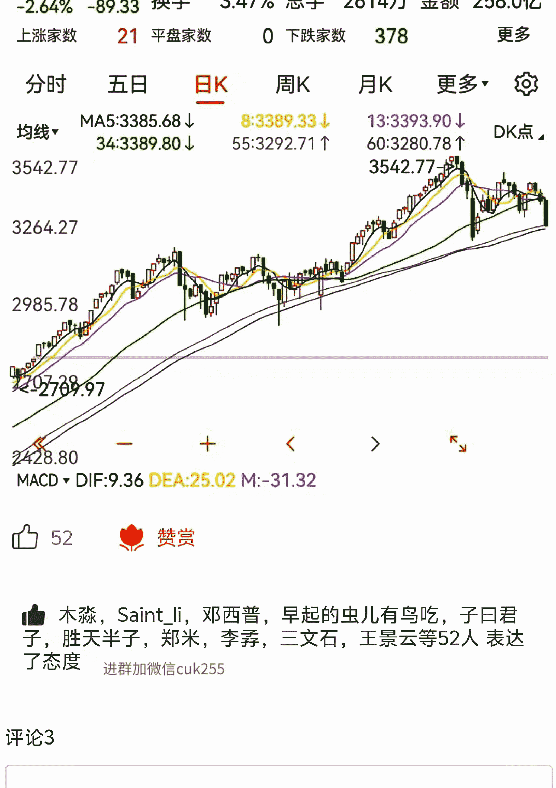

# 看3280增强

昨天下午，今天可能小反弹一下后杀去找这个位置，会操作的你已经知道怎么搞减仓的，减的这些等点。

要配合什么看？回调效应，要开盘拉多久拉重，是万万不能的，因为是基本面，不要觉得银行很重要，科技和新能源是权重，无量反弹减量，有量上拿着者。

如果没有发生这种情况，和22-24截然不同，你那你再来看即可（概率极低）。

战略学的是什么，你要说的是思维框架，是做好想事情发生的可能性，然后做好应对的策略。进群加微煜煜255

今天又是无量拉重，是万万不能的，因为是基本面，不要觉得银行很重要，科技和新能源是权重，无量反弹减量，有量上拿着者。

那是另一口行情，

看准，主要看你手里的品种，它量就是舒服刚够，当然还是要看盘，大盘给给你杀到340度，舒服你也扛不住。

昨天的经济工作会议报，一是消费，二是AI+，三是内卷，是四地的。详细解读有隔壁。

静待今天的市场如何演变吧。

斥子，月还不离开，先要诚不骗人。小盘微股盘，阳胆拉升，大矮盘，典型的走势，量很多私募，年底要结算了。

这块基本不要了。

# 评论区

吕俊辰：居然守，上来就刷到也是巧了。占个位沙发
2023/12/12 08 回复

关注：大王早上好，感谢大王指点迷路，还有明年，北上深的房地产还有回升的希望吗？
2023/12/12 05 回复

南润大王：回复：基本上回震荡，大约27年出来，快的明年三季度
2023/12/12 05 回复

# 深度视野优质集团（链接优质社群，助你成功）

全部包含以下内容：限时年费188/年 加微信cuk255

- ① 吃瓜群众包帝圈加微信时群对话（原价 365 元/年）
- ② 子明私享汇（内部）文章（原价 568 元/年）
- ③ 政室（顾子明）付费内容加送顾子明群群
- ④ 米联储闲【作者米穗】（原价 599 元/年）
- ⑤ 欧洲金雀会员专属文章（原价 328 元/年）
- ⑥ 砖瓦仁内部圈（原价 400 元/年）
- ⑦ 卢克文青读书会专属文章（原价 699 元/年）
- ⑧ 鉴茶财经知识星球（原价 3310 元/年）
- ⑨ 猫哥的视界知识星球文章（原价 299 元/年）
- 10 财新周刊【独家新闻】（原价 1498 元/年）
- 11 杨世光在金钱坝（原价 2200 元/年）
- 12 蒜森财经知识星球（原价 1600 元/年）
- 13 潇泽异译付费文章（持续更新）
- 14 司马林解课全套音频和全套书籍收藏无删减（原价 2.3 万）
- 15 虚构三部[民国梦、帝国争霸、不被理解的MAO]（原价 599 元）
- 16 卢克知识星球文章（原价 268 元/年）
- 17 额额外再送：卢祺新浪韭搏付费专栏、三村丰老王、三花九树文集

不定内容：......（更多资源将下去）......

- ① 守夜人司令知识星球、接换魔王知识星球、成术花财富、雪球花甲老头等
- ② 创始人笔记、达叔谈论知识星球、成术花财富、雪球甲老头等
- ③ A视野、大树乡谈、江初同学、咩咩说、上海海家等付费文集
- ④ 西凤付费文章、老端、赢在八小时之外、局外人的视界、升值、老体制内等等其它一些大V付费文章（每月不超过 600 元付费文集）

限时年费188/年

# 底层底链接全网V优质内容

深度视野文集
进群微信cuk255

深度视野（付费文集）

