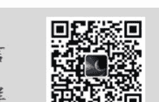

# 鉴茶财院 250822: 要看到决心

昨天在市场的焦虑时刻，

deepseek 新版本横空出世，

关键时刻讲了底牌，

实际上，不短的时间上，

当然利好四大低位板块之一的 AI 应用，之前那篇大家再去温习，

更深刻，更长远，

利好它适配的国产芯片，即国产技术的另外三个低位：算力芯片（从 ASIC 一路延伸到 AIDC 和国资云）、华为链、光刻机。

外面各种讲什么 FP8，我们说的那几个 ASIC 算力芯片都是受益的。

老生常谈的科创芯片 ETF 依然可以低看。

这次发布，也说明了上面的一个决心，

加微信jnts2，免费进资料群

没有 H20 入华，我们是要把国产领域做起来的，

哪怕英伟达进入了，也会可能给出配额，比如，不能超过算力的多少比例。

东方要成为这一轮科技革命的策源地和发起人，而不是追随者打工人，这是我们非常重要的底层逻辑之一。

后面，还有大基金三期要发力投资。

ps，香港某稳定币牌照已可以在内地大公司发行 RWA 在找我们（当然不是让大家去弄概念股），

同学们如果有相应资产，最好是充电桩、发电站、算力中心等能产生现金流的资产等，可是上市公司，第一手的资源啊可以联系思想。

如果不知道什么是稳定币、RWA，隔壁进阶先学会，稳定币早与每个人生活息相关。

当然，如果我们帮哪个资产找好了去挂牌，会通过合理合法的方式告诉大家。

评论:

莹：大王太赞了

加微信jntsg2，免费资料群

蒋文强：大王，请问中科光能继续持有吗?手上有半仓。

南院大王 回复蒋文强：只是弹性小，位置又不高

蒋文强回复南院大王：好的，谢谢大王

迦 回复南院大王：没出完，留了半仓，今天吃了大肉，感谢大王

# 知识星球TOP

添加微信 付费资源分群 免费入群

微信: jntg2

| 序号 | 公号/星球/社群 | 原价 | 领域 |
| :--- | :--- | :--- | :--- |
| 1 | 生财有术 | 2765/年 | 副业、搞钱 |
| 2 | 宗容岱吃瓜虎 | 365/年 | 时政、历史 |
| 3 | 记忆Legacy/雯木西风 | 365/年 | 成长、经济 |
| 4 | 欧洲金龙 | 328/年 | 时政、历史 |
| 5 | 户克尤青青会 | 699/年 | 时政、社会 |
| 6 | 体制内司令 | 599/年 | 体制、职 |
| 7 | 局外人的视野 | 669/年 | 金融、时政 |
| 8 | 潇浑异传 | 4166/年 | 财富、成长 |
| 9 | 守庆心中小令 | 599/年 | 时政、经济 |
| 10 | 江宁知府 | 365/访 | 时政、国际 |
| 11 | 政堂/顾子明 | 568/年 | 时政、经济 |
| 12 | 书院 | 1399/仿 | 金融、财富 |
| 13 | 大树树丰 | 199/年 | 时政、成长 |
| 14 | 水库大匠 | 10000送 | 房产、经济 |
| 15 | 洪源的宏观策略 | 4376/年 | 经济、搞钱 |
| 16 | 金融通击龙 | 4576/年 | 股票、行研 |
| 17 | 猫猫的世界 | 299/年 | 时政、社会 |
| 18 | 飞沫龙 | 3600/年 | 股市、经济 |
| 19 | 米联储储见闻 | 599/年 | 经济、金融 |
| 20 | 签赛财经汇 | 330/年 | 房产、资产 |
| 21 | 赢在八小时之时 | 365/年 | 成长、职场 |

...

+图书、报告、课程等各类价值资源，不再列齐

- 免费群 每日分享资源(均20+),75/年
- VIP群 每日分享所有资源

# TOP星球 TOP社群

加微信号jntg2，免费进资料群 ✖微信
