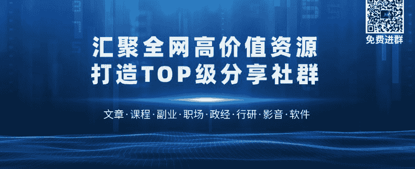

# 鉴茶财经院 250807：高低位各得所得

来复习下我们的总体逻辑，高低切。

## 一、高位的海外算力：

PCB、光模块。

之前的观点一直是光模块比 PCB 稳，本质是产能还没爆发，早上也讲了天宇的产能 4 季度释放，今天就表现出来，一样砸下去 6 个点，旭创就能拉回来，胜宏就不行。

PCB 的筹码松了，性价比不高了。

高位里的，相对低位铜缆和冷链：
博创、太辰光、瑞可达、二线的长飞、兆龙等等，轮动无处不在，一个大涨过后就轮到另外一个。

当时错易中天的同学，大家点了太辰光，它迟早要历史新高，瑞可的补涨也很有效能。安费诺 100 亿亿美元收购的康普 CSS 部门，就是这个领域的。

液冷，老友英克、川环、同弈，游资打造的龙头潜中，也给大家讲了，这里虽有分歧，后市依然看。今天铜缆线和液冷表现好很多，因为低位。

## 二、海外算力之外的两个大低位

### 低位 1，国产科技
### 低位 2，非科技低位

## 一、国产科技上三大不那么洼的地方：

a. 第一个就是国产芯片，首看算力。之前讲了这只龙龙头可能是东芯，给了三次机会：世界算力大会一次，首闰回马枪一次，大盘调整一次。次看带算力概念的 SoC，芯原、朔捷、炬芯都趋势向上。哪呆东芯跑不动了，可能就交棒寒王。

b. 第二个是光刻机，张江、茂长、波长、福晶等，表现达标。

c. 第三个 AI 应用，山赛 Figma、万兴、政务大模型拓尔思等，全天保持强势，评价蓄蕴欲动。

## 二、非科技低位

反内卷和新消费。

新消费里最核心的游戏一路新高，有业绩的巨人、冰川、华通等都讲过，基本没涨够。中排一点游族、宝通，更后排可见点大模型概念神州泰岳 20 日线的机会。

东鹏代表的柠檬饮料，中宠宝代表的宠物食品，曼卡龙、元隆雅代表的谷子经济，水羊代表的医美等。前两天没有人说消费的时候我们专门提到，参与的同学应该收获不错。

看看小于儿这个直觉和择时，大赞。要问原因，就是两触杀进来，反正位置低。

以上是全貌的概览供学习。仍然告诉大家要注意的是，这轮牛市轮动特别快，一个板块最多连续 3 天，一两天反而是常态，不要追高，埋伏轮动，关注低位，不会去搞 ETF，95% 人最终跑不过它。

不要怕涨，趋势没坏就在主升浪；不要怕跌，资金深度介入的领域没那么快结束。今天就是个明显的例子，光模块强势拉回来，国产半导体和 AI 应用就没大涨。今晚，压力又给到了总瓢把子英伟达。

最后，恭喜东芯的同学们，4 天 8 板精准上车，这新闻你们与有荣焉。

**新闻：
东芯股份录 8 天 4 板
证券时报网
东芯股份[688110]最新：73.20 张幅：20.00% 涨跌：12.20
东芯股份再度涨停，8 个交易日内录得 4 个涨停，累计涨幅为 90.97%，累计换手率为 121.07%。截至 11:29，该股今日成交量 6162.45 万股，成交金额 42.43 亿元，换手率 13.93%。最新 A 股总市值达 323.73 亿元。

南院大王 250804:

第二是我们提长长期趋势的模样：柠檬饮料与宠物食品。柠檬饮料东鹏、宠物食品中宠、乖宝，一段消停后又能看了了。

第三是新消费。各种乱七七八糟的谷子经济等，曼卡龙、水羊股份、元隆雅等，多少看谁有点业绩吧。消费谁？其实要看香港的惹黄金，兼看 PPMT，它稳了，太 A 的消费就开始跟了。

**评论：**
小于儿：我今天又进入宠里里面了。（2025/08/04）
闲闲巴巴：大王，帮我看一下中淳科技。（2025/08/04）
微信信号jntsg2，免费进资料群

南院大王 回复闲闲吧：给你看过很多遍了，看着不好吗，都都不怕涨还怕，趋势没坏什么。（2025/08/04）
leo：8 月 5 日

南院大王 250804:
第二是我们提长长期趋势的模样：柠檬饮料与宠物食品。柠檬饮料东鹏、宠物食品中宠、乖宝，一段消停后又能看了了。
第三是新消费。各种乱七七八糟的谷子经济等，曼卡龙、水羊股份、元隆雅等，多少看谁有点业绩吧。
消费谁？其实要看香港的惹黄金，兼看 PPMT，它稳了，太 A 的消费就开始跟了。

---
★免费群 每日分享份资源 (每日20+),/75年
★ VIP群 每日分享所有资源

加微信jntsg2，免费进资料群
