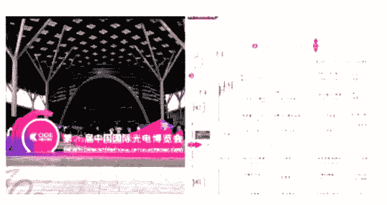

# 今天就4个字

持股待侠。

尤其是在桌上的，pcb打头，光模块继续，产业链继续。

胜能继续，它后排的二线品牌，铜箔、电子布、树脂等都会跟进，原理和受益在过去几个月谈过的可以以往前翻。

高手们可以看看直接在20日上线刚开始或者准备鞭。

正在召开的，博会最新的消息，有些同学看到了，两大老头领先和立讯提出了CPC（共封装铜互连）的概念。

核心变化在于，从交换机ASIC侧开始，通过铜直连直接连接到交换机的端口，使得内部信号的传输的PCB环节，功耗有大幅优化，又解决了CPO不易维修的问题。

这其实就是王者之之前讲了好几次的“铜互互”。

好妙家伙们认为金诺是领先，深度绑定旭创，打破安费诺垄断，这个同学们同学们自己看，我们不是太熟悉。熟悉的大家都知道道父子侠，长飞和博创。

跟在后面的那几位同学也往前向前，即“铜链接”。

康宁在中国制裁，光纤的市场会出来，博创是谷歌供应商，谷歌主玩的是ASIC。

当然还述为纯技术探讨，新的同学不要急下舟，本文打算看到6月，要多去理解分析和机构的逻辑与打法。

还是那句话，机会多的是，不高高，新手菜鸟多要指教。

说是那句话，机会多的是，不追高，新手菜鸟要多看指数。

昨天，90%的公司都跑不赢创业板。

深度视野文集
进群微信cuk255

周：大王：甲骨文最大的受益方会不会是工业联？前景如何

金生丽水：TT 飞光纤质怎么样，值得买吗

水镜 回复 金生丽水：妖体质，胆胖者上🤭

沉静如海 回复 金生丽水：对比A股低估

# 深度视野优质集圈（链接优质社群，助你成功）

全部包含以下内容：限时年费188/年 加微信cuk255

- ① 吃瓜群众倍帝训练文时群群对话（原价 365 元/年）
- ② 子明私享汇（含）内部文章
- ③ 政事室（顾子明）付费内容还随送子明群
- ④ 米联诸英【作者米ان】（原价 599 元/年）
- ⑤ 欧洲金雀会员专属文章（原价 328 元/年）
- ⑥ 砖瓦折内部圈（原价 400 元/年）
- ⑦ 卢克文青读书会专属文章（原价 699 元/年）
- ⑧ 鉴茶财经知识星球（原价 3310 元/年）
- ⑨ 猫哥的视界知识星球文章（原价 299 元/年）
- ⑩ 财经新周【独家新闻】（原价 1498 元/年）
- ⑪ 杨世在金钱圈（原价 2200 元/年）
- ⑫ 森淼财经知识星球（原价 1600 元/年）
- ⑬ 激泽异读付费文章（持续更新）
- ⑭ 司马林解读末选全套音频和全套书籍版权无删减（原价 2.3 万）
- ⑮ 虚构三部曲[民国梦、帝国狂潮、不被理解的 MAO]（原价 599 元）
- ⑯ 克知识星球文章（原价 268 元/年）
- ⑰ 额外再送：卢锐元新浪薇付费专栏、三村丰老文、三花九洞文集

不定期内容：——（更多资源将下去了……

- ① 守夜人司令星球、接换魔王后星球、达达泛论星球、成就财富圈、雪花花甲老头等
- ② 创始佳星
- ③ A视野、大树乡谈、江宁后、泮咩说、上海家等付费文集
- ④ 西凤付费文章、老端、高在八小时之外、局外的视界、升值、老体制内等其它一些大V付费文章（每月不超过600元的付费文集）

限时年费188/年

# 低成本链接全网V优质内容

# 深度视野文集

# 进群微信cuk255

深度视野（付费文集）

