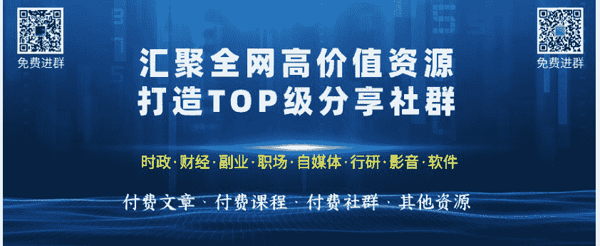

# 南院大王

洗的很认真

成交量2.5万亿，继续放量00亿，仍然在基础锚码的充分交换。
复一下基础锚码，也给新同学们讲讲布局，主策就是主线，主寨，一对新人。
海外算力，国产芯片。

1. 昨天天大女方的海外算力，有点支撑了，光模块得敏歇继续，pcb直接继续，错过蓝宏你还没有收益，你对比它和跟差的涨幅？
2. 今天就能轮到国产算力，芯片系的，繁靠之崛起为首，打头的龙1毫不太用力，订单准备又复的织的本来就是龙2。今天挑着头晕意，后面的各种跟进，包括昨天说的瑞刚。华为了的，华国，华丰跟着涨就是了。

600的时候，多少博博唱空寒寨，说人家就值100。前两天科技调整的时候，又有人唱空说它一文不值，都是“我执”啊。

# 都是“我执”啊。

就像创制新药，都认为人为家贵了，其实不算太来的，昨天大低后开就是机会。认为药还邱佑后面还有它，凯莱英，康伦，昭衍，都不错。昨天应该跌不跌，不用说它比比较强。
任何事情，不要预设立场，生出发别。这里表扬一下乘风山岚同学，寒王1200的时候能听到听话坚决守住，谁说女子不如。

周末，请继续关注深圳的光博会，有些新东西已经过了，在市场反馈出来了，大家可以继续看有什么新东西来。

车首：华工
郑伟：大王 Cxo, cgo 接下来走补弥弘

南院大王2025/9/9:

# 罗卜，给正经的“共封装光学”卖铲子，未来的 osc 光交换机是提过的腾景，可惜高了等它回调。

加微信kaiwu7878进群获取全网付费资源
