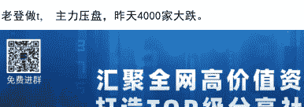

# 温故如知

已知：
1. 上面要低波动。2. 上面要牛。3. 科技是明牌。

证得：

- 1. 指数不会有大波动，涨期在3700-3900左右波动。
- 2. 为了降低波动，量化狂出小微芯片和半导体，信号老觉得、主力芯片，昨天4000家大涨。
- 3. 小芯片已经破位，下撤可能开始，并将芯片大涨。

所以：

现在的主角是海外量子和国产芯片。

- 海外量子聚聚，它也越来越坚实。
海外量子在狂涨和全球方向的劲，分波出来当推力人。
- 国产芯片已经步入半导体突破的阶段。之前《男儿的崛起》，设备还有两个方向：一个是光机、长波、激光、福磊，一个是芯片、刻机、中芯是核心，但量子大弹性高。
弹性大的，比过的科技行业，聚焦实体，筛选优有安全芯片，逻辑之前，之前的优孰高下，它涨封了。
设备这块已经很彻底，要把两个方向：

- a. 中筹已经做错，三里聚可能更好，国产芯片设备开始涨了。
- b. 有“先进制造”概念。

团队在刚组初期还很甜，渗透专家家，可以想想两句。
重组是不可能的。
这里的ETF是5881170，还有更优的560780。
大盘要看下20日压力，压力小越能坚持：海外量子强势局面=国产芯片设备建设。
铁打的设备领先还没有走完的。
半导体设备我们今天看老铁们：高高回调怎么怎么办？取决于在冰点上。
科技的三大位，国产芯片，华为了，现在涨过了，就割下设备了。
从我们七月说它了，需要等等。
还没有更具性价比的，很多科技，适合新手黑马分批次，跟涨的走势就是车。不用怕。

# 完毕，我们还没学会腾讯找阿里百度1000亿服务服务器，阿里找百度1000亿芯片，百度再找腾讯1000亿服务。

