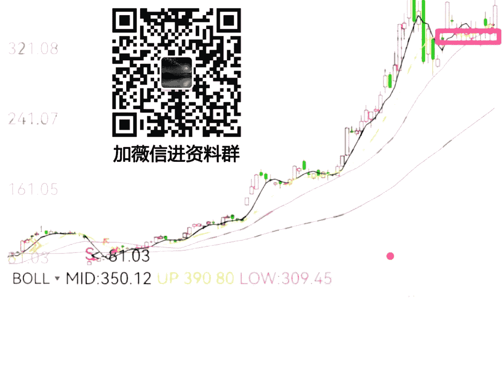

进入：莱享财经核心

## 双轮驱动越起来越均衡

昨天莱方桌上上的是，今天就拉起来，因为基金暴要来了，弄不好越涨越便宜，所以核心的不能空看。

就像你发现自己折腾半天，还不一直拿差量。

现在的一线上是算力核心，一线下是中芯概念设备，再匹配大块头部数字指数维护。

强势弱的平台理论非常重要，关键位置它会抓住抓住比20日的xy，箱体结构整天拉起来，又比你今天涨的华工，上次涨还是旧的平台位置，上涨6%的够了哥兄弟们儿吧，若是谨慎达到预期收益后，可以胆留一部分了。

此外还有什么方案呢？

它如果突破100，且稳5日平台或者形成小矩规模，那就有机会卖出“伯略钢铁”，到时候会往130，如果不到100直接接下去了站住视为不想130，你利润很ok可以出掉了。虽量也是够了。

| 分 | 时 | 日 | 周 | 月 | K | 更多 | 更多 |
| :--- | :--- | :--- | :--- | :--- | :--- | :--- | :--- |
| 97.68 | 今涨 | 91.10 | 最高 | 97.68 | 最低 | 98.30 | 10.00 |
| 8.88% | 换 | 10.27% | 跌 | 103.27 | 金额 | 98.30 | 982.2 |
| 跌 | 981.7 | 沪深 | 53.9% | 更多 | | | |
| 均线-MA55.31 | 10.87 | 10 | 20.78 | 14 | DK | 不复复 | |

| 分 | 时 | 日 | 周 | 月 | K | 更多 | 更多 |
| :--- | :--- | :--- | :--- | :--- | :--- | :--- | :--- |
| 85.28 | 今涨 | 79.23 | 最高 | 86.91 | 最低 | 85.28 | 79.23 |
| 7.94% | 6.27 | 换 | 12.13% | 跌 | 102.27 | 金额 | 86.07 |
| 826.24 | 跌 | 718.6 | 沪深 | 191 | 更多 | | |
| 均线-MA80.66 | 10.78 | 20 | 27.55 | 57 | DK | 不复复 | |

| 分 | 时 | 日 | 周 | 月 | K | 更多 | 更多 |
| :--- | :--- | :--- | :--- | :--- | :--- | :--- | :--- |
| 376.00 | 今涨 | 348.23 | 最高 | 385.88 | 最低 | 369.25 | 341.00 |
| 6.02% | 2.16% | 换 | 6.37% | 跌 | 56.43 | 金额 | 208.6 |
| 537.21 | 跌 | 3329 | 市值 | 47.40 | 更多 | | |
| 均线-MA355.31 | 10.352 | 20 | 35.01 | 1.12 | DK | 不复复 | |

