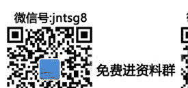

# 鉴茶财经院250903：今天看出部分弱点

今天的调整很好，顺其自然，没有乱用外力干涉节奏，如果明天能调整更好，机会有没有就再说了。

## 总体情况什么？

依然是主线（女方）即海外算力最强。

原因很简单，有业绩，有利利润，三季度放释放更多。

光模块 ≈ PCB > 铜链接 > 液冷 > 电源 > 交换机。

- 光模块：早上讲旭创最强，技术PE都优秀，所以它走出来的是反包走势。
- 光芯片：源杰、仕佳光。
- PCB：龙一、龙二、胜宏、生益电子。
- 液冷：英维克。
- 电源：Mgmt、中恒。
- 交换机：锐捷。

华为一样，更重视交换机和通讯。

华为 PCB：生益电子、光模块、华工、铜链接、华丰；华为为电源液冷，同上。

OCS 概念的有腾景、赛微。

主线女方 > 主线男方。

国产芯片目前还在企稳，寒王一行不行大家都萎靡，再观察两天。

寒卓稳了，后面的各种 GPU、SOC、MCU、设备、材料等，才能谈。

主线男方的主线位置是有的，丢不了。

- 游戏：三家位置不变，巨人是 AI 游戏，游戏是消消机构抱团，没那么张扬。
- 创新新药：除了点的几个具体，港股创新药 513120 也在。

新同学们要列入注意，要进取不来它，看情况适低入，不要梭哈，怕高了就分批的。

创新药的关键词是 ADC、双抗和 GLP-1。

咱们所有的申医药里，科伦博泰也很优秀，同样的，成都都先导。

创新药就是开盲盒模式，此起彼伏，轮着搞就行了。

起码要看到两个关键的医疗大会。

- 机器人：还是 T 链。机器人的问题是，游资多，机构抱的少，所以会被 T。

划重点，并不是说那些二线的不好，在核心的涨了之后，它们后续依然有机会，甚至有大机会。

主线男方的主线位置是有的，丢不了。
