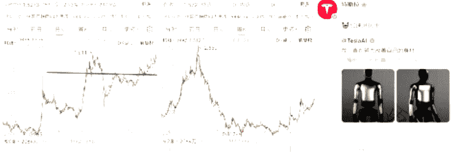

# 逻辑开始走准

美股已经有涨不动了，业绩和故事都是空档期。

这几天悄然涨起来的中马哈，稳稳的突破了去年10月8日的高点。去年，只是逻辑预计站不住，现在仍有业绩和预期的支撑。

美国降息。最直接的受益就是他们。

不要觉得今年涨了就高了，2021年以来它们几乎腰斩（见图二），市值损失了6万亿人民币以上。

没它们弹性那么大的对应是恒生科技ETF，你直接搞榜中马、互联、行，要弹性更大，港股创新药。

9月的局势非常诡，会有更多的人跑不ETF。进群微信信cuk255。

今天高位看点：中芯复牌后国产芯片不能站住；
低位看点：固态电池/储能。

老老，无奔乔木、奎桃小丸子、冒泡，都是出来的拼。小狗抱TaC，钱债，于洋、落川、江等22人觉得很难中三科技。

## 深度视野优质社群（链接优质社群，助你成功）

全部包含以下内容：限时年费188/年 加微信cuk255

- ① 吃群众含倍训练文加时训练群对话（原价 365 元/年）
- ② 子明私享汇（含）内部文章（原价 568 元/年）
- ③ 政事室（顾子明）付费内容加送顺子子明群
- ④ 米联诸闲文【作者米栖】（原价 599 元/年）
- ⑤ 欧洲金雀会员专属文章（原价 328 元/年）
- ⑥ 砖瓦斥内部文档（原价 400 元/年）
- ⑦ 卢克文青读书会专属文章（原价 699 元/年）
- ⑧ 鉴茶财经知识星球（原价 3310 元/年）
- ⑨ 猫哥的视界知识星球文章（原价 299 元/年）
- ⑩ 财经周【独家新闻】（原价 1498 元/年）
- ⑪ 杨世光在金钱圈（原价 2200 元/年）
- ⑫ 森淼财经知识星球（原价 1600 元/年）
- ⑬ 激泽异玲付费文章（持续更新）
- 14 司马林解读猛选全套音频和全套书籍收藏无损减（原价 2.3 万）
- 15 虚走三部曲[民国梦、帝国战争、不被理解的 MAO]（原价 599 元）
- 16 卢克文知识星球文章（原价 268 元/年）
- 17 额外再送：卢薛元新浪播获费专栏、三村丰老王、三花九洞文集

定期内容：……（更多资源将下不下了）

- ① 守夜人司令知识星球、接换魔王后星球、成达论星球、成就财富圈、雪花花甲头部等
- ② 创始之星、达叔泛论星球、成就财富圈
- ③ A 视野、大树乡谈、江初好、泮咩说、上海海家等付费文集
- ④ 西凤付费文章、老端、高在小时之时、局外人的视界、升值、老体系内等等其它大 V 付费文集（每月不超过600 元的付费文集）

限时年费188/年

## 低成本链接全网V优质内容

## 深度视野文集

深度微信（付费文集）

