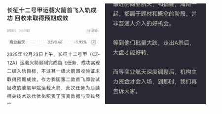

# 商业航天为什么大跌 长征12...知识星球

# 详情

返回 鉴享财富进阶

100课程大师
2025-12-23 15:40

商业航天为什么大跌

长征12飞了，整体成功，虽然回收不好，板块为什么大跌？

游资量化一贯的手法，预期卖现预期涨，盈利好出货。

在之前商业航天扫盲课程我们就讲过，它就是题材和概念，不要因为涨了几天就觉得是主线，要跨年什么样的。起码从口上来说，机构买一个东西，等的是α+β的预期，是真希望维斯双击的，是看产业的。

游资的发心就是炒了卖给散户。

主力为什么不买商业航天？

一、业界太差，很多都是亏的，或者几百市值率，怎么下得了手。

二、盘子小子大，最大的中国通1000亿，几百亿的杂质一堆，让你们怎么买？

三、是结构太差，里面全是牢牢的散户和游资主力，拉上去接盘。

商业航天目前纯属事故阶段，怎么钱都没明白，当年的新能源，哪哪里控聚，起码能靠谱的。

# 深度视野VIP群 一人追涨50+V 付费群加微信cuk255 微信ch5568

现在的它们，既不商业，也不航天，都是一些零组件。

那商业航天完了吗？没有。

经过调整后，喜欢灵活的部分可能会用一部分小仓位去买，那时候才是介入机会。

后面有一个更大的故事。

# 中美航天竞赛，

# 付费群+V: cuk2555

人工追踪50+大V 付费群...

航天十二号运载火箭成功进入太空，回收与对接均取得胜利
2022/12/23 10:16
2022年12月23日北京，中国十二号（CZ-12）长征火箭在文昌发射成功，二号成功入轨，遥测数据正常。作为我国首次商业航天发射任务，此次任务圆满完成，相关关键技术再次取得重大突破。

那些被看作是大的，走出大跃。航天产业正在调整，机构力量会整合，到时候，我们将大家。

最后编辑：2022-12-23 15:48

59人觉得很赞

-   东郭先生：等大王的号令，等价介入的机会。2022-12-23 16:03
-   滨不亨：等大王的号令，等价介入的机会。2022-12-23 16:42
-   绿晴-盛天下：大王，协变在什么情况呢？什么时候介入？2022-12-23 17:28
-   李坤衣：大王好，可控核变脸哪些？什么时候介入？2022-12-23 21:36

# 深度视野VIP群 人工追踪50+大V 付费群加微信cuk255 微信chp5568

# 深度视野优质集圈，链接优质群，助你成功

全部包含以下内容：限时年费188/年 加微信cuk255

- 1 吃瓜群众倍信圈加时群群对话（原价 365 元/年）
- 2 子明私享（含）内部文章（原价 568 元/年）
- 3 政事堂（原子明）付费内容加再送顺子明群聊
- 4 米联储闲【作者米糕】原价 599 元/年）
- 5 欧洲金准会员专属文章（原价 328 元/年）
- 6 钨幻厂内部圈（原价 400 元/年）
- 7 卢克文青读书会专属文章（原价 699 元/年）
- 8 琅茶财经星球（原价 3310 元/年）
- 9 猫哥的视界星球（原价 299 元/年）
- 10 财新周【独家新闻】原价 1498 元/年）
- 11 杨世光在钱（原价 2200 元/年）
- 12 森森财经星球（原价 1600 元/年）
- 13 源译付费文章（持续更新）

# 深度视野文集
群微cuk255

- 14 司马林解读毛选全套音频和全套书籍珍藏版无割（原价 2.3 万）
- 15 虚虚三部曲[民国梦、帝国争战、不被理解的 MAO](原价 599 元）
- 16 卢克文知识星球文章（原价 268 元/年）
- 17 额外再送：卢阡新浪微博得付费专栏、三村丰老王、三花九树文集
不定期内容：（更多资源将不断……）

+ ① 守夜人司令知识星球、接鸽魔王知识星球、自有知识星球、
② 创始笔记、达沃译论星球文章、成付财富圈、雪花甲老头等
③ A 视野、大树乡谈、江初知道、咩咩说、上海海家学等付费文集
④ 西风付费文章、老端、赢在八小时之外、局人的视界、升值、老体制内等其它一些V付费文章（每月低于600 元的付费文集）

# 限时年费188/年 低成本链接全网V优质内容
