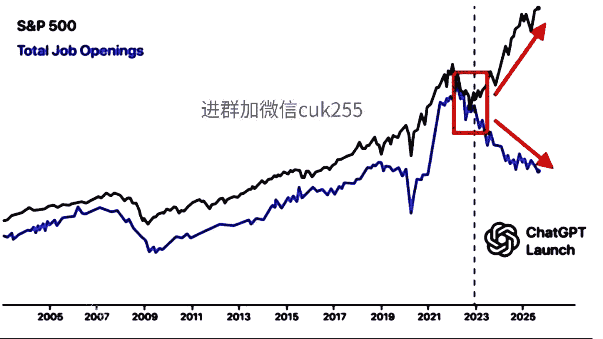
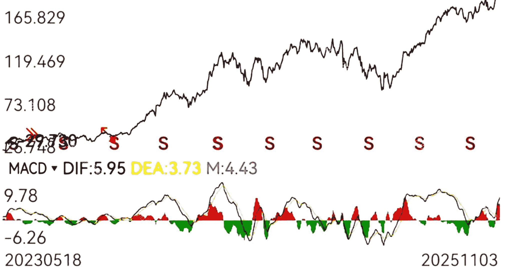
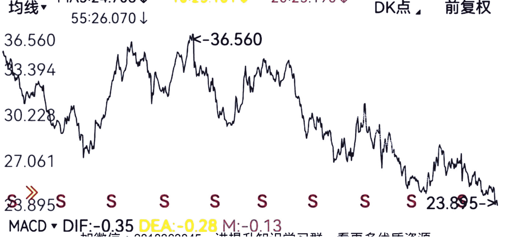

# 毁灭式创新

2023年的ChatGPT出现以后，资本回报和劳动力回报显著的分道扬镳（图一）。

典型的案例是，英伟达市值从3万亿美元到4万亿美元，耗时410天；从4万美元跨越5万亿美元，仅用时113天。美国AI投资规模突破1万亿美元，但汽车回收数量已攀至2009年高位，汽车回收，代表很多人还不贷款，车被银行收走了。

卡夫亨亨克的CEO说，消费者信心跌至十年来最低点，且逐步扩散到25-35岁的中等收入群体。

薛学夫在《两次危机研究》里说：“重大的技术革命总是使生产力得到极大程度解放，这不仅改变着生产函数和产生‘毁灭’的创新效应，而且每次技术革命都对社会结构、地缘政治、国家力量产生深远而根本性的影响。”

现在很多人批评AI是泡沫，AI还不赚钱，这种日子拉的长一点才是好事，否则这就是典型的“危机的前兆”。因为很快会更大的贫富差距和分化，直到最底层的收入连消费品和贷款都开不起，危机爆发。

图二，上图是英伟达，下图是卡夫亨亨，全球最大的食品饮料公司之一，巴菲特重仓错误了品种。

# S&P 500

Total Job Openings

# 三季报预披露：于2025-11-19(美东)盘后披露2025...

| 分时 | 五日 | 日 | 周K | 月K | 更多 |
| :--- | :--- | :--- | :--- | :--- | :--- |
| 均线 MA5 | 204.066 ↑ | 55: 182.013 ↑ | | | |
| 10 | 194.168 ↑ | 20: 189.371 ↑ | DK点。 前复权 | | |
| | 212.190 | 212.190 -> | 119.469 | 73.108 | |

MACD DIF: 5.95 DEA: 3.73 M: 4.43
9.78
-6.26
20230518
20251103

# 卡夫龙亨 24.330 -1.62% -0.400 切换同列

| 均线 MA5 | 24.708 ↓ | 55: 26.070 ↓ | | | |
| 10 | 1025.101 ↓ | 20: 25.190 ↓ | DK点。 前复权 | | |
| | 36.560 | 33.394 | -36.560 | 30.228 | 27.061 |

MACD DIF: -0.35 DEA: -0.28 M: -0.13

# 深度视野优质集团（链接优质社群，助你成功）

全部包含以下内容：限时年费188/年

- ① 吃瓜群众包时圈加微信时群对话（原价 365 元/年）
- ② 子明私享汇（含）内部文章
- ③ 政室（顾子明）付费内容加送顾子明群聊
- ④ 米联储闲【作者米穗】（原价 599 元/年）
- ⑤ 欧洲金会员专属文章（原价 328 元/年）
- ⑥ 砖瓦斥内部文档（原价 400 元/年）
- ⑦ 卢克文青读书会专属文章（原价 699 元/年）
- ⑧ 鉴茶财经知识星球（原价 3310 元/年）
- ⑨ 猫哥的视界知识星球文章（原价 299 元/年）
- 10 财新周【独家新闻（原价 1498 元/年）
- 11 杨世光在金钱煽（原价 2200 元/年）
- 12 蒜森财经知识星球（原价 1600 元/年）
- 13 激泽异译付费文章（持续更新）
- 14 司马林解课全套音频和全套书籍藏版无割减（原价 2.3 万）
- 15 虚构三部曲【民国梦、帝国争亡、不被理解的 MAO（原价 599 元）
- 16 卢克文知识星球文章（原价 268 元/年）
- 17 额外再送：卢涯元新浪微博付费专栏、三村丰老王、三花九洞文集

定期内容：......（更多资源不下去了）......

- ① 守夜人司令知识星球、接换魔王知识星球、成术花财富、雪球花甲老头等
- ② 创始笔记、达叔谈论知识星球、成术发财富、雪球花甲老头等
- ③ A视野、大树乡谈、江沛序、泮咩说、上海家学等付费文集
- ④ 西凤付费文章、老端、赢在小时之时、局外人的视界、升值、老体制内等一些大 V 付费文章（每月低于 600 元的付费文章）

# 限时年费188/年 底部链接全网V优质内容

# 深度视野文集

