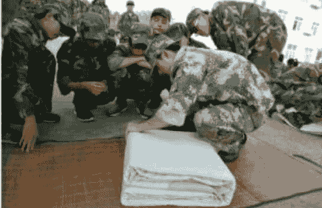

## 大王与你读兵法 23: 叠被子能打胜仗吗?

想必我们电视上都看过很多解放军叠被子的照片，大家大学军训时也搞过，被子叠的豆腐块一样方方正正的。

很多人可能纳闷，你被子弄那么方干干嘛？睡觉睡不完的铺？每天在这上面花费精力，吃饱撑的吗？上战场的时候带被子？

美军，人家从不叠被子，都是少爷兵，坦克要装空调，日常喝冰可乐的，散散漫漫的，不是一样很好打仗吗?

原因在哪里？我军的很多战士甚至官兵，基本素质是优质的。

一方面，很多人理解能力非常有限，别说理解指令遵循指挥了，让你分清左右，他都半天搞明白。

另一方面，因为教育程度和原生家庭的原因，他们身上一堆小农阶层的毛病，比如护巴、短视、不服管理、缺乏团队意识等。

那怎么办？只有通过最简单最基本最刻板的训练，让他形成按部就班、遵守条令、不折不扣的习惯。

习惯久了，就形成了服从命令的潜意识，你“指挥”才具有了可能。

古代也是一样，欧洲的很多战争是大贵族带着小领主和骑士，职业甚至雇兵开片，规模不大，但是兵员素质尚可。

所以，部队的基层是最不能讲究个性的地方，除了长相，大家行为模式基本一样。

这就是组织管理学的重要经验，也是孙子教大家的第一条。

“治众如治寡”

管理很多人，要像管理一个人一样。

因为他们基本都是那个样子。你希望他们的样子，比如行为，举止，技能等，就是“标兵”。

如果不是怎么办？把他们削成一样的样子。孙子的第一课给我们什么启发？

第一，如果你管的是基层人员，职能和任务高度相似，那么，你就得强调共性，要求他们是一个模板。

第二，“寡”是一个人，也是典型，你要学会树立典型，要求大家看齐，遵照，模仿，进而使他们一样。

第三，你让他们怎么一个一样，你自己心里有数，你的考核、绩效，都是服务于这个模板，要求他们更像“典型”的，而你招聘中的所谓的“人才模型”，就是这个“寡”的具体标准。

包括年龄、性格、学历、行为等等。

典型的例子就是富士康，几十万人的工厂，不亚于大型军事集团，你怎么管？治众如治寡。

富士康要的人，不管男女，都是一个标准，一套考核，一样的薪酬，文化氛围同时，他对你吃饭、渴水、上卫生时间等都做出了严格的规范。

学会了治众如治寡，你迈向了走向管理者的第一步。

是的，被子不能打仗，然而，今天你拧着人性，强行把被子叠方，力行这种形式主义，明天，你让他攻山头炸碉堡，他才会习惯从。

管理，都是从形式主义，强行要求模板开始的。

但你永远只会套，一直在那搞形式就傻了，后面孙子继续教你迭代更深的。

思考题：中国人为什么讲“成家立业”，要先成家再立业，体质里尤其要重视你的家庭稳定和关系呢？

# 大王与你读兵法

## 大王与你读兵法一起讨论

最后编辑：2023/9/9

## 知识星球TOP

| 序号 | 公号/星球/社群 | 原价 | 领域 |
| --- | --- | --- | --- |
| 1 | 生财有木 | 2765/年 | 副业，搞钱 |
| 2 | 众宗吃瓜群 | 365/年 | 时政，历史 |
| 3 | 记忆亥财/逸树西风 | 365/年 | 成长 |
| 4 | 欧洲金轨 | 328/年 | 时政，历史 |
| 5 | 卢克青云会 | 699/年 | 时政，社会 |
| 6 | 体制内主任 | 599/年 | 体制；职场 |
| 7 | 局外人的视界 | 669/年 | 金融，时政 |
| 8 | 溯泽异昂 | 4166/年 | 财富，成长 |
| 9 | 宁夜人总司令 | 599/年 | 时政，经济 |
| 10 | 江宁知府 | 365/年 | 时政，国际 |
| 11 | 政事堂/顾子明 | 568/年 | 时政，经济 |
| 12 | 唐书 | 1399/年 | 金融，财富 |
| 13 | 大树乡谈 | 199/年 | 时政，成长 |
| 14 | 水库恢大 | 10000/年 | 房产，经济 |
| 15 | 洪灏宏观策略 | 4376/年 | 经济，搞钱 |
| 16 | 金企通/北海南山 | 4576/年 | 股票，行研 |
| 17 | 猫哥的世界 | 299/年 | 时政，社会 |
| 18 | 飞老龙 | 3600/年 | 股市，经济 |
| 19 | 米联诸见闻 | 599/年 | 经济，金融 |
| 20 | 茶茶财经圈 | 330/年 | 房产，股票 |
| 21 | 赢在八小时之外 | 365/年 | 成长，职场 |
