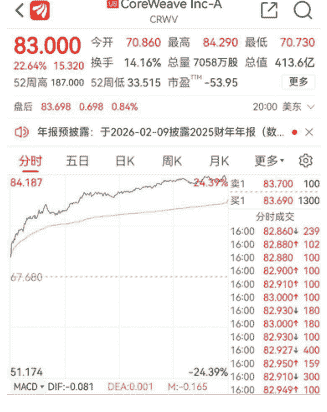

# 详情

# 返回 财经经

南院大王
2025-12-21 10:23

易经第34雷大壮：亨亨亨

易经的下卦，是从30未卦，少男少女谈恋爱开始的。

恋爱谈了，结婚了，婆媳关系处理了，男人又正值壮，该图谋正事了。

这就是34壮。

大壮。利贞。

《象》曰：雷在天上，大壮，君子以非礼履。

大壮卦利于坚守正道。

这卦的景象，下卦为天，上卦为雷，天鸣，云滚，势宏宏，阳气盛盛，万物生长大而且壮，故名“大壮”。

君子看到这种意境，才明白要融入时代的洪流，不要做没有礼教的事情。

很多人觉得要做事要勤备辛苦，错了，第一件事是抬头看路，搞清楚主线在哪里。

就像之前大王给一个朋友说的，怕你胆子小，你要做头部的生意，后来他想办法打进一个手机龙头公司所在的大楼，那都是话了。

初九：壮于臼，征绥，有虞。

象曰：壮于得，其朋也。

强在街上，不宜易盲蹄，要诚诚信自。

时代的主线出来的时候，可以劝观察险一点，这时候比较较小，潮流也免有

# 群众工具 笔记

就像秦未兴起，一开始声势最大的就是陈胜旻，结果聚军主力就把他来了，很快GG，

而刘邦是怎么干的？他是看到梁启羽等六国贵族代表的机构主角下场后，才右侧交易，市场调整，冲进威阳扫底。

九二：贞吉。

象曰：九二贞吉，以中也。

有些人看到形势大好，潮流滚滚，就喜欢一把梭，全部压上，大干一场，猛加杠杆。

现在全国最优秀的房企是谁？杭州的滨江。什么恒大，万科，绿地等等，都随暴雨吹去。

地产最热的时候，老板只专注杭州和华东，浙江都不愿意跨出，

别人劝他多拿地，他挂在嗓上的一个是，“看得清形势，摆得正位置”。

现在的别的房企一文钱难避，英雄汉了，

九三：小人用刚，君子用柔，贞厉。牛触，穿其角。

象曰：小人用刚，君子柔也。

小人依力量喜欢强运，就像公羊撞顶剃色，角若被卡住了。

君子不会学会，用网，网开开面，肯得克制使用力量。

很多人在年后，确实壮了，挣了钱，做了事，觉得自己对了，固执己见，觉得你

而君子不论富贵贫，都不吝谦和为，从不迷横。

开始犯错，往往是觉得自己已开始的。

所以你平时看到大领导都平易近人，小人物张跋覆。

九四：贞吉，悔亡（wáng）。刚淇（léi），涓不赢，沛于大获（y）之孚（fù）。象曰：刚淇不赢，尚往也。

经过之前的教训，你学会了怎么正确使用力量，慢慢失去了自信，篱茧破了，卡进去羊角被吐出来了，此时你强得像大车的轮子一样。

乔布斯就是这样把椅子做起来目中无人，被董事会踢出，期间他修身养性，再回单单，终成一代宗师。

马斯克也如此，成为钢铁侠后自觉满脸肿白，重新回归主业，特斯拉历史新高，也将成为首位万亿亿美元的富豪。

六五：获羊于甚，无悔。象曰：羊于甚，亦当也。

易，通“场”，为边界之意。在边界丢失了羊，没有悔，因为位置不当。

即使是主浪和大趋势，也不是什么钱都能够的，能力范围之外的，得不到也不要有想法，看开点，何必分吃争取呢?

红星美龙来接住趋势，家居装修好的，非要去搞房产，主业要去一起玩，卖身求生。

中南建设来搞工程和建筑的，挣点辛辛苦钱挺好，非要去甲方盖亚洲第一高楼，现在变成了不良资产。

上六：牢羊牵塞，不能贞，不能贞，无利，顽则吉。

象曰：不能充，不能充，不祥辞。顽则吉，凶不长辈。

# 社群工具 笔记

进不去。

咋办呢？谁有难忍忍，等到周期反转的那一天。

小目标老王同志就是这样的，现在赛虎篱下，怎么办？扛着呗。

雷天大壮告诉的是普通人如何抓住机会，

刚来就要参与的，要信早信，

在趋势发展的过程中，调整推高位，

在形势明朗和大局锁定的时刻买开离手，不要轻狂，及时反省，当你强大的时候，最大的不是别人，而是自己的“傲气”和“蛮力”，

坚信趋势，收获锦豪，才是真正的“大壮”。

下周，迎接主线的回归和春季曙。

南海：受益匪圈!
永远谦，永远对市场充满敬畏。

等75人觉得很赞

# 社群工具 笔记

面包：请大王下周谷歌的扩充依然是主线的观点不变吧？
2025-12-21 10:47

都是矮饺：大链：
2025-12-21 10:47

大转兴：达链回归，

大转兴：看看大王有没有更新
2025-12-21 11:06

叶枫：不买能？
2025-12-21 11:18

# 深度视野VIP群 人工追踪50+大 付费群加微信cuk255 微信ch558

# 深度视野VIP群 优质文集，限时188

全部包含以下内容：

- 1 粉丝圈（原价365 元/年）
- 2 政事堂（原价400 元/年）
- 3 内部圈（原价568 元/年）
- 4 卢储间（原价599 元/年）
- 5 欧洲金会员（原价328 元/年）
- 6 卢克文读书会专属（原价699 元/年）
- 7 鉴茶财经星球（原价3310 元/年）
- 8 猫哥的视界（原价299 元/年）
- 9 财经新周（原价1498 元/年）
- 10 杨世光在钱（原价2200 元/年）
- 11 森森知识星球（原价1600 元/年）
- 12 源译付费文集（持续更新）

# 深度视野文集
群微信cuk255

14 司马林解读毛选全套音频和全套书籍珍版无减（原价2.3 万）
15 虚走三曲民国梦、帝国争亡、不被理解的 MAO（原价599 元/年）
16 卢克文知识星球文章（原价268 元/年）

17 额外再送：卢萨元新涨付费专栏；三村边老王、三花九洞文集
不定期内容：（更多资源写下了......

+   ① 守夜人司令知识星球、接鸽魔王知识星球、生才有知识星球、
② 创始笔记、达沃译论星球、成付财富圈、雪花花甲老头等
③ 视野、大树乡谈、江初响、泮咩说、上海海学等付费文集
④ 西风付费文章、老端、赢在小时之外、局人的视界、升值、老A体制内等其它一些大V付费文章（每月不低于600 元付费文集）

# 限时年费188/年  低成本链接全网DV优质内容
