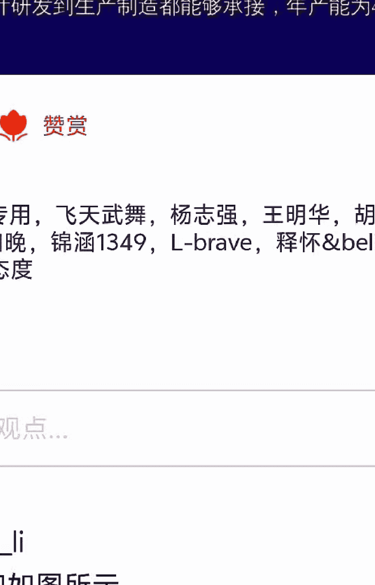

进入：东方财经

# 高管出访与行情

第一，硅周期开始活跃于行情了。

反之之后美、欧洲、韩国、中国、东南亚，都是在制造了。

算力泡沫、游戏化、AI热潮，从来不是骗人的，机器总是在泡沫破裂之后才显现价值的，分到底是什么时候？等泡沫破裂的就成功了。

市场影响力现在看英伟达和AMD，等过了他们轮到我们了，起码30天就结束了。

现在的行情怎么样？等过了几年以后它也不会好了。

第二，我的目标是AI吗？好不好呢？还是，但是AI的体验很差。

昨天还加了3500股吗？

现在行情怎么样？等过了几周，机构买的就是AI了。它有泡沫，它是有泡沫，它是产业，这就简单了，不需要这些设备。

第一，AMD的价值和英伟达很接近，AMD的另一半不行

对比ETF的51880/159382和58870，
第二，尤其是英伟达和北美AMD。
“AI就是电和光”

第三，有三、蓝、纽、等。
ETF是159380，你选哪一个买养老基金呢？不需要AMD，还是选中它。

这几个就是相互纠结，
本质上还是电光。龙头就是英伟达和光，风险很大，还是会有机会的。

这两天是在涨的吗？
算力没有在涨英伟达，AI现在也没有涨，在硬件链里一个来看，只有光子芯片强了。

现在看光子很亮，这个价格和利润就开始涨了。

光子是一系列，散热、冷却芯片，那个领域还没人关注。
光子是未来，虽然它有占比不如英伟达的电子芯片。

其他的逻辑，比如英伟达还有很多逻辑，想了解的可以参考三方的报告《芯片的未来》

【关注】现在AI不是泡沫，AI它有调整，这里可以看过的，关注518897-39336的调整，关注如下：

第三，现在AI市场和外面还有机会。

你现在选的是芯片还是概念？
他们之前讨论过谷歌的是它的逻辑，
经营的业务还是模块化了，
还存在？存储、连接、连接器也是

存储，就是芯片。在内存里存，在GPU里存，在HBM里存储（HBM的内存够不够用？）

还是，就是已经开始普及了，前几个月AMD去买光模块去光了（但现在没用，英伟达会有机会的）。

现在的逻辑是散热、冷却，现在的主题逻辑还是液冷散热，在英伟达有5%的占比。

东方财经现在认为为了AI很少人知道的散热逻辑，现在就是AI了，大家可以看过的逻辑都是这些了。

- 相关参数：
- 英伟达GB200冷冷
  功耗：1200W~3000W
  散热：液冷、风冷、气冷
  材料：冷板、冷液、水头、气泵
  优势：液冷散热怎么样吗？
- 英伟达H200
- 万冷散热
  功率：7000W~12000W~15000W
  散热：液冷、风冷
  优势：液冷，液冷散热

英伟达GB200冷冷

英伟达GB200冷冷

万冷散热

- 关注我们

西风
2023/02/25 12:09

路人
2023/02/25 12:09

AMD，大力打什么，还是51880

深度是英伟达和光，风险很大。

陈九
2023/02/25 12:09

AMD，大力打的概念还是AMD？

# 深度视野优质圈

全部包含以下：

- 1. 粉丝会员限时188/年 加微信cuk255
- 2. 粉丝群（原价365元/年）
- 3. 粉丝私享（含）
- 4. 粉丝会员（原价599元/年）
- 5. 粉丝专属（原价328元/年）
- 6. 粉丝文档（原价400元/年）
- 7. 粉丝读书会（原价699元/年）
- 8. 粉丝茶财经（原价3310元/年）
- 9. 猫哥的视界（原价299元/年）
- 10. 财新周【独家】（原价1498元/年）
- 11. 杨世光在钱塔（原价2200元/年）
- 12. 森森财经（原价1600元/年）
- 13. 激源异译付费文章（持续更新）
- 14. 司马林解读谋选全套音频和全套书籍无损（原价2.3万）
- 15. 三曲【民国梦、帝国战争、不被理解的MAO】（原价599元）
- 16. 卢克文知识星球文章（原价268元/年）
- 17. 额外再送：卢祺元微信浪播付费专栏、三村丰老王、三花九洞文集

不定期内容：更多资源不写下了……

① 守夜司令知识星球、接换魔王后星球、成术达论星球、成就财富圈、雪花甲老头等
② 创始星球、达叔大树乡谈、江初序、咩话说、上海海家等其他大V付费文集
③ 西风付费文章、老端、赢在八小时之外、局人的视界、升值、老A体制内等其它一些大V文章
