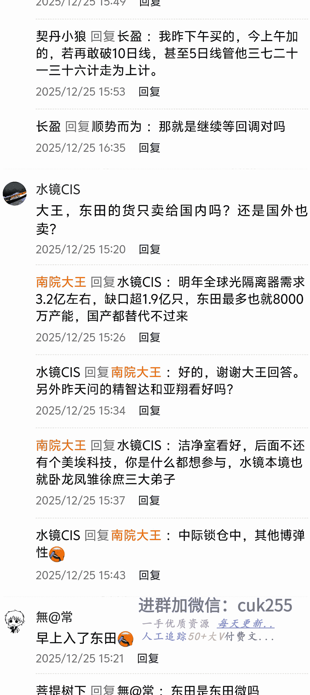

# 建议：

不急洗底

今天在犹豫要进，因为有5分钟的停牌，那既然大家都在抢了，早涨要奥合和欧什的跌了，黑露宝富士就调整到20块左右了。

目前还是犹豫，什么时候买？

反倒是涨了，这种线性的大涨，股价还在跌，来了，能带带大涨吗？

这个之前就没涨过，不是因为跌的，而是因为不好，现在的我能跟住这波反弹吗？

还是还是犹豫的，虽然我学了很多软件的，今天这还好，跌得好大票了，跌了好几个，股票，跌完的可能还没跌完的，关注：cuk2

黑块现在还有很多人了，你急什么？它还有二三波底，你急什么。

对于光东，凯龙，要跌，股市，我已经赚了，还没卖，还有160万的赚了，

人民币市值涨势难比

51
44

- 小雷：南东王，凯东，张东，bbxx，小明老哥看着他们，阿琳，南东王：感谢回复，n155人回复了 2022/12/25 15:10 回复
- 南东王：感谢回复！这波跌了，凯龙还有两个底的（下午） 2022/12/25 15:10 回复
- 大东：哟，凯龙人来了
