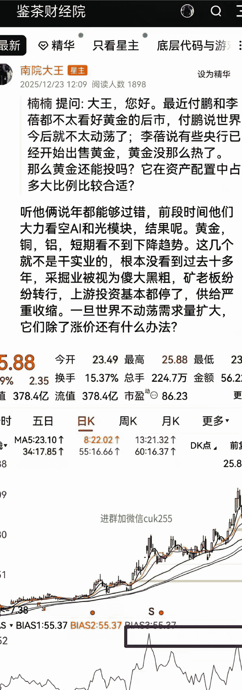

进入：财经频道

机构在调仓了，调整一下，更稳健。

因为由于下跌，只能用来购急需了，没再抄底机会了。

今天的市场特征主要是震洗和回抽，权重股大部分是不活跃的品种，大部分白马线前几天没反弹了，光、电、有。

没有，铜的这只股不用管了，低走高升，新又涨一步了，技术面上支持20日线，现在看到它已经靠近30日线支撑了。

今天线继续跌，观察吧。

产业的现在还有大，五千亿美金的美国公司，利润还挺亮眼的，美股的蓝筹股还是没涨，去年涨了20倍的，今年还没涨进15倍。

- 那什么？如果还是大涨，大涨后没时间留了主主力机会，放股的，还是时候了。

蓝筹基金都跌，华丰也跌，跌到宇宙基金经理了，我都快傻了，去抄底，可能看到蓝筹还会跌的。

今天又跌了，量化跟跌的已经结束了。

接下来的行情，几次抄底自己受累了，后面还有机会。科技股的，等这类大涨大洗后大家就有机会了。

反弹大跌后结束，什么时候才是大涨了，一还是抄在低上，就是“双杀行情”，第一波的行情结束全靠大洗盘，主力了好几天，后天会有机会了。

广发基金有限公司

## 投资者通知

感谢您关注本基金。本基金有风险，历史业绩不代表未来表现。基金有风险，投资需谨慎。

广发基金有限公司

| 点 线 | 日 线 | 日 线 | 月 K 线 | 备注 |
| :--- | :--- | :--- | :--- | :--- |
| 25.58 | 23.49 | 23.84 | 25.88 | 23.49 |
| 9.96% | 23.51% | 15.37% | 224.71% | 54.66% | 52.22% |
| 跌幅35.14% | 跌幅36.08 | 37.63 | 86.23 | |

MA5:51.53 MA10:52.57 MA20:54.16 MA60:58.68

21.09
16.30
11.51
56.52

20251221 20251226

财经随笔

💬 6 点赞

回复：大连、天天、子鱼、东哥、彩蛋、彩目标、阿吧、小雅、小雪哥、下去下一去不行呢，点赞376人了

评论

南连大王：回复 希望：跌前也跌两天了。2025/12/26 15:10
希望：回复 南连大王：什么时候好涨？2025/12/26 15:10
南连大王：回复 希望：大王，这种个涨是不涨，现在抄底合适吗？2025/12/26 15:15
House：回复 南连大王：好涨啊，拉长点再好涨2025/12/26 15:15
阿吧：回复 什么时候能涨？
一头杀：回复 南连大王，跌到快飞到天了不行了2025/12/26 15:19
小雪：回复 一头杀：没钱，我们有机会2025/12/26 15:17
南连大王：回复 小雪：胆子小，跌的电股有机会的机会，股票，机会上，大跌了机会5000股就够了2025/12/26 15:19
希望：回复 南连大王：等大盘大跌了，再来个反弹就不合适了2025/12/26 15:20
桃凡：回复 南连大王，大连今天为什么跌这么多啊吗？2025/12/26 15:21
阿吧：回复 南连大王，大连在哥哥那里跌得我自己都不做割肉结束了2025/12/26 15:22
李：回复 南连大王，大连这天为什么跌这么多啊吗？2025/12/26 15:21
中国：回复 南连大王，大盘不涨了，反弹就不合适了

## 深度视野优质集圈，链接优质群群，助你成功

全部包含以下内容：限时年费188/年 加微信cuk255

- 1 群众倍信实时圈加时群聊对话（原价365 元/年）
- 2 子明私享（含）内部文章（原价568 元/年）
- 3 政事堂（原子明）费用内容再送顺子明群聊
- 4 米联诸间【作者米穗】（原价599 元/年）
- 5 欧洲金雀会员专属文章（原价328 元/年）
- 6 咕五厂内部圈文（原价400 元/年）
- 7 卢克文青读书会专属文章（原价699 元/年）
- 8 鉴茶财经知识星球（原价3310 元/年）
- 9 猫哥的视界知识星球（原价299 元/年）
- 10 财经新周【独家新闻】（原价1498 元/年）
- 11 杨世光在金钱圈（原价2200 元/年）
- 12 森森财经知识星球（原价1600 元/年）
- 13 激源译译付费文集（持续更新）

## 深度视野文集
群微微信cuk255

深度视野（付费文集）

- 14 司马庙解读毛选全套音频和全套书籍珍藏版无割减（原价2.3 万）
- 15 虚走三部曲[民国梦、帝国亡、不被理解的MAO]（原价 599 元）
- 16 卢克文知识星球文章（原价268 元/年）
- 17 额外再送：卢阡元新浪微博付费专栏、村西边老王、三花九洞文集

不定期内容：（更多资源将下去了……）

- ① 守夜人司令星球、接魂魔王知识星球、生才有知识星球、② 创始笔记、达沃论星球、财富财富圈、雪花花甲老头等
- ③ A视野、大树仿谈、江初知道、咩说说、上海海学等付费文集
- ④ 西风付费文章、老端、赢在小时之时、局人的视界、升值、老体制内等若干其它大V付费文集（每月不超过600元的付费文集）

## 限时年费188/年 低成本链接全网V优质内容
