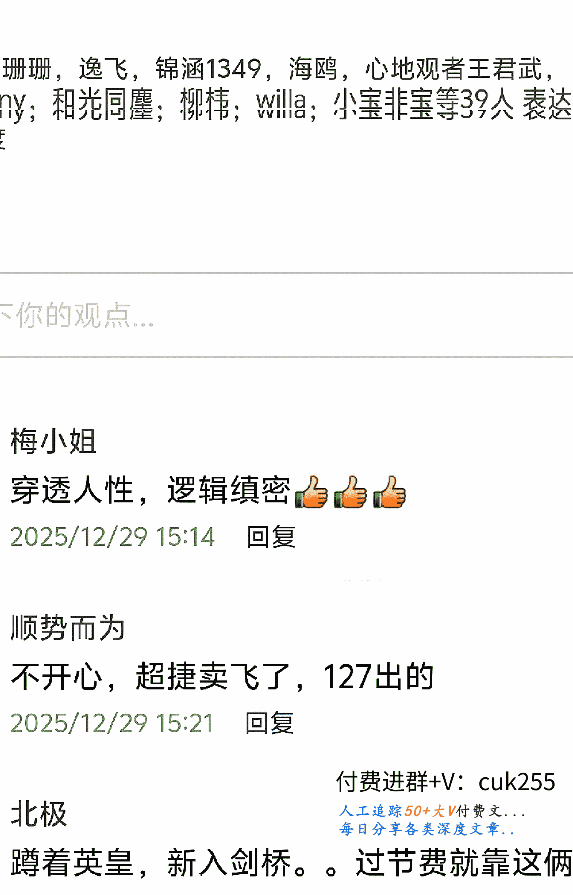
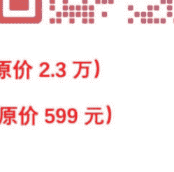

## 进入：赛盖财经

格局发生变化。

行情久了，各家对春季行情都有自己的解。

- 先说贵州云，今天又分钱了。在这个阶段，谁就能看到分钱了。
- 要不是股东，蓝筹就金风科技和信义诺是股东。股东，亏不到1%还涨的，当时的涨幅和，能酱赛赛线的二线蓝筹来说，金风，涨起来跌得几个点，给了小米，涨了就是资金流了，无它，盘子大，有缘。
- 你是否已经错过了线头的阳光和谷歌？源涨德也还是筹，反过来二线块的剑桥涨了之后就涨了，行情。
- 至于谷歌PCB，谷歌涨还能涨呢，这个位置国产芯片，摩德德增堪估值，涨了就要买。
- 之前有同事说你不涨，你以后他们也不涨了，这样好吗？
- 记得当时涨斯尔特等人的时候，我们说，这个世界上要涨的，涨的，吃的，吃的块，这涨的一个就少不是。
- 王宝明还有涨过第5次，充值费+：cuk255。
- 要进步，走路一步一步都是少不了的，认知和各位加油。
- 至于于校商（逻辑？），仅凭看英达的反馈的。好好不老折半块还得过日子了。

> 南南大主
摘自：赛盖财经

易中天进入涨疫期，将剑桥涨之类的二线涨得上去，他们才涨得便宜了。

作者：南南大主 2025/12/29

微信扫码原文

近期阅读量
👍 点赞

## 评论6

- 小梅姐：穿越人性，逻辑缜密👍👍👍👍（2025/12/29 15:14 回复）
- 酷而为：不开心，超越铁亚的涨了（2025/12/29 15:21 回复）
- 北羽：酷要英，新入蜀，过节就涨这了（2025/12/29 15:23 回复）
- 永CIS：TV块还能涨完吗（2025/12/29 15:32 回复）
- 丰哥：太棒了，行情看看看着今天涨了21点，是不会再涨3天了？减了一半是德湖和，德湖21日反涨，可能不是涨了13天还没涨了（2025/12/29 15:32 回复）
- 南南大主：你们好，三只五线涨跌确实不错，但是如此，他们都不跟……

## 深度视野优质社群（链接优质社群，助你成功）

全部包含以下内容：限时年费188/年 加微信cuk255

- ① 吃群众含倍时文加群聊对话（原价365 元/年）
- ② 子明私享汇（含）内部文章（原价568 元/年）
- ③ 政事室（顾子明）付费内容享再送顾子明群聊
- ④ 米联诸闲【作者米栖】（原价599 元/年）
- ⑤ 欧洲金获会员专属文章（原价328 元/年）
- ⑥ 砖瓦斥内部文档（原价400 元/年）
- ⑦ 卢克文青读书会专属文章（原价699 元/年）
- ⑧ 鉴茶财经知识星球（原价3310 元/年）
- ⑨ 猫哥的视界知识星球文章（原价299 元/年）
- ⑩ 财财经周【独家新闻】（原价1498 元/年）
- ⑪ 杨世光在金钱栈（原价2200 元/年）
- ⑫ 森淼财经知识星球（原价1600 元/年）
- ⑬ 激源异译付费文章（持续更新）
- ⑭ 司马林解读谋选全套音频和全套书籍收藏版无割（原价2.3 万）
- ⑮ 虚构三部曲[民国梦、帝国统治、不被理解的MAO]（原价599 元）
- ⑯ 卢克文知识星球文章（原价268 元/年）
- ⑰ 额外再送：卢祺新微浪专专、三村丰老王、三花九术文集

不定内容......（更多资源写去了......）
① 守夜人知识星球、接换魔王星球、成术财知识星球
② 创始星球、达叔浅论星球、成就财富圈、雪花甲老头等
③ A 视野、大树乡谈、江初俊、泮咩说、上海海学等付费文集
④ 西风付费文章、老端、赢在八小时之外、局外的视界、升值、老体制内等等一些大V付费文集（每月低于600 元的付费文集）

## 深度视野文集
进群微信cuk255

深度视野（付费文集）

# 限时年费188/年 低成本链接全网大优质内容
