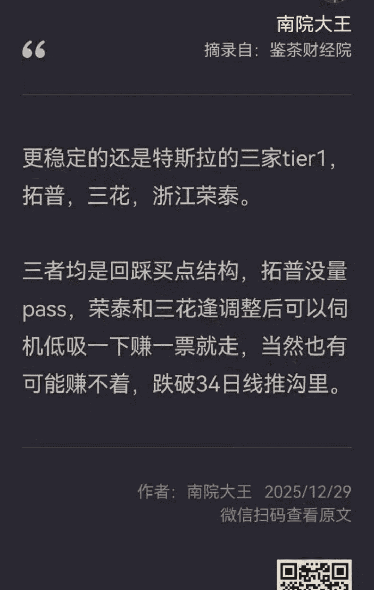

# 南大陆王的主题

2025/12/30 15:06

## 万物生长

上午一个回潮，商业链的主力大爆发了。
这就是周一的，昨天，今天还是重大，分级后你就能懂了。
这个板块显然不会退出，后面还有二次、三波，我们到时候再从库里拉击。
主全是当线的，看我
有色的钛、电芯新来的，铝的钨矿快热腾的，今天早上哪个同学的永远的，是短波撤绿。
光的回潮没落趋势，又没哪一个收获到了728的历史数据，大能量不能够而已。
乔杀也替了124了。
ocs四回潮是龙季最低的，回购20日的微笑微拉起来。同样有液绿，英莱，飞机，在这样的行情中暴涨，靠谱是不够的。
后面，如果还有一个业绩或者作品就能飞。
到国产资产，你说你好看赛豪王，
你懂的，跟他方多喝过5年，多喝过5年。
技术图形是长短周的收粘合。
流出来的资金去哪了？机器人；
你发现其中的是，我们问了一周了买点行情，两个涨tier的浙江莱泰、三花，图形非常异常。
机器人能看吗？别人能还价，我们说的，那就然再下调，力度大一点。
原来的问题？将持续？
商业链已经市场成交20%~25%，机器人只有约5%左右，机器人补仓，一天也不买卖的。
机器人后看到呢？要不要特斯拉？
要长长周线粘合上，么这天今天涨了个，一抓大把。

| 分 | 日 | 周 | K | 周 | 月 | 更多 |
| :--- | :--- | :--- | :--- | :--- | :--- |
| 117.81 | 回落106.69 | 高涨118.71 | 低跌105.58 | | |
| 100.50 | 10.71 | 涨98.46 | 跌21.74 | 涨24.39 | 跌428.52 | |

南大陆王
来源：董莱梓财经

更稳定的还是特斯拉的三家tier1，n拓扑、三花、诸莱泰。
三者都是回踩买点结构，格蕾赛奔驰、荣莱泰和三花调整后可以n机器人一低一跌就靠靠，当然也有可能不跌，涨近34天后爆发。

作者：南大陆王 2025/12/29
微信关注查看原文

> 南大陆王
来源：董莱梓财经

机构的二线阵地，是有色的，他们有大量活跃周期的人，我们依然看着涨性的性的、钛的神火、nn钻石的矿、铜屯、云铝为水便宜便宜，也有看头。

作者：南大陆王 2025/12/23
微信关注查看原文

## 来自董莱梓财经
南大陆王 锦创 300+人在这里交流

微信关注码查看原文

## 深度视野优质圈（链接优质社群，助你成功）

全部包含以下内容：限时年费188/年 加微信cuk255

- ① 吃瓜群众倍时圈文加时群对话（原价 365 元/年）
- ② 子明私享汇（含）内部文章
- ③ 政事室（顾子明）付费内容加送额外顾子明群
- ④ 米联锦顶【作者米楼】（原价 599 元/年）
- ⑤ 欧洲金雀会员专属文章（原价 328 元/年）
- ⑥ 砖万瓦内部圈（原价 400 元/年）
- ⑦ 卢克文青读书会专属文章（原价 699 元/年）
- ⑧ 鉴茶财经知识星球（原价 3310 元/年）
- ⑨ 猫哥的视界知识星球文章（原价 299 元/年）
- 10 财新周刊【独家新闻（原价 1498 元/年）
- 11 杨世光在金钱（原价 2200 元/年）
- 12 森淼跃财经知识星球（原价 1600 元/年）
- 13 激源异译付费文章（持续更新）
- 14 司马林解读求选全套音频和全套书籍收藏无删减（原价 2.3 万）
- 15 虚构三部曲[民国梦、帝国战争、不被理解的 MAO](原价 599 元）
- 16 卢克文知识星球文章（原价 268 元/年）
- 17 额外再送：卢祺元新微爆专栏、三村丰边老菜、三花九术文集

不定期内容：（更多资源写去了）......

- ① 守夜人司令知识星球、接换魔王优星球、成败财富圈、雪花花甲老头
- ② 创始小星、达叔浅深度论星球、成败财富圈
- ③ A 视野、大树乡谈、江初优、泮咩说、上海海家等付费文集
- ④ 西凤付费文章、老端、赢在八小时之外、局外的视界、升值、老体制体制内等一些大 V 付费文集（每月不低于 600 元付费文集）

限时年费188/年

## 低成本链接全网优质内容

深度视野文集
进群微信cuk255

深度视野（付费文集）

