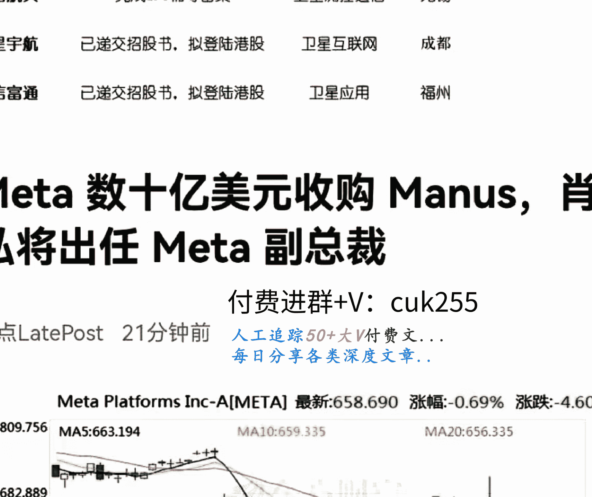

进入：鉴享财经频道

# 分歧，机会继续

大盘今天万挑战310难度很高，其实也不够结构稳的。

商业航天继续大分歧，前期的量化股已经砸跌，航天主题的节奏也跟不上了，机构开始对接这个领域。

既然机构对接，那么只要你是股东，你真猛了。火箭、天兵、星湖等，只要看你有业绩，这里就是SpaceX的行情。

崩结绕了炒了链，T链完了炒了链，达链完了炒了谷歌，链结之后炒X链。昨天两个要“已经”的说很透了，大家们可以自己研究和挖掘。

然后还有两个机会操作的同学们，产业二线卫星的价值。

卫星无疑减量，国内碳纤维类材料上台面的就5家，中航高、光复材料、神聚塑、吉林中高科技、风电一起做，你离机场不将乖，已经过去了。

还有一家是中南科技，它是国内少数能量产数字TYH，也是对接国际T100级航天级超级碳纤维，它的毛利非常高，专业面向航天。

技术图形近似《三生万物》模型，你来对比即可。

另一个是萨航高，新时候问过他们以后，周末上了，萨航高自己也干了，旗下下个一个董涨，给上空的卫星提供数据调试，航天科技的上八院非常认同，旻的运行有几千，有些不留得等它等等。

今年市值大，商业航天的分歧会带来大盘，那会被看到行情资金流向谁也来了。

meta最近活跃频繁，股票的行情有望反弹。

# Meta 数十亿美元收购Mus，尚将出任Meta CEO

LatePost 2025/07/21 19:00 关注12.5万人

《晚期LatePost》独家获悉，Meta 以数十亿美元收购 AI 应用 Meta 的社交业务。这是Meta成立以来第三大收购，费用仅次于WhatsApp 和 Scale AI。

赞

L-bauer，我就像一个李、雪梅、三文石、蒋、满，西乔、郑坤、绍欣、钦近等五个网友表达了态度

评论3

你想写下评论...

Jerry
2025/12/30 08:15 回复

黄牛梅
大王同学，商业航天已经被打跑了，从11月几就开始平摊再里面被他们起伏，获利，再回来追涨那些是底部的，真的够清楚清楚就清楚了
2025/12/30 08:15 回复

南山王又是黄牛梅：老了套路再次来一次：影视，还是分类、洗发，属于不同的领域。
2025/12/30 08:20 回复

# 深度视野优质集圈 链接优质群，助你成功

全部包含以下内容：限时年费188/年 加微信cuk255

- 1 吃瓜群众含信时圈加时群对话（原价 365 元/年）
- 2 子明私享兮（含）内部文章（原价 568 元/年）
- 3 政事堂（原子明）付费内容再送颜顺子明群聊
- 4 米联锦间【作者米糕】（原价 599 元/年）
- 5 欧洲金雀会员专属文章（原价 328 元/年）
- 6 铸五厂内部圈（原价 400 元/年）
- 7 卢克文读书书会专属文章（原价 699 元/年）
- 8 鉴茶财经知识星球（原价 3310 元/年）
- 9 猫哥的视知识星球（原价 299 元/年）
- 10 财经新周【独新闻】原价 1498 元/年）
- 11 杨世光在金钱（原价 2200 元/年）
- 12 森森财经知识星球（原价 1600 元/年）
- 13 源译译译付费文章（持续更新）

# 深度视野文集 群微微信255

- 14 司马林解读毛选全套音频和全套书籍珍藏版无削减（原价 2.3 万）
- 15 虚虚三部曲[民国梦、帝国争战、不理解的MAO]（原价 599 元）
- 16 卢克文知识星球文章（原价 268 元/年）

- 17 额外再送：卢阡新源涨爆博付费专栏、三村边老王、三花九术文集不定期内容：（更多资源将下了……）① 守夜人司令知识星球、接鸽魔王知识星球、生有术知识星球、
② 创始笔记、达沃译论知识星球、成付财富圈、雪花桃花甲头等
③ A 视野、大树乡谈、江宁后、咩同学、上海海学等付费文集
④ 西风付费文章、老端、赢在八小时之外、局人的视野、升值、老A体制内等其它一些大付费文章

# 限时年费188/年 低成本链接全网V优质内容
