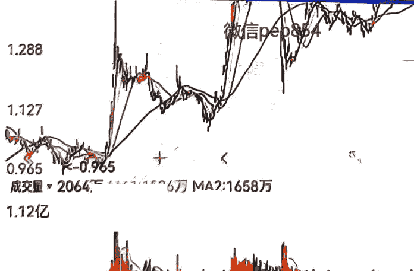
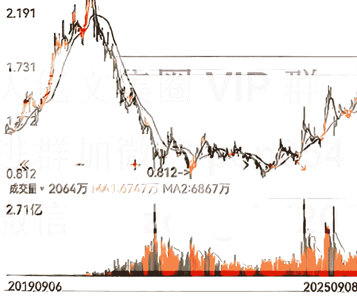

# 人工智能
逻辑开始走

美股已经涨点涨了，业绩和故事都是空钩的。

这几天行情猛然起来的是中概吗，稳稳的突破了去年10月8日的高点。

去年，只是蓝筹稍稳不住，现在有了业绩和预期的支撑。

美国储备，最直接的受益的就是他们。

不要觉得今年差了点就完了，2021年以来它们几乎崩斩（见图二），

它们弹性那么大的对应是恒生科技ETF，你直接碰中中互联网行业，要弹性更大，港股创新药。

9月的趋势非常稳定，会有更多的人进etf。

之前一直讲恒生科技是低位，能把它拿稳了，这轮牛转起来就能吃到美联储息和中国国产复苏的红利，

今天高位看点：
中芯复后国产芯片不能站住，

低位看点：固态电池/储能。

# 更多优质资源：微信cuk255

# 中概互联网ETF
513050 份

| 指标 | 数值 |
| :--- | :--- |
| 价格 | 1.572 |
| 今开 | 1.540 |
| 最高 | 1.575 |
| 最低 | 1.539 |
| 涨跌 | 2.28% |
| 变化 | 0.035 |
| 总跌 | 2064万 |
| 金额 | 32.15亿 |
| 量比 | 1.30 |
| 涨幅 | 1.563 |
| 跌幅 | -2.93% |
| 最新份额 | 237.5亿 |

中国指数联50人民币 9883.80 (2.08%) 跟踪误差 0.71%

分时 五日 周K 月K 更多

均线：
MA5:1.535↑ 10:1.522↑ 20:1.504↑ DK点、前复权
55:1.443↑ 1.611-> 1.450

1.288
1.127
0.965 -0.965 <
成交量 2064万6万 MA2:1658万
1.12亿
20240605 20250908
微信pep854

# 最后编辑：2025-09-09
# 更多优质资源：微信cuk255微信

# 中概互联网ETF 513050

| 指标 | 数值 |
| :--- | :--- |
| 今开 | |
| 最高 | |
| 最低 | |
| 总手 | |
| 金额 | |
| 量比 | |
| 昨收 | 1.572 |
| 外币 | 0 |
| 内含 | 0 | 更多 |

跟踪指数 中国证50人民币 9886.74 (0.00%) 跟踪误差? 0.71%

分时 五日 日K 月K 更多
均线：
MA5:1.512↑ 20:1.421↑ DK点，前复权n2.650 <-2.650

更多优质资源：微信cuk255

特斯拉
12小时前
加速进化中

@TeslaAI
我一直在努力改进自己的素材
#数字人# #TeslaAI#

# 更多优质资源：微信cuk255

雪梅：大王，有中航国际，若是补跌的话还先出来吗？折腾带着薯片站糕梅
2025-05-09 09:04

南雨大王 回复 雪梅：国产薯片要站酷就靠薯片是否支棱
2025-05-09 09:11

吃娇好菇：国内电台今天涨涨都是换手~
2025-05-09 07:05

放意的，周末热，周一开就能护市，然后给你来一个冲回潮，周二知道开春天，崩杀要等到，你，再起来。
2025-05-09 09:17

吃娇好菇 回复 南雨大王：学会了~
2025-05-09 09:10

雾风山岚：南雨大王：行情太大了
2025-05-09 09:14

优占 回复 南雨大王：大王，已经关注几个了，今天才决定加入一个篮球，锋线篮球和万亿锡很多的时候入的了，蹭一机会啊，上周看到几年来之前未上过的几个好手，心疼不已，想想还能跌到多少你再入场吗
2025-05-09 09:54

🔥大火：大王师傅，他还还有仓吗，最近比较软，要要不要
2025-05-09 09:12

南雨大王 回复 大火：它们不跟趋势走，并不涨也不卖了，已经翻两倍还不，真要技术上崩30和被锁住了。
2025-05-09 09:14

雾风山岚：大王的买，看来互联ETF，其他的，除了数字新高，就割跌不为止，不买不动山🔥
2025-05-09 09:42

Follow：大王 安安龙看着长线吗？还是差不多被套走了？
2025-05-09 09:55

花王DIK HUN*：明白大王你问什么今年还没赢et了。起伏太大了
2025-05-09 01:11
