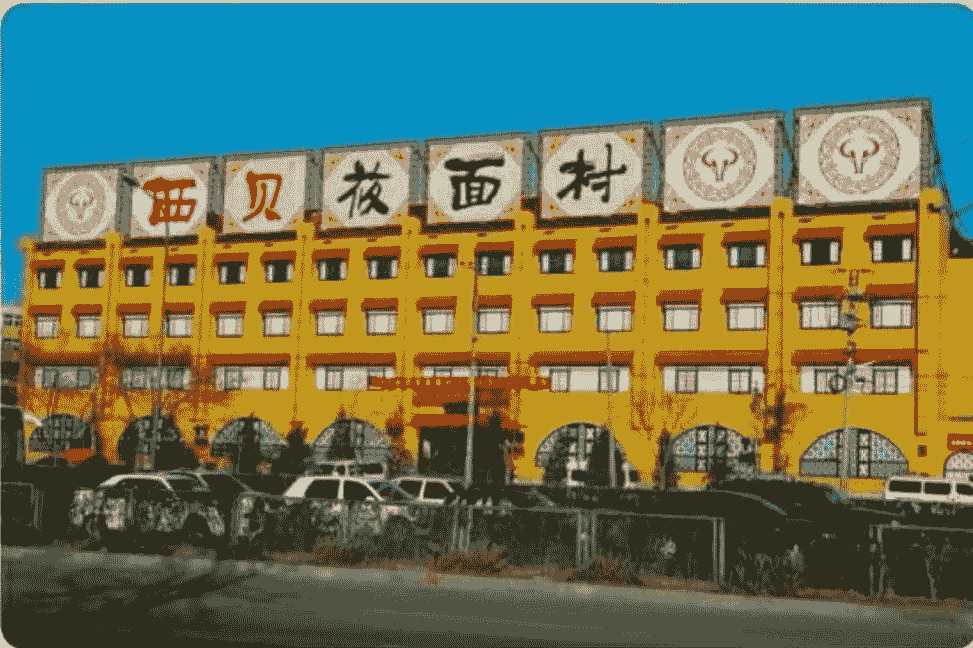

# 南院大王的主题

2025/9/20

西贝贾国龙的玄学分析

周末不谈市场了，按惯聊点风花雪月。

《道德经》说，玄之又玄，众妙之门。

玄是什么意思？高级，深奥，小众。

玄色，是黑色，玄学的意思，是高端学术问，是有有些人我跟你解释不清楚，干脆

深度视野文集社cuk255 有温度高质量社群cuk255 不给你说了，省的你不识货还倒打一辈。

就像钱森说，多笨的人 15 岁还学不会微积分吗？15 岁能会的几个？

王德峰教授讲，40 岁还不信命，悟性太差。

佛道两家的比较好听，叫叫做“根器浅”。

第一，贾国龙为什么在过去 20 年很顺？

过去 20 年，国运是八白，土运，土运，房地产，建筑，也代表小鲜肉。地产大兴，你看鹿晗肖战之类的就很流行。

西贝是什么？西是金，贝是钱，也是金。又主营西北菜，妥妥属金。

2001-2023 年，土运当道，土生金，西贝自然顺。

2024 年，步入“九紫离火运”，国运变成火。

但 2024 年是转折，甲辰年，辰土很旺，依然有利于西贝，辰还是水库，荀子的《劝学》篇，积水成渊，蛟龙生焉。

贾国龙，你都国龙了，当然是龙，利于他，24 年业绩大，筹备公司上市，一时风头无双。

第二，2025 年为什么形势急直下？

2025 年，是乙巳年，乙木是灌木，生巳火更旺，火运正式到来。

西贝，全都是金，火克金，直接炼了。加上你又叫国龙，2025 年，龙是犯太岁的，叫做“刑太岁”，就是受伤，流血，口舌之争的意象。

大S也属龙，25 年没了，令人扼腕痛。如果贾老板有玄学顾问，或者自己看书，应该知道要，谨言慎行，悄咪咪的低调，先把今年猫过去再说，然而并并没有。

## 第三，为什么应期在九月？

9.7–10.7 日，是农历乙酉月，酉是金，西贝也是金，时令金气肃杀，和年度的乙巳年相冲，火金冲突到了极致。

单看该月，乙木是花草，酉金是刀剑，刀割花草，意象就是肃杀，震荡，甚至“穿头破脚”。

所以我们讲这个月市场不好做，有些人会被割到手，流血，尤其是其脚，膝盖，出问题。

天地要平衡，就得用“辰”解之，辰酉合，辰就是龙，国龙合走收走了。

## 第四，未来的展望呢？进群微信

2026 年，丙午年，火旺到极致，克金克的更厉害，西贝不好说。

但是，西贝干的是餐饮，本身属火，如果真的明厨亮灶，明火烹饪，那是顺应离火大运的，

同时，26 年午相生，有贵人出现，利好属龙，贾国龙应该会有机会。

西贝的整个命运，系于贾国龙个人一身。最后说的别的，贾国龙很早年在北京开的餐厅，西贝夜面村，大王去吃过，有炕，有包房，一口大锅炖的黄河鲤鱼，土的装修，但风味很好。

后来，贾国龙请了里斯，特劳特，华与华等一大堆公司做咨询策划，其实看得出来，这个人是知道不足，尊重知识，尊重人才，愿意花钱的。

但后面可能持续的成功，让他变的自满，丢掉了当年锐意进取和虚怀若谷的精神，弱小从不是生存的障碍，傲慢和偏见才是。

大王讲这些，不是说玄学有多神奇，而是希望大家要有敬畏之心，敬畏自然，敬畏天道，敬畏市场，永远要保持谦虚谦，不骄不躁的作风。

组织上说的那句话太对了，“不忘初心，牢记使命”。初心是你来时的路，多想想你才不会飘。使命是你发出的愿，多做做你有大出息。

深度视野文集社cuk255 有温度高质量社群cuk255 *

## 深度视野优质圈（链接优质社群，助你成功）

全部包含以下内容：限时年费188/年 加微信cuk255

- 粉丝群对话（原价 365 元/年）
- 子明享会（原价 568 元/年）
- 米穗加时（原价 599 元/年）
- 欧洲会员专属（原价 328 元/年）
- 砖瓦内部（原价 400 元/年）
- 卢克文读书会专属文章（原价 699 元/年）
- 鉴茶财经（原价 3310 元/年）
- 猫哥的视界（原价 299 元/年）
- 财新周刊独家（原价 1498 元/年）
- 杨世光在钱爆发（原价 2200 元/年）
- 森淼财经（原价 1600 元/年）
- 激泽异译持续更新
- 司马林解课全套音频和全套书籍版权无损（原价2.3 万）
- 虚构三部曲民国梦、帝国扩张、不被理解的MAO（原价 599 元）
- 卢克文星球（原价268 元/年）
- 额外再送：卢薛元微信滚浪付费专栏、三村丰老王、三花九树文集

不定内容：（更多资源暂写去了）......
- 守夜人司令、接换魔王、成富有知识星球、创始人笔记、达叔谈论星球、成付财富、雪花记忆甲头部等
- 视野、大树乡谈、江初序、咩咩说、上海海学等付费文集
- 西风付费文章、老端、赢在小时之时、局外人的视界、升值、老体制内等一些大V付费文章不低于600 元付费文集

## 底层链接全网V优质内容

深度视野微信cuk255 深度视野（付费文集）

