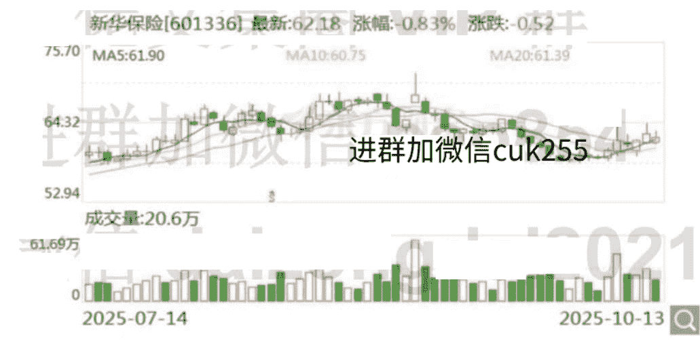

# 新华，操作方式如829，高出了不...

南院大王 星座
2025/10/14 09:38

新华，

操作方式如829，

高出了不用怕不接回。

新华村不是没福利，需要的是耐心。

## 新华保险：预计2025年前三季度净利299.86亿元-341.22亿元 同比增长45%-65%

中国证券报·中网 11小时前 6评论

## 深度视野优质集群（链接优质社群，助你成功）

全部包含以下内容：限时年费188/年 加微信cuk255

- 1 吃瓜群众粉丝群时文加时群群对话（原价 365 元/年）
- 2 子明私享汇（内部）文章（原价 568 元/年）
- 3 政事室（子明佛）付费内容加送额外子明群聊
- 4 米联储兜【作者米栖】（原价 599 元/年）
- 5 欧洲金雀会员专属文章（原价 328 元/年）
- 6 砖瓦内部文档（原价 400 元/年）
- 7 卢文青读书会专属文章（原价 699 元/年）
- 8 鉴茶财经知识星球（原价 3310 元/年）
- 9 猫哥的视界知识星球文章（原价 299 元/年）
- 10 财新周【独家新闻】原价 1498 元/年）
- 11 杨世在金钱圈（原价 2200 元/年）
- 12 森森财经知识星球（原价 1600 元/年）
- 13 激译译付费文章（持续更新）
- 14 司马林解读末选全套音频和全套书籍版权无损减（原价 2.3 万）
- 15 虚虎三部曲[民国梦、帝国战争、不被理解的MAO](原价 599 元/年）
- 16 卢克文知识星球文章（原价 268 元/年）
- 17 额外再送：卢祺新涨微获付费专栏、三村丰老王、三花九热门文集

不定内容：......（更多资源将写下了......）

① 守夜人知识星球、接换魔王后星球、生才有知识星球
② 创始纪记、达叔谈论星球、成就财富圈、雪花甲老头等
③ A 视野、大树乡谈、江初序、咩咩说、上海海家学等付费文集
④ 西凤付费文章、老端、赢在八小时之外、局人的视野、升值、老A体制内等等其它一些大V付费文章（每月不超过600 元的付费文章）

## 深度视野文集
进群微信cuk255

深度视野（付费文集）

限时年费188/年

# 低成本链接全网U优质内容
